# Software Development Lifecycle (SDLC)

---

## 1. Was ist der SDLC

Ein strukturierter Prozess, der die Phasen der Softwareentwicklung beschreibt. Entwickelt in den **1970ern**, um große Geschäftssysteme zu managen; bis heute relevant.

Phasen: **Requirements-Analyse → Systemdesign → Implementierung → Unit-Test → Integrationstesting → Systemtesting → Acceptance-Testing → Deployment → Wartung (Maintenance)**.

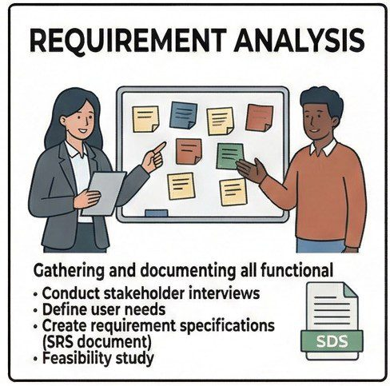

## 2. Anforderungen (Requirements)

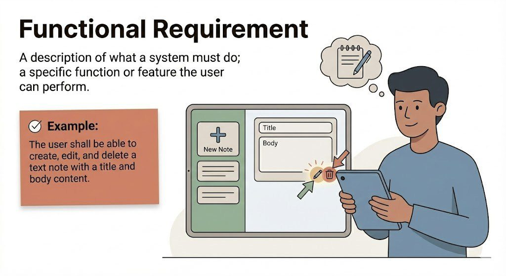

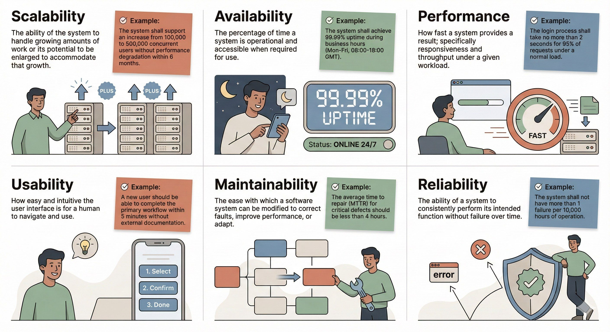

### Funktionell vs. nicht-funktional

- **Funktionale Anforderungen (Functional requirements)** definieren, *was* das System vollbringt (z. B. „Bestätigungs-E-Mail bei Kontoerstellung senden", „Artikel per Suchbegriff finden", „Warenkorb vor dem Checkout verwalten", „Social Login", „Benachrichtigungen", „Feedback/Bewertungen").
- **Nicht-funktionale Anforderungen (Non-functional requirements)** definieren, *wie gut* es funktioniert.

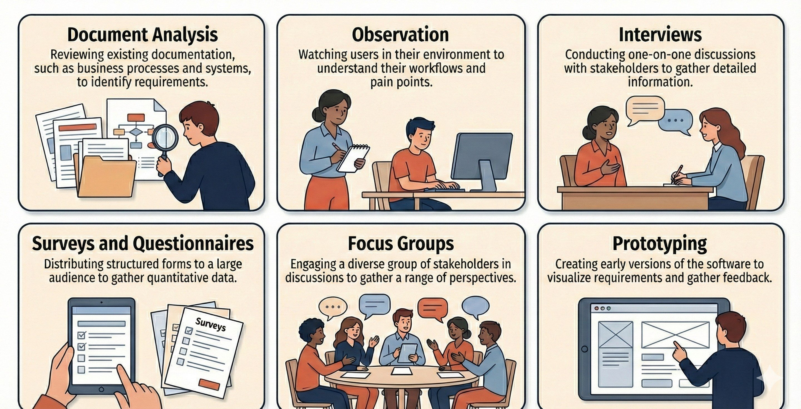

### Erfassung funktionaler Anforderungen

| Methode | Zweck |
|---|---|
| Dokumentenanalyse | Bestehende Geschäftsprozesse/Systeme prüfen |
| Beobachtung | User in ihrer Umgebung beobachten (Workflows, Pain Points) |
| Interviews | Einzelgespräche mit Stakeholdern |
| Umfragen & Fragebögen | Quantitative Daten aus großen Zielgruppen |
| Fokusgruppen | Diverse Stakeholder-Perspektiven |
| Prototyping | Frühe Versionen, um zu visualisieren und Feedback zu sammeln |

KI kann helfen (z. B. Zoom-Meetings in Anforderungen zusammenfassen) — aber **den KI-Output immer auf Korrektheit prüfen, verfeinern und mit dem Kunden bestätigen**.

### Requirements-Elicitation & -Management

- **Elicitation (Erfassung)**: Stakeholder identifizieren → Informationen sammeln (Interviews, Umfragen, Workshops) → dokumentieren.
- **Management**: Priorisierung (was ist zuerst essenziell), Änderungsmanagement (kontrollierte Änderungen, Scope Creep verhindern), Verification & Validation (System erfüllt die Anforderungen; die Anforderungen erfüllen ihren Zweck).

### Herausforderungen & Lösungen

Herausforderungen: Stakeholder können ihre Bedürfnisse nicht formulieren; widersprüchliche Prioritäten; sich wandelnde Geschäftsbedürfnisse.

- **Bessere Fragen stellen**: vom Problem statt von der Lösung ausgehen („Welcher Pain Point? Welcher Business-Wert?"); offene Prozessfragen („Wie läuft das aktuell? Was bricht?"); Annahmen hinterfragen („Was, wenn Daten fehlen? Wer besitzt diese Entscheidung?"); **5 Whys** für Root Causes.
- **Zusammenführen & Konflikte auflösen**: zur Bestätigung paraphrasieren („Also habe ich verstanden, dass…"); vage Aussagen in testbare Anforderungen übersetzen; **MoSCoW** (Must/Should/Could/Won't) einsetzen.

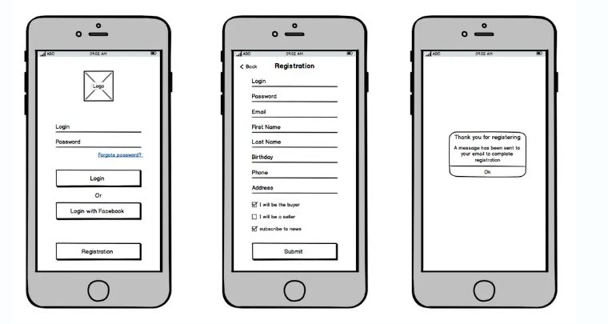

## 3. Prototyping & MVP

- **Wireframes** — low-fidelity-Seitenstruktur. **Mockups** — statisch, aber realistisch (Branding, Farben, Schriftarten). **Hi-fi-Prototypen** — am nächsten am Endprodukt; testen Visuals *und* User Flow.
- **Typen**: throwaway (schnelles Feedback, wird verworfen) / evolutionary (inkrementell bis zum Finale verfeinert) / incremental (Teile separat bauen, am Ende integrieren).
- „Ich kann dir nicht sagen, was ich will — aber ich erkenne es, wenn ich es sehe."

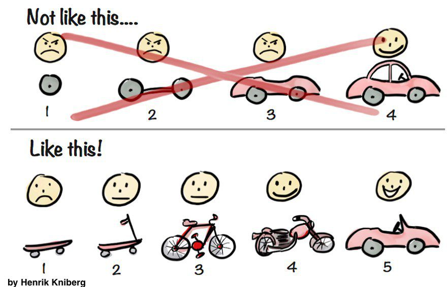

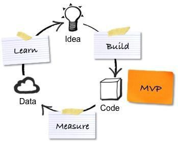

### MVP (Minimum Viable Product)

- **Maximal validiertes Lernen über Kunden mit minimalem Aufwand** sammeln. Minimum = so wenig Aufwand wie möglich; Viable = genug Qualität, um zu beurteilen, ob Kunden es nutzen.
- Die Idee mit echten Usern testen → lernen → den nächsten MVP iterieren; reduziert das Risiko, etwas zu bauen, das ökonomisch nicht tragfähig ist.

| Aspekt | Prototyp | MVP |
|---|---|---|
| Zweck | Konzept, Design, UX testen/visualisieren | Kernfunktionalität an User liefern |
| Funktionalität | Oft nicht-funktional/begrenzt | Voll funktionsfähige Kernfeatures |
| Marktreife | Nicht marktreif | Marktreif |
| Feedback-Fokus | Design & Machbarkeit | Produktwert & Usability |
| Stufe | Früh, vor voller Entwicklung | Erster nutzbare Launch |
| Ziel | Design/Machbarkeit validieren | Business-Idee validieren & User gewinnen |

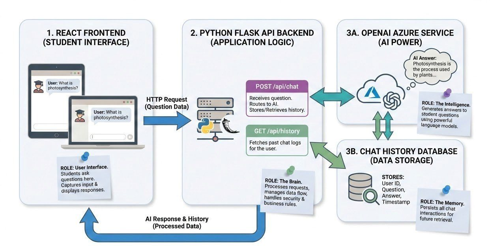

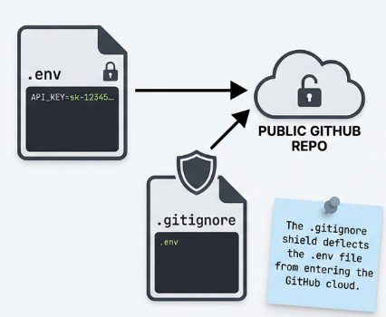

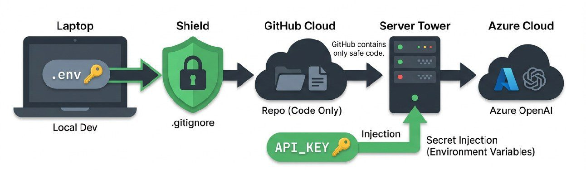

## 4. Design & Implementierung

- Anforderungen sagen **was**; Design sagt **wie**.
- Ein **System-Design-Interview** lässt einen Kandidaten ein skalierbares System an der Whiteboard entwerfen — prüft das Reasoning über Anforderungen, Trade-offs, Komponenten-Interaktionen.
- **Beispiel: GenAI-Chat-App** — Python-Flask-API-Backend (Business-Logik, Daten-Speicherung/-abruf; leitet Fragen an den AI-Dienst weiter) + React-Frontend (UI; sendet API-Requests, zeigt Antworten) + OpenAI-Azure-Dienst (GenAI-Antworten) + Datenbank (vergangene Chats).
- **API-Keys schützen:**
  - Entwicklung: Secrets in `.env` (lokale Umgebungsvariablen); `.gitignore` schließt `.env` von der Versionskontrolle aus. **Secrets dürfen niemals im Remote-Repository landen.**
  - Produktion: Keys in der Plattform gespeichert (z. B. Vercel-Umgebungsvariablen), beim Deployment injiziert, vor Öffentlichkeit und Frontend verborgen.

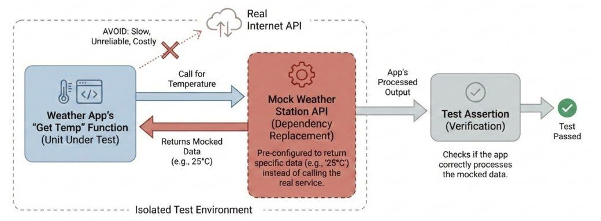

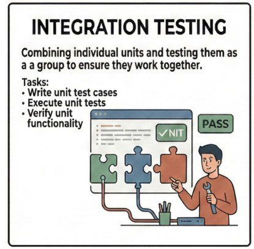

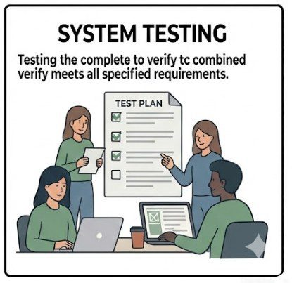

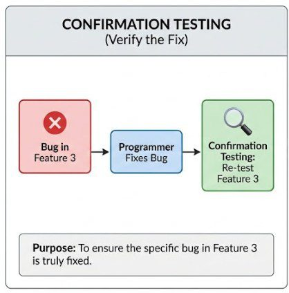

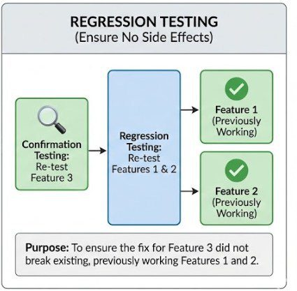

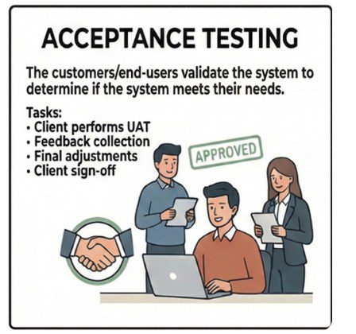

## 5. Testphasen

- **Unit-Testing**: einzelne Einheiten (Funktionen, Methoden, Klassen) **isoliert** gegen ihre Design-Spezifikation getestet; Fehler sind leicht zu lokalisieren.
- **Integrationstesting**: Module zusammenführen und als Gruppe testen — ein fehlerfreies Modul kann bei Integration trotzdem brechen (z. B. ein Caller missversteht die Interface-Spezifikation).
- **Systemtesting**: das gesamte System implementiert alle Anforderungen — Funktionalität, Robustheit (Erholung von Fehlern), Interoperabilität (Drittsysteme), Performance (Durchsatz, Antwortzeit), Skalierbarkeit, Zuverlässigkeit über Zeit, Doku-Nutzbarkeit.
- **Pull Request (PR)**: ein Workflow, in dem ein Developer vorschlägt, einen Branch in einen anderen zu mergen, damit Teamkollegen vor der Integration reviewen.
- **Confirmation-Testing**: zuvor fehlgeschlagene Testfälle erneut ausführen, um den Fix zu verifizieren.
- **Regressionstesting**: nach Änderungen erneut testen, um sicherzustellen, dass keine zuvor korrekte Funktion kaputtgegangen ist. Alle Tests erneut ausführen (Automatisierung hilft — Microsoft führt **über 60.000 Unit-Tests pro PR in unter 7 Minuten** aus) oder eine Teilmenge wählen, die den geänderten Code erreicht.
- **Testautomatisierung**: Software steuert die Testausführung; ein Unit-Test ist Code, der prüft, ob ein anderes Stück Code wie erwartet funktioniert (z. B. JUnit für Java).
- **Acceptance-Testing**: Kunde/Enduser validiert das System gegen Akzeptanzkriterien (Funktionalität, Performance, Sicherheit).
  - **Alpha-Test**: am Entwickler-Standort, mit anwesendem Entwickler.
  - **Beta-Test**: an User-Standorten ohne Entwickler — am nächsten an der tatsächlichen Nutzung.

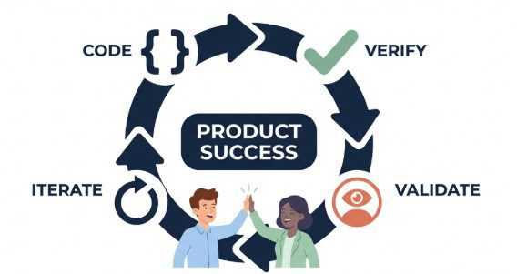

### Verification vs. Validation

- **Verification** — „Bauen wir das Produkt **richtig**?" Code-Review, Unit-/Integrations-/Systemtesting; von Developern durchgeführt.
- **Validation** — „Bauen wir das **richtige** Produkt?" Prototyping, Acceptance-Testing, Usability-Testing, A/B-Testing.
- Validation liefert **neue Anforderungen** zurück in den Loop (Feedback-Loop).

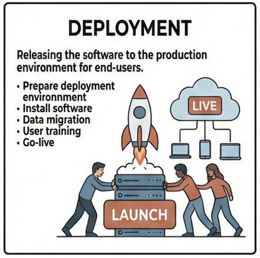

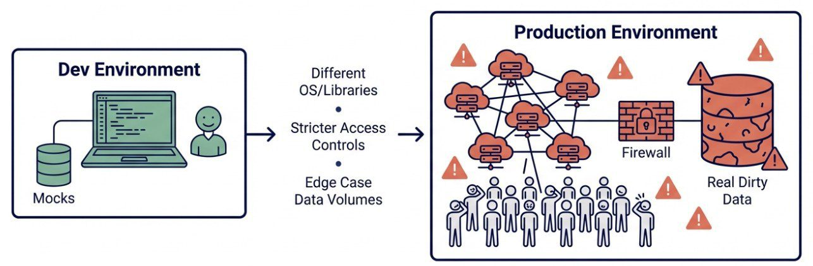

## 6. Deployment & Umgebungen

- **Dev- vs. Produktions-Unterschiede**: OS-/Library-Versionen; Edge Cases und Datenmengen in Produktion; strengere Zugangskontrollen/Firewalls; andere Resource-Limits; live externe Dienste, die anders verhalten. („Works on my machine" ≠ funktioniert für User.)

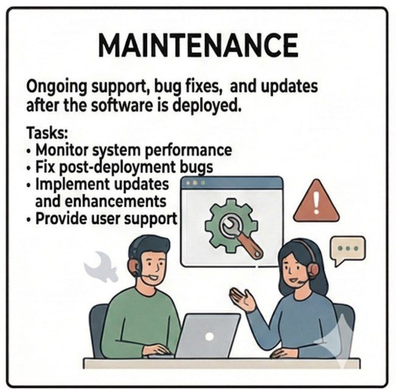

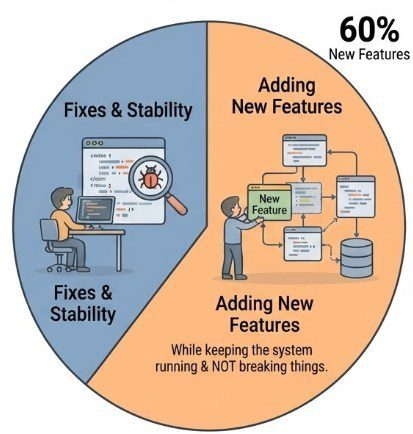

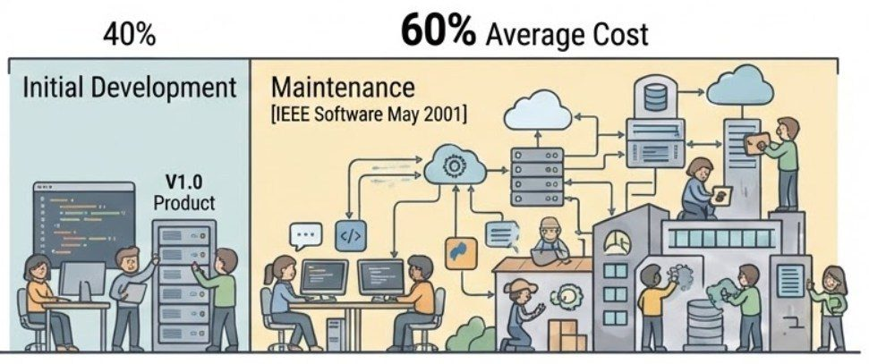

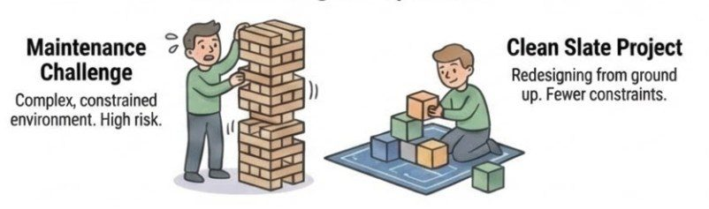

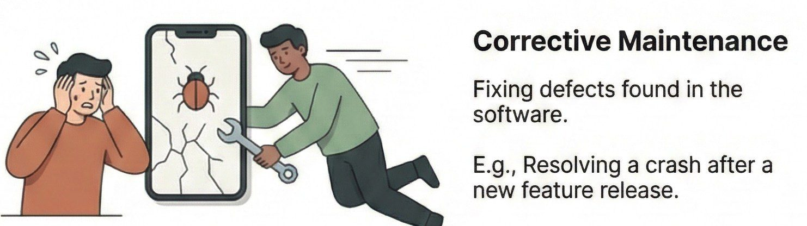

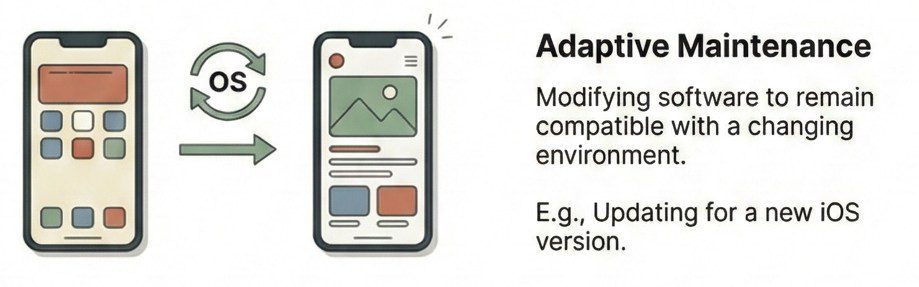

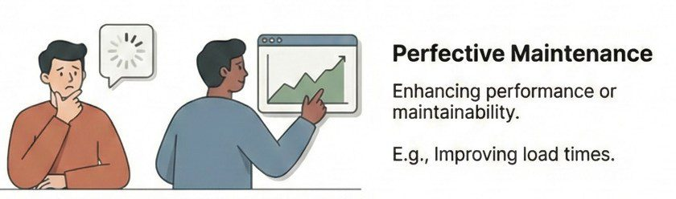

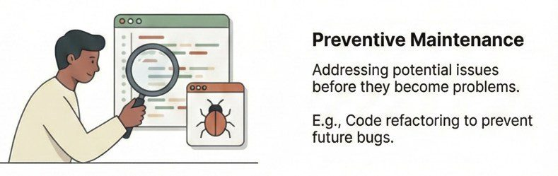

## 7. Wartung (Maintenance)

- Modifikation eines Softwareprodukts **nach** dem Deployment: Produktions-Bugs fixen, Patches veröffentlichen, Performance verbessern, neue Versionen.
- **60/60-Regel** (IEEE Software, 2001): Wartung macht durchschnittlich **60 % der Lebenszykluskosten** aus; ~60 % der Wartung besteht darin, neue Features hinzuzufügen, ohne Bestehende zu brechen. In Clean-Slate-Projekten ist Wartung oft schwieriger als Entwicklung.
- **ISO/IEC 14764:2006** Wartungstypen: **korrektive** (Defekte fixen), **adaptive** (Kompatibilität mit sich ändernden Umgebungen halten), **perfektive** (Performance/Maintainability verbessern), **präventive** (potenzielle Probleme früh adressieren).

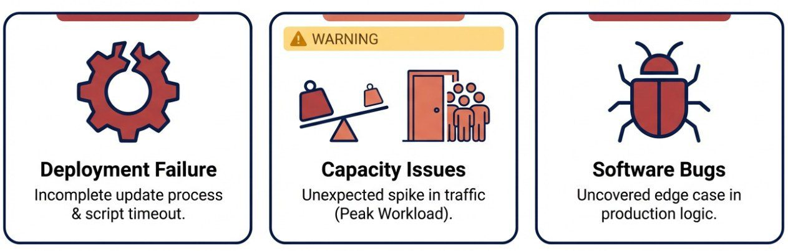

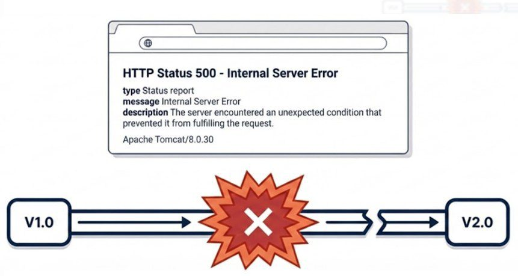

### Case Study: Deployment-Ausfall

- 01:00 Uhr: neues Feature deployed; Health-Checks bestehen.
- 03:00 Uhr: neue ineffiziente Queries (ohne Indizes) beginnen, Resources zu blockieren; Antwortzeiten degradieren — **keine Alarme**.
- 10:00 Uhr: Incident entdeckt — 7 Stunden unbemerkter Degradation.
- Untersuchung: Resource-Exhaustion + hohe Latenz korrelieren mit dem Deployment um 01:00 Uhr → Root Cause: unindizierte Queries.
- Mitigation: Queries umschreiben, Indizes hinzufügen; Patch v1.1 in Staging getestet; in Produktion deployed; **Service 21:00 Uhr wiederhergestellt**.

| Metrik | Definition | Dieser Fall |
|---|---|---|
| **TTD** (Time to Discover) | Fehlerstart → Team weiß Bescheid | 7 Stunden (3 Uhr → 10 Uhr) |
| **TTM** (Time to Mitigate) | weiß Bescheid → Fix verifiziert | ~8 Stunden (Diagnose, Patch, Staging, Deployment) |
| **TTR** (Time to Recover) | Gesamte Customer-Impact | 18 Stunden (3 Uhr → 21 Uhr) |

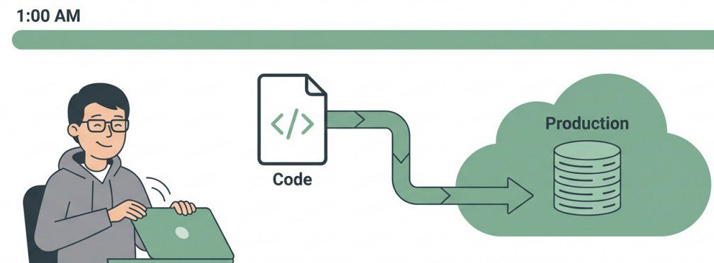

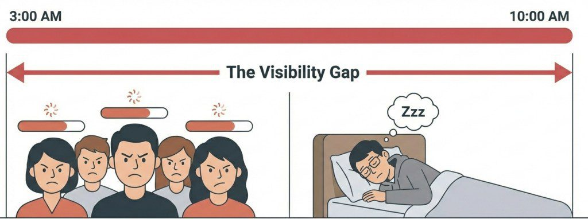

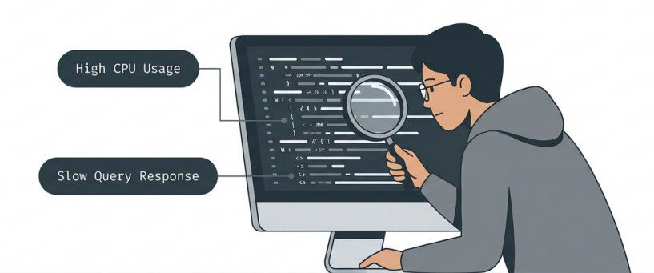

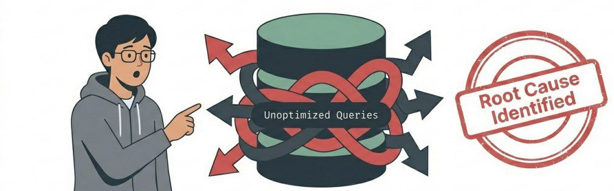

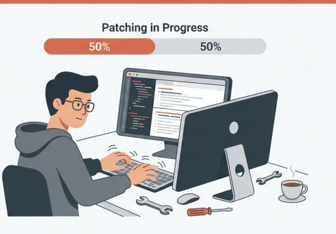

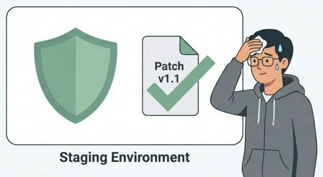

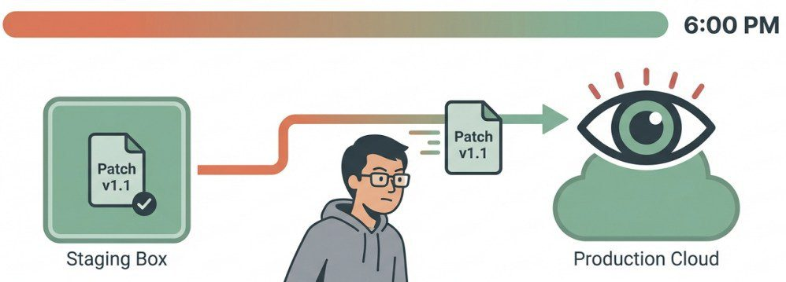

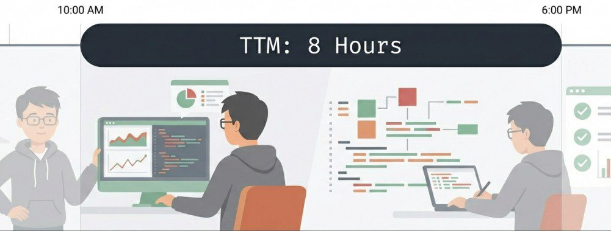

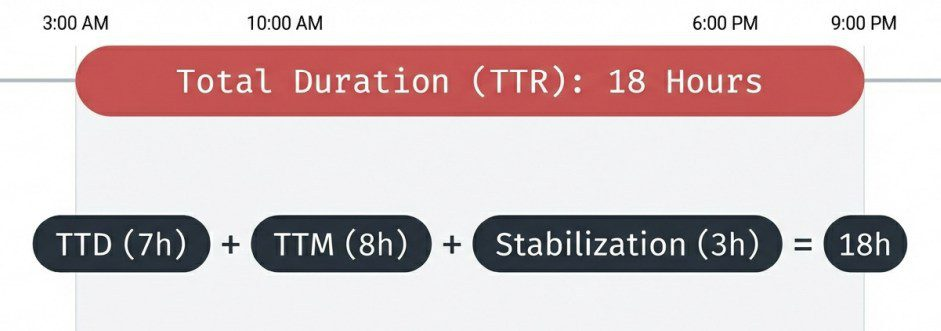

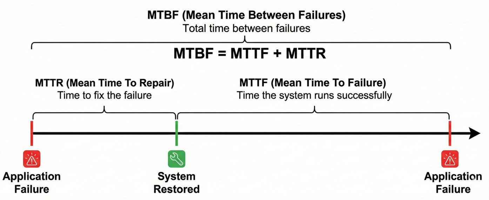

## 8. Verfügbarkeit (Availability)

- **Verfügbarkeit = Uptime / (Uptime + Downtime)** = MTTF / (MTTF + MTTR). Wird in „Neunen" beschrieben:

| Uptime | Downtime/Woche | Downtime/Monat | Downtime/Jahr |
|---|---|---|---|
| 99 % | 1,68 h | 7,2 h | 3,65 Tage |
| 99,9 % | 10 min | 43,2 min | 8,76 h |
| 99,95 % | 5 min | 21,6 min | 4,38 h |
| 99,99 % | 1 min | 4,32 min | 52,56 min |
| 99,999 % | 6 s | 26 s | 5,26 min |

- Faktoren, die die Verfügbarkeit beeinflussen: Hardware-Ausfall, Netzwerk-Instabilität, Software-Bugs, Wartungsfenster, Security-Angriffe (DDoS), Stromausfälle, Kapazitätsüberlastung, Konfigurationsfehler, Dritt-Ausfälle, schwaches Backup/Wiederherstellung.

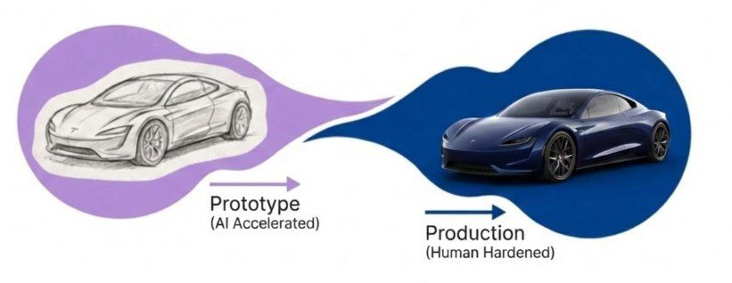

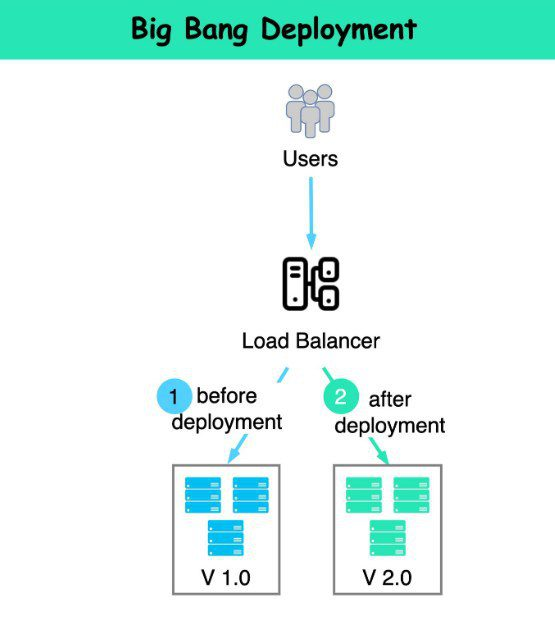

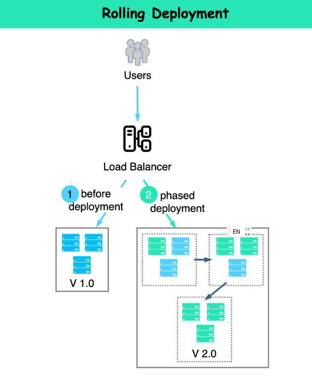

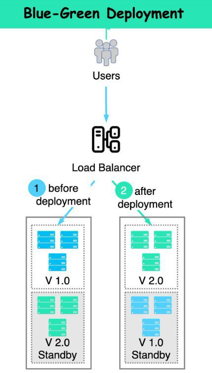

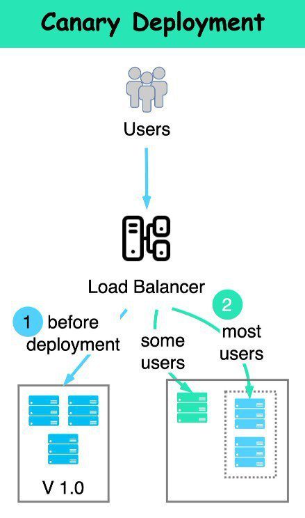

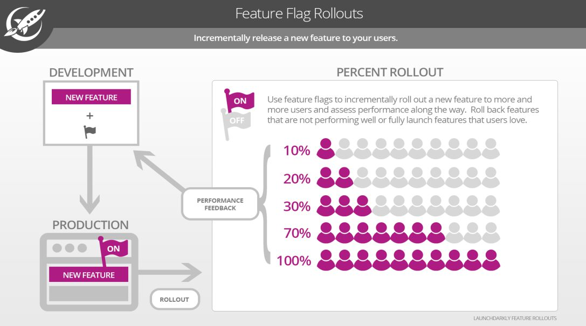

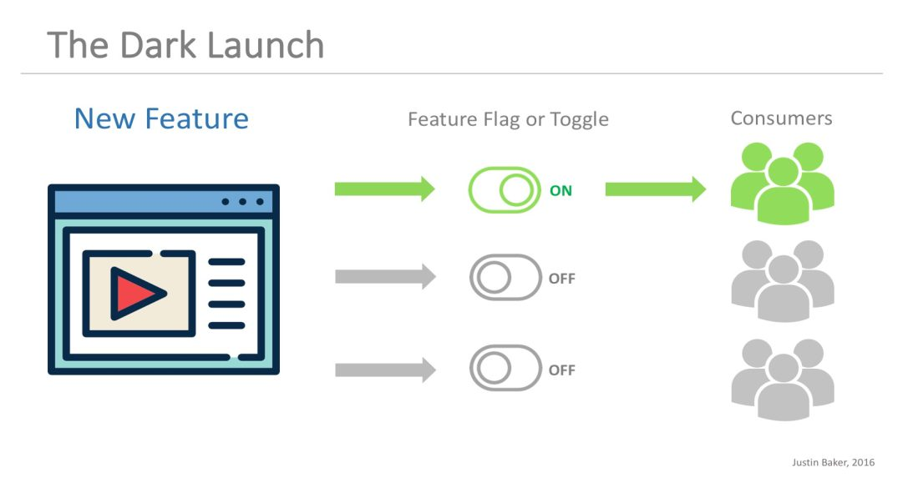

## 9. Deployment-Strategien

| Strategie | Funktionsweise | Trade-offs |
|---|---|---|
| **Big Bang** | Neue Version in einem Stück veröffentlichen, mit Downtime; bei Fehlschlag rollen zurück | Riskant für öffentlich sichtbare / business-kritische Apps; kein leichtes Rollback während Downtime |
| **Rolling Upgrade** | Neue Version ersetzt allmählich die alte; beide koexistieren | Inkompatible Komponenten können zurückgerollt werden |
| **Blue-Green** | Zwei identische Umgebungen; gesamter Traffic auf Blue; auf Green deployen + testen; Traffic umschalten, sobald bereit | Sofortiges Rollback durch Zurückrouten auf Blue |
| **Canary** | Kleine Teilmenge der Instanzen upgraden; einen Slice der User dorthin routen; bei keinen Fehlern erweitern | Kleinstmöglicher Blast Radius für eine neue Version |
| **Feature Flags** | Feature-Sichtbarkeit/-Aktivierung umschalten, **ohne neuen Code zu deployen** | Entkoppelt Release vom Rollout |

### Wie Big Tech Code shippt

1. Git-Commits während der Entwicklung (jede Änderung wird getrackt).
2. **CI/CD** (z. B. CircleCI) übernimmt beim Commit: Build, Unit-Tests, Quality-Checks.
3. Code wandert in **QA-Umgebungen** für Regressions- und Performance-Checks.
4. Produktions-Rollout über Feature-Toggles, Canary-Deployments, A/B-Testing.
5. **Monitoring & Zuverlässigkeit**: SREs beobachten die Performance mit Prometheus, Datadog usw. und lösen Probleme live.

## 10. Key Takeaways

- Requirements-Qualität treibt alles Downstream an; Elicitation-Techniken, MoSCoW und 5 Whys einsetzen.
- Prototypen, um Design zu validieren; MVP, um die Business-Idee zu validieren.
- Verification = Produkt richtig; Validation = richtiges Produkt.
- Früh gefundene Bugs sind deutlich billiger; in Ebenen testen (Unit → Integration → System → Acceptance).
- Deployment ist eine Risikomanagement-Übung: die Strategie nach Kritikalität und Rollback-Bedarf wählen.
- Wartung dominiert die Lebenszykluskosten (60/60) — dafür designen.
- Produktion ist ihre eigene Umgebung: unterschiedliche Daten, Limits und Abhängigkeiten erwarten.
