# Kollaboration und Versionskontrolle in der Softwareentwicklung

---

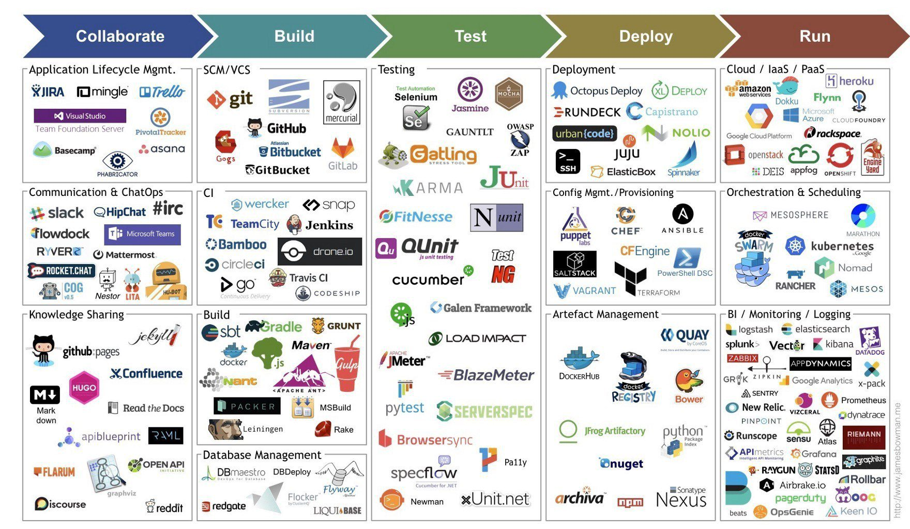

## 1. Warum Versionskontrolle

Ohne sie sammelt sich Code als Haufen von `final`, `final_v2`, `FINAL_real`-Dateien an (der „Piled Higher and Deeper"-Comic). Versionskontrolle gibt dir Historie, Kollaboration und Sicherheit.

## 2. Git & GitHub Basics

- **Git** — ein Versionskontrollsystem, das die Historie von Quellcode trackt.
- **Repository** — ein Container für dein gesamtes Projekt: alle Dateien/Ordner plus vollständige Revisionshistorie; dein Projektordner, in dem die Arbeit passiert.
- **GitHub** — Cloud-Hosting für Git-Repositories (ein **Remote-Repository** ist jeder Server, der eines hostet, z. B. GitHub oder Bitbucket).

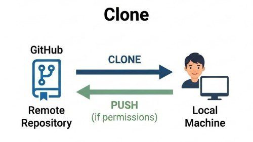

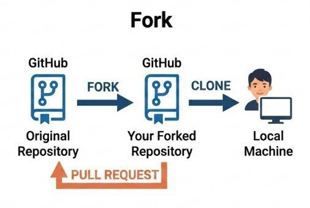

### Clone vs. Fork

- **Clone** — lokale Kopie auf deiner Maschine; holt alle Repository-Daten zu diesem Zeitpunkt (jede Version jeder Datei). Für deine eigene Entwicklung.
- **Fork** — persönliche Kopie auf GitHub; entwickle dort und trage per **Pull Request** bei. Standard für Open-Source-Beiträge.

### Kern-Befehle

| Befehl | Zweck |
|---|---|
| `git clone` | Repository mit voller Historie klonen |
| `git init` | Ein Verzeichnis in ein neues leeres Repository verwandeln |
| `git add` | Änderungen aus dem Working Directory in die Staging Area bewegen |
| `git commit` | Gestagte Änderungen in das lokale Repository committen |
| `git push` | Lokale Commits an das Remote pushen |
| `git pull` | Remote-Updates holen und in den aktuellen Branch mergen |
| `git fetch` | Neueste Remote-Updates abrufen (ohne Merge) |
| `git merge` | Geholte Updates in den aktuellen Branch integrieren |
| `git checkout` | Branch wechseln oder Dateien aus Commits wiederherstellen |
| `git branch` | Branches listen/anlegen |
| `git log` | Commit-Historie anzeigen (Nachrichten, Autoren, Zeitstempel) |
| `git status` | Aktueller Repository-Zustand, Änderungen, Branch-Info |
| `git diff` | Unterschiede zwischen Branch/Commits anzeigen |

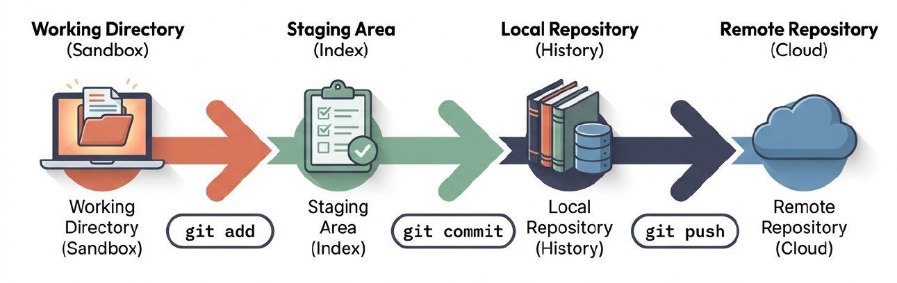

### Die drei Zonen

1. **Working directory** — der eigentliche Ordner, in dem du Dateien editierst.
2. **Staging area (Index)** — der „Ladeplatz" zwischen Workspace und dauerhafter Historie.
3. **Lokales Repository** — dauerhafte Snapshots des Projekts zu bestimmten Zeitpunkten.

- **Commit** = ein dauerhafter Snapshot, der gestagte Dateien in das lokale Repository bewegt; erhält eine eindeutige ID.
- **Push** = lokale Commits (z. B. `main`) an das Remote (`origin/main`) hochladen.
- **Branch** = eine separate Entwicklungsachse ab `main`; Feature-/Bug-Arbeit isoliert halten, bis sie fertig ist.
- **Merge** = einen fertigen Branch zurück in main integrieren; erzeugt einen neuen Commit **mit zwei Eltern**, der die kombinierte Arbeit enthält.

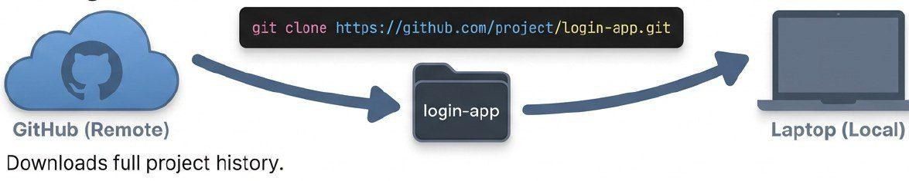

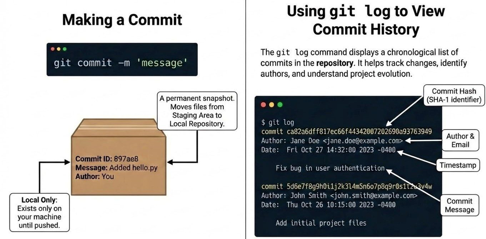

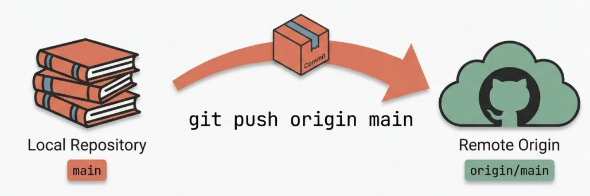

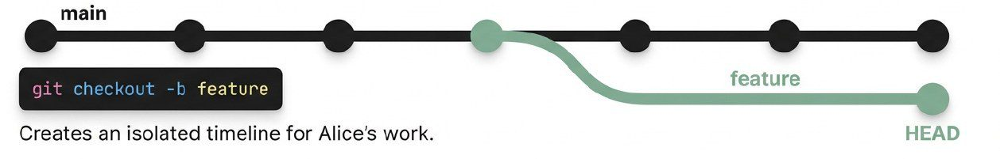

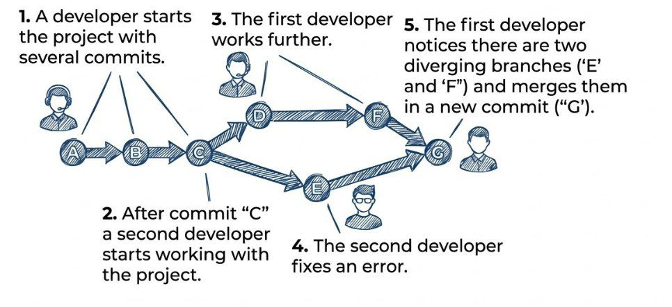

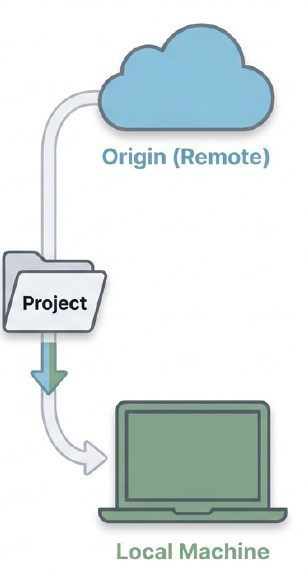

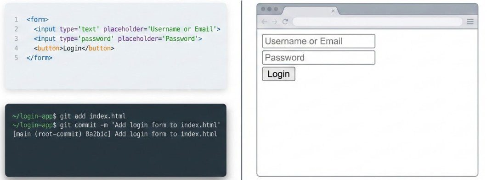

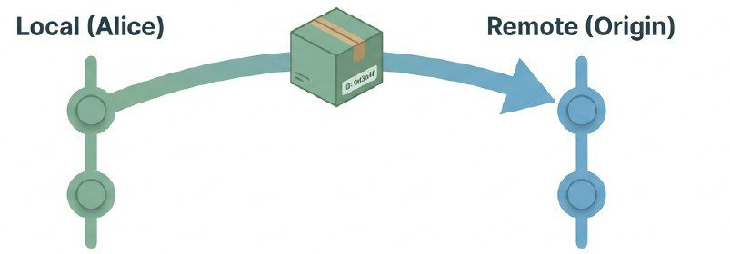

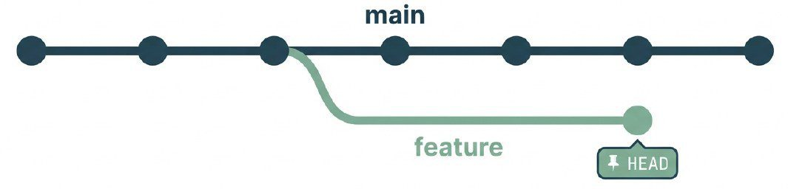

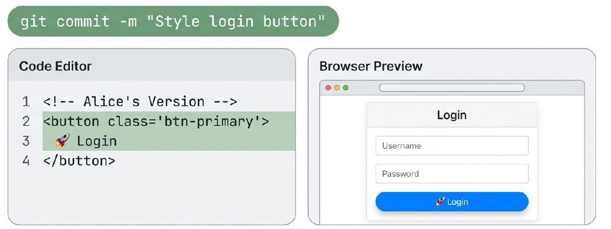

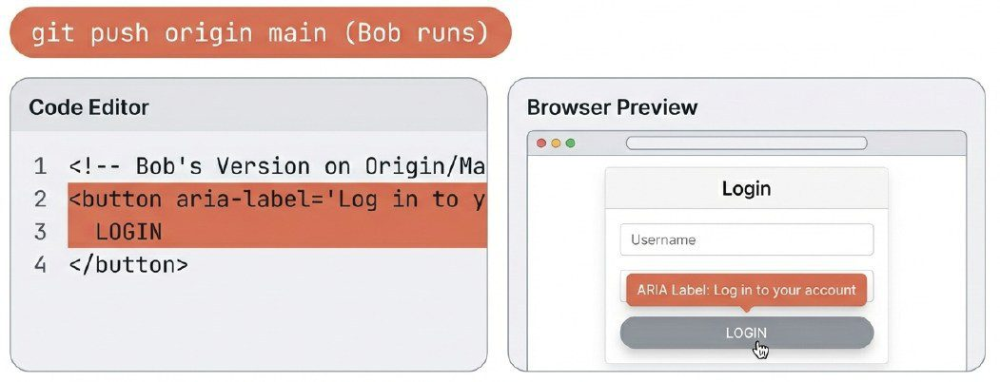

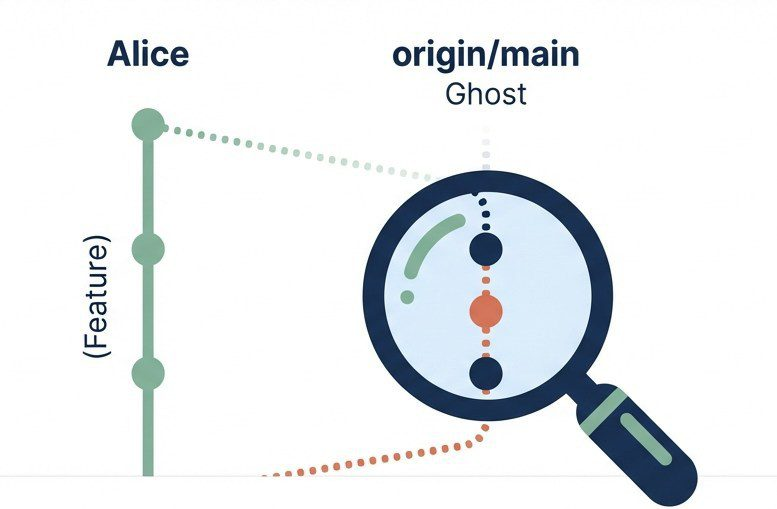

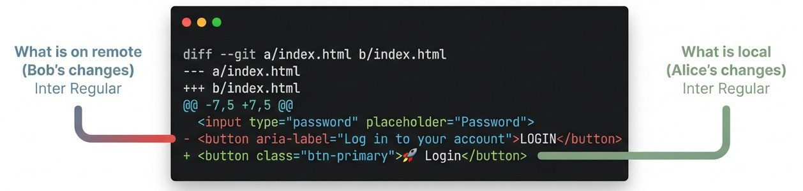

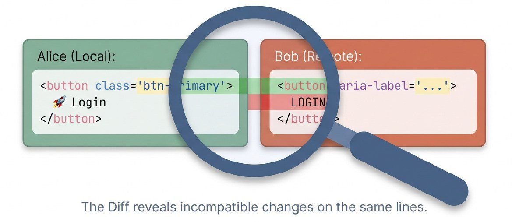

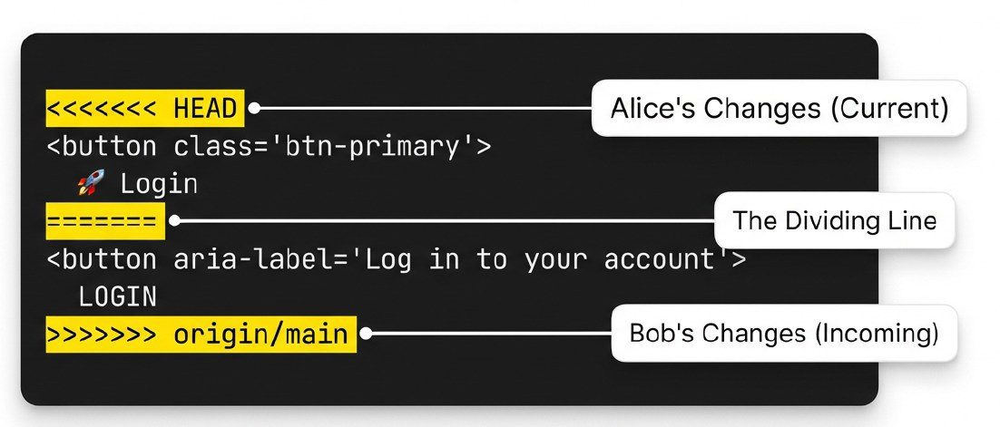

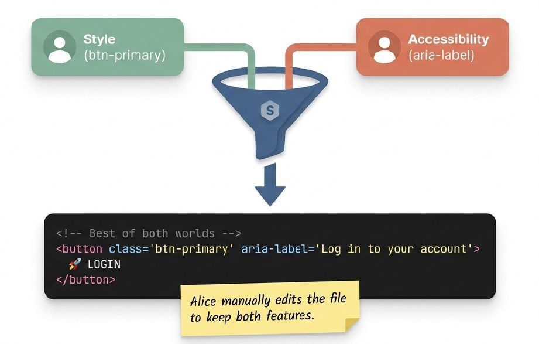

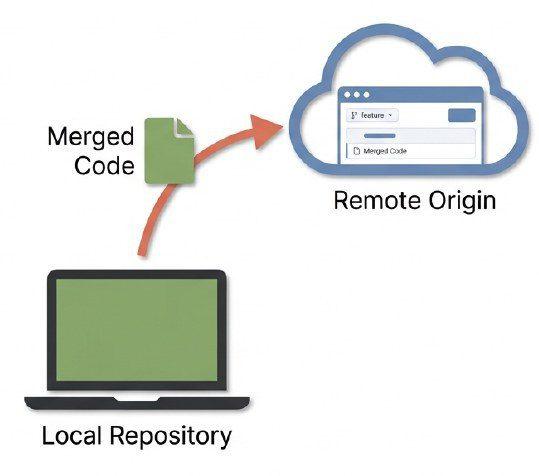

## 3. Szenario-Ablauf (Alice & Bob)

1. `git clone https://github.com/project/login-app.git` — lädt Repo + volle Historie; lokaler Ordner verlinkt mit `origin`.
2. Alice erstellt ein Login-Formular: `git add index.html` → `git commit -m 'Add login form to index.html'`.
3. Synchronisieren: `git push origin main` — origin entspricht jetzt Alices Historie.
4. Alice isoliert neue Arbeit: `git checkout -b feature` (anlegen + wechseln). `git branch` listet die Branches.
5. Alice verfeinert die UI (CSS, Button-Icon), staged und committet.
6. Inzwischen **pusht Bob an das Remote `main`** — hat Accessibility-Attribute hinzugefügt (`aria-label` für Screenreader) und den Text in Großbuchstaben gesetzt.
7. `git fetch` — aktualisiert das Wissen über das Remote (lädt Bobs Commits) **ohne die Working-Dateien anzufassen**. `origin/main` ist der **Remote-Tracking-Branch** (Verweis auf den Remote-Branch; „origin" ist der Standard-Remote-Name nach dem Clone).
8. `git diff origin/main` — zeigt, dass Alice und Bob **denselben Code an derselben Zeile geändert haben**.
9. `git merge origin/main` — **automatischer Merge schlägt fehl** (gleiche Zeile von beiden geändert). Git fügt **Konflikt-Marker** ein, die beide Versionen zeigen.
10. Alice **löst** den Konflikt manuell — kombiniert das Beste aus beidem, löscht die Marker (braucht menschliche Absicht; Git kann das nicht automatisch).
11. Finalisieren: `git add index.html` → `git commit -m 'Merge origin/main; resolve login button conflict'` → `git push origin feature`.
12. **Pull Request** — ein dedizierter Ort, an dem Teamkollegen den Code inspizieren, Fragen stellen und die Qualität sicherstellen, bevor die Arbeit dauerhaft wird. Bob reviewt und kommentiert.
13. Alice adressiert Feedback lokal: editieren → `git add` → `git commit -m 'Update button text'`.
14. `git push origin feature` — **kein neuer PR nötig**; das Pushen auf denselben Branch aktualisiert automatisch die bestehende PR-Konversation. Bob gibt frei; das Feature wird in `main` gemergt.

## 4. Conventional Commits

Eine lightweight-Spezifikation für konsistente, explizite Commit-Historie. Gängige Typen:

| Typ | Bedeutung |
|---|---|
| `feat:` | Neue Funktion |
| `fix:` | Bugfix |
| `docs:` | Dokumentationsänderungen |
| `style:` | Formatierung/Style (keine Verhaltensänderung) |
| `refactor:` | Code-Umstrukturierung ohne Feature-/Bug-Änderungen |
| `test:` | Tests hinzufügen/ändern |
| `chore:` | Wartung (Dependency-Updates, Config wie `.gitignore` etc.) |

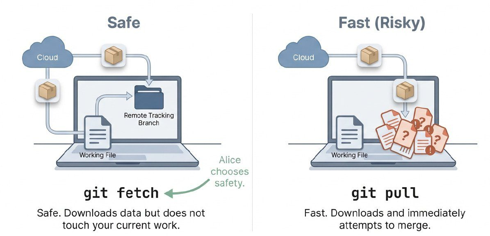

## 5. Fetch vs. Pull & Branch-Hygiene

- **`git fetch`**: lädt neue Daten, rührt Working-Dateien nicht an — sicher, erlaubt das Review vor dem Merge.
- **`git pull`** = fetch + sofortiger Merge in die aktuelle Arbeit.
- **Häufig aus main pullen**, während man auf einem Feature-Branch ist: hält den Branch aktuell, löst kleine Konflikte inkrementell, vermeidet einen riesigen Konflikt zur Merge-Zeit.

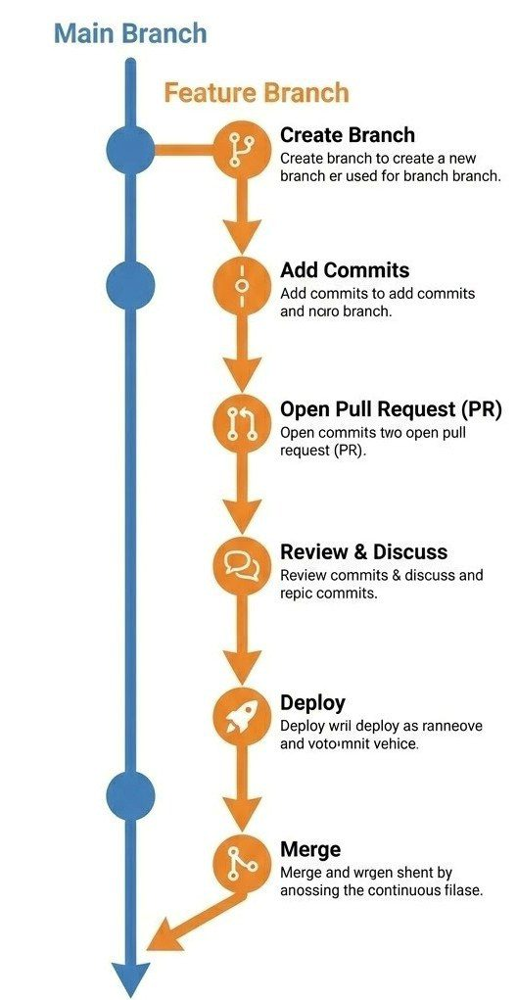

## 6. GitHub Flow

Lightweight-branch-basierter Workflow für Teams mit regelmäßigen Deployments:

1. **Branch anlegen** von `main` — isolierte, sichere Entwicklung.
2. **Commits häufig hinzufügen** — transparente Historie, leicht, spezifische Änderungen zurückzunehmen.
3. **PR öffnen** — startet Diskussion und Review.
4. **Review & Diskussion** — Reviewer schlagen Verbesserungen vor; der Developer committet die Fixes.
5. **In main mergen** — das Feature wird produktionsreif.

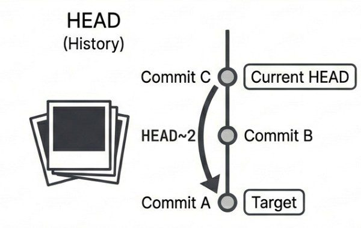

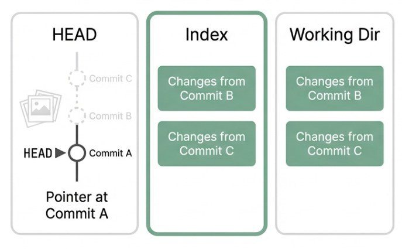

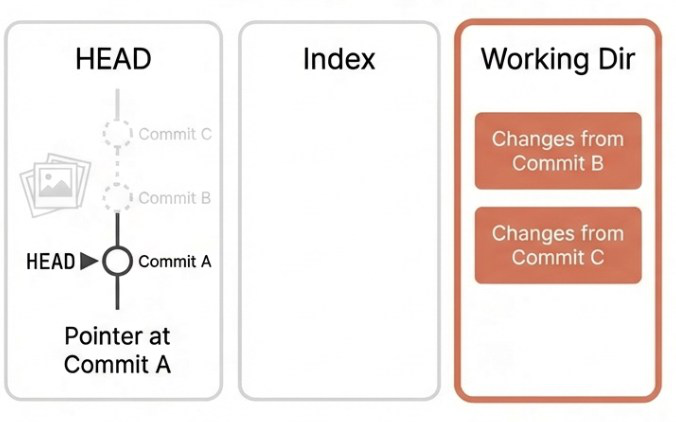

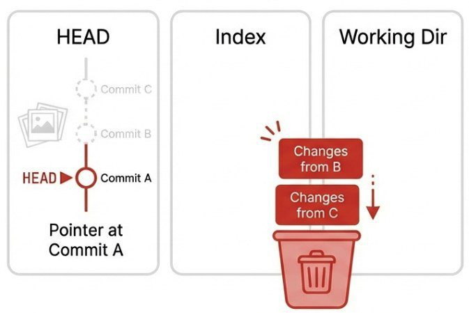

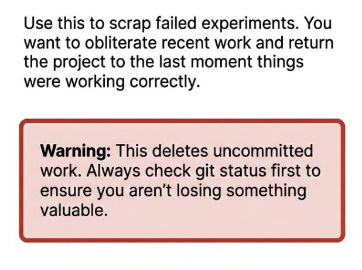

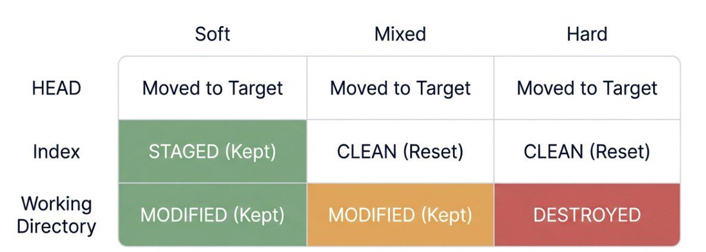

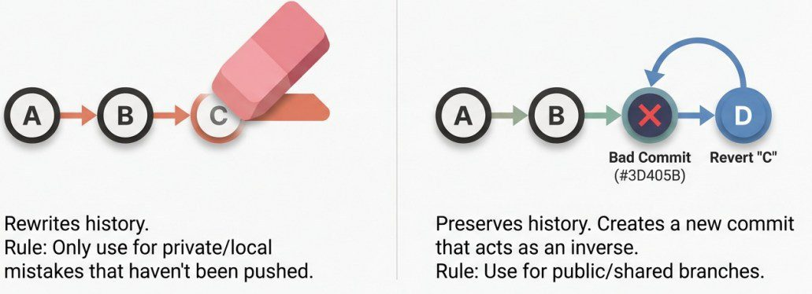

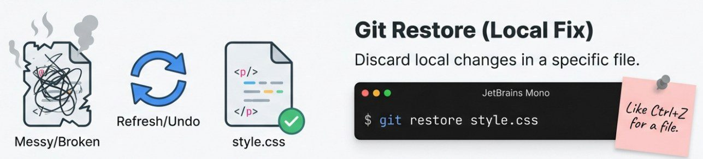

## 7. Undo-Operationen

`git reset [mode] HEAD~2` — die letzten zwei Commits rückgängig machen (HEAD = neuester Commit; `HEAD~2` = zwei zurück). Drei Modi:

| Modus | Historie | Staging (Index) | Working dir | Wann verwenden |
|---|---|---|---|---|
| `--soft` | Rollt zurück | **Änderungen bleiben gestagt** | Unangetastet | „Ich bereue, dass dies separate Commits waren" — **squash** unordentliche Commits zu einem sauberen Commit |
| `--mixed` (Default) | Rollt zurück | Geleert | **Änderungen bleiben, unstaged** | „Ich bereue das Commit, will aber weiterarbeiten" — Staging überdenken, Commits aufteilen |
| `--hard` | Rollt zurück | **Zerstört** | **Zerstört** | „Ich bereue, dass diese Commits je existiert haben" — das Repo entspricht exakt dem Ziel-Commit; **mit Vorsicht verwenden** |

- **Force push** (`git push --force`): überschreibt den Remote-Branch mit der lokalen Historie; nur-remote-Commits werden gelöscht.
  - **Best Practice**: niemals einen Branch resetten, der bereits an ein geteiltes Remote gepusht wurde; nur Commits resetten, die ausschließlich auf deiner Maschine existieren; Commits von Teamkollegen gingen sonst verloren.
- **`git revert`**: erzeugt einen **neuen Commit, der einen alten inversiert** — schreibt die Historie nicht um; das **sicherste Undo in kollaborativen Umgebungen**.
- **`git restore <file>`**: stellt eine Working-Datei auf den letzten committed Zustand zurück (z. B. `git restore style.css`, nachdem man experimentelle Edits bereut hat).

## 8. Kollaboration über Code hinaus

- **GitHub Issues** — Enhancements, Tasks, Bugs (Bug-Reports / Feature-Requests) tracken.
- **Release** — Packaging & Distribution einer spezifischen stabilen Version an User/Systeme.
- **Release notes** — dokumentierte Zusammenfassung der Änderungen, Verbesserungen und Fixes für dieses Release.

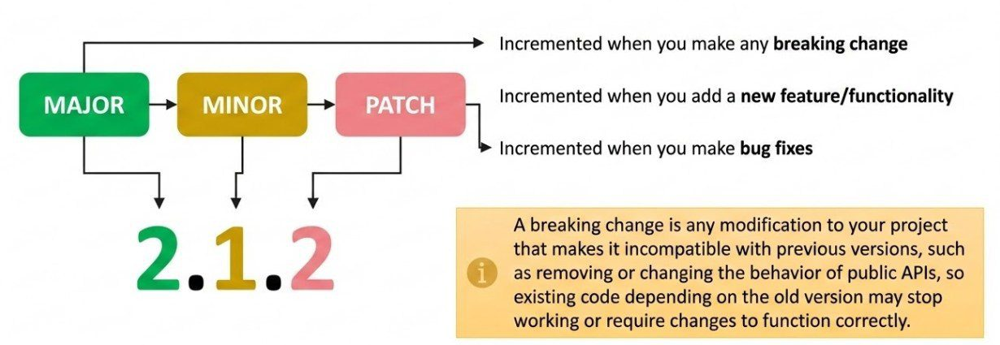

## 9. Semantische Versionierung (Semantic Versioning)

`MAJOR.MINOR.PATCH`:

- **MAJOR** — Breaking Change.
- **MINOR** — neue Funktion/Funktionalität (zurückwärtskompatibel).
- **PATCH** — Bugfixes.

**Übung** (Start bei v1.0.0):
- `fix: remove exposed Azure API key` → **v1.0.1**
- `feat: add Python Flask API backend` → **v1.1.0**
- `feat: upgrade to v2 API structure` (breaking) → **v2.0.0**

## 10. Key Takeaways

- Mentales Modell: **Working directory → Staging area → lokales Repo → Remote**; jeder Befehl bewegt Dateien zwischen diesen Zonen.
- Branchen, um Arbeit zu isolieren; mergen (oder PR), um zu integrieren; Konflikte bewusst lösen.
- `fetch` ist sicher, `pull` merged; häufig aus main pullen, um Branches frisch zu halten.
- Auf geteilter Historie `revert` bevorzugen; `reset` lokal; niemals über die Arbeit von Teamkollegen `--force` pushen.
- Conventional Commits + semantische Versionierung geben Historie und Releases eine vorhersagbare, maschinenlesbare Form.
