# Überblick über Software-Testing

---

## 1. Was ist Software-Testing

Eine **Untersuchung, um Stakeholdern Informationen über die Qualität** des getesteten Produkts zu liefern. Qualitätsaspekte: erfüllt User-Bedürfnisse, Konformität mit den Anforderungen, frei von Fehlern/Ausfällen, Eignung zur Verwendung, Kundenzufriedenheit, Zahlungsbereitschaft.

### Drei grundlegende Test-Stile (Beispiele für eine LLM-Dokumenten-App)

- **Happy Path** — beabsichtigter Workflow mit gültigen Eingaben: User lädt eine unterstützte `.pdf` innerhalb der Größenlimits hoch; die App parst sie und schickt sie erfolgreich an das LLM.
- **Edge Cases** — extreme, aber gültige Grenz-Eingaben:
  - PDF genau bei Supabases maximaler Dateigröße; sehr langer Dateiname; Dokument, das das maximale Kontextfenster des LLMs ausschöpft; schnelles wiederholtes Klicken auf „Summarize"; während des Uploads wegnavigieren und zurückkehren.
  - Verwandte API-Fehler: `200 OK`, `400 Bad Request` (Content-Filter / ungültige Anfrage), `429 Too Many Requests` (Rate-Limit), `500 Internal Server Error`.
- **Negatives Testing** — ungültige Eingaben & Fehlerbedingungen, die das System ablehnen oder sauber behandeln sollte: nicht unterstützte Dateitypen (`.exe`, `.mp4`, `.zip`), korrupte PDFs, überdimensionierte Dateien, LLM-API-Ausnahmen, schnelle wiederholte Einsendungen an den Summary-Endpoint.

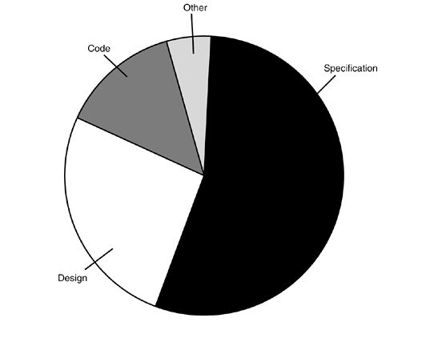

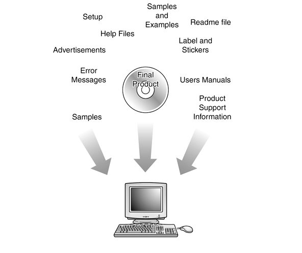

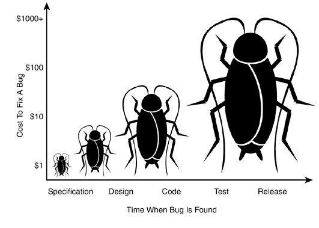

## 2. Defekte, Test-Typen, Kosten

- Studien zeigen, dass die **Hauptursache von Software-Defekten Spezifikation und Design** ist — nicht Coding.
- **Dynamisches Testing** — das Programm mit Testfällen ausführen, um Defekte zu detektieren.
- **Statisches Testing** — etwas testen, das **nicht läuft**: Code und Dokumente (Anforderungsspezifikation, Design, Benutzerhandbuch, Testplan, Testfälle) prüfen, um Fehler zu lokalisieren. (Auch Nicht-Software-Teile können Bugs haben.)
- **Die Kosten, einen Bug zu fixen, steigen je später er gefunden wird** — Defekte früh finden.

### Verifizierbare (testbare) Anforderungen

> Eine Anforderung ist verifizierbar, wenn und nur wenn es einen endlichen, kosteneffizienten Prozess gibt, mit dem eine Person oder Maschine prüfen kann, dass das Produkt sie erfüllt.

- Nicht verifizierbar: „funktioniert gut", „benutzerfreundlich", „soll normalerweise passieren".
- Testbares NFR-Beispiel: ~~„leicht von medizinischem Personal bedienbar"~~ → *„Medizinisches Personal muss alle Systemfunktionen nach vier Stunden Schulung bedienen können; danach dürfen die durchschnittlichen Fehler erfahrener User zwei pro Nutzungsstunde nicht überschreiten."*

### Defect Removal Efficiency (DRE)

- Ein guter Testing-Prozess **erhöht die von Testern gefundenen Defekte, verringert die von Kunden gefundenen** und detektiert Defekte so früh wie möglich.
- **DRE = (detektierte und entfernte Defekte) / (Gesamtdefekte)**, wobei Gesamt = in Entwicklung gefundene + im **ersten Jahr nach Release** gemeldete Defekte.
- Beispiel: 1000 in der Entwicklung gefunden + 100 im ersten Jahr gemeldet → insgesamt 1100.
- **Übung**: Team A findet 30 im Testing / 70 bei den Usern (DRE ≈ 30 %); Team B findet 20 / 30 (DRE ≈ 40 %) → **B ist effektiver**, trotz weniger gesamt.
- Jede Phase kann Defekte *einführen* und *entfernen*; Testing dient vor allem der Entfernung — und Defekte falsch zu fixen kann neue einführen.

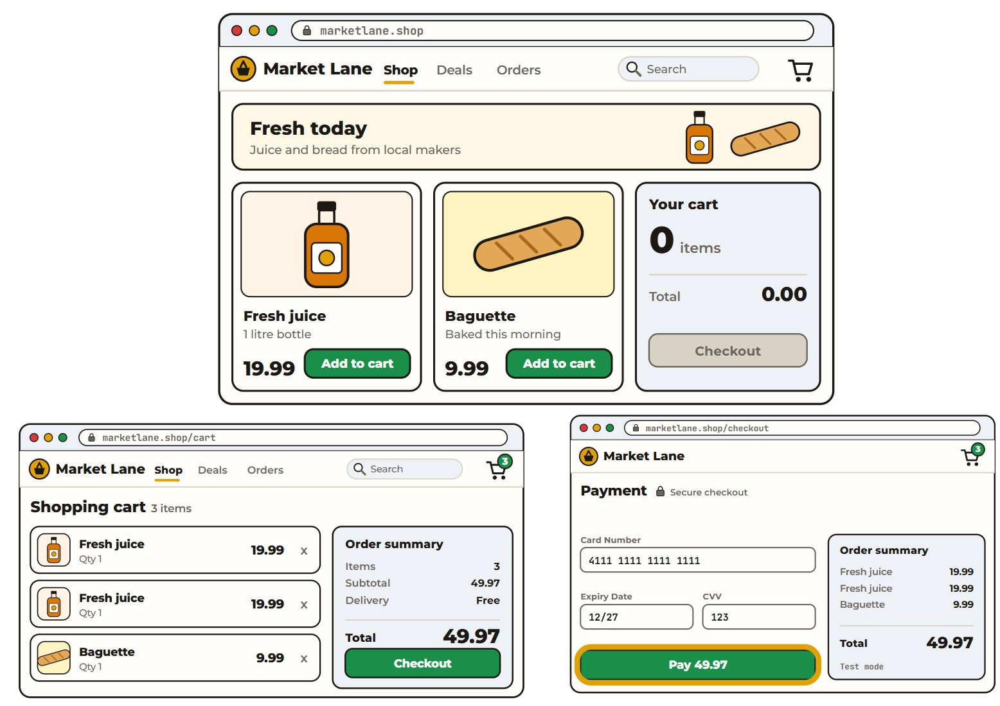

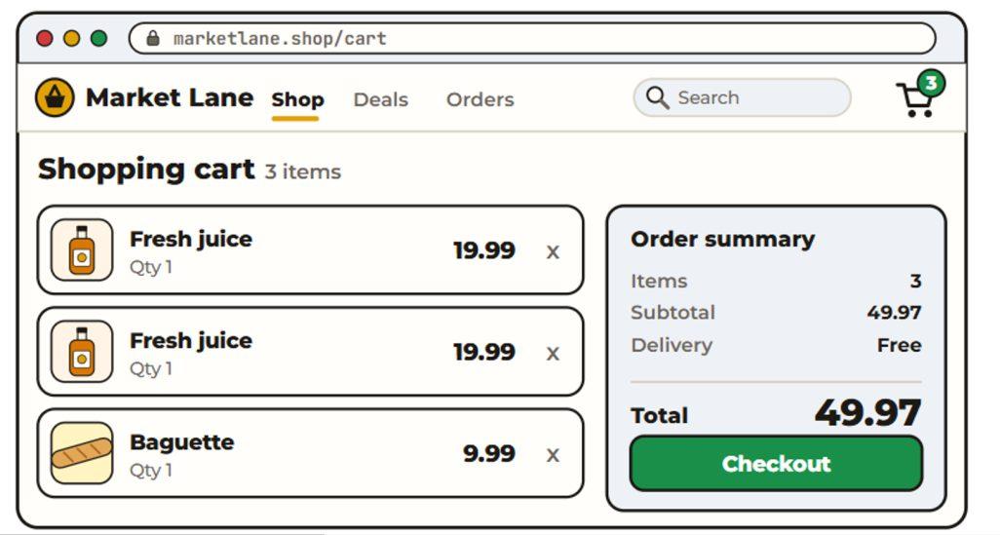

## 3. Manueller vs. automatisierter Test

### Manueller Test

Eine Person führt Testfälle manuell aus (z. B. Warenkorb-Beispiel: 2× 19,99 $ + 1× 9,99 $ hinzufügen → „3 Artikel" und „49,97 $" verifizieren).

| Stärken | Schwächen |
|---|---|
| Usability-Testing (intuitive Oberfläche) | Zeitaufwändig |
| Visuelle Validierung (Layout, Farben, Responsivität) | Fehleranfällig (menschliche Berechnungsfehler) |
| Exploratives Testing (unerwartete Bugs) | Nicht wiederholbar (Tester führen unterschiedlich aus) |
| Gesamtes UX-Gefühl & Flow | |

### Automatisierter Test

Software steuert die Testausführung. Agiler kurze Zyklen machen manuelle Regression fast unmöglich. **Schichten** (schnell/billig → langsam/teuer): **Unit-Tests → Service-Layer-Tests → UI-Tests**.

Weisen, automatisierte Tests zu schreiben: **Hand-scripted** (Testcode schreiben), **aufgezeichnet** (Tools erfassen UI-Interaktionen zur Wiedergabe), **GenAI-gestützt** (z. B. GitHub Copilot).

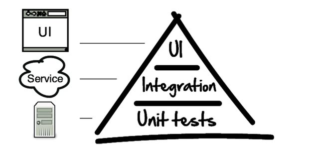

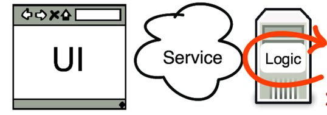


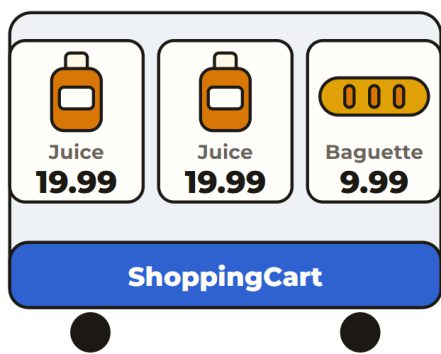

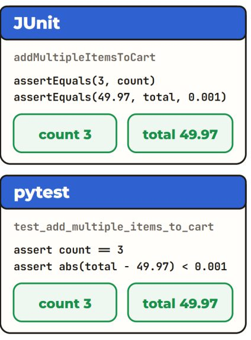

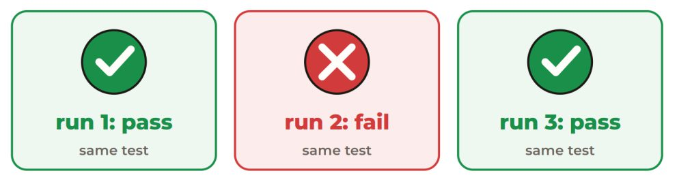

## 4. Unit-Testing

- Ein Code-basierter Test, der eine kleine, isolierte Einheit (einzelne Funktion/Methode) verifiziert. Frameworks: **pytest** (Python), **JUnit** (Java), **Jest/Mocha** (JS).
- **Assertion** = eine Aussage, die prüft, ob eine Bedingung wahr ist; falsch → der Test schlägt fehl.
- Beispiel (Warenkorb: 2× 19,99 $ + 1× 9,99 $):

```java
// JUnit — Arrange / Act / Assert
ShoppingCart cart = new ShoppingCart();
cart.addItem(2, 19.99);
cart.addItem(1, 9.99);
assertEquals(3, cart.getItemsCount(), "Cart should have 3 items after adding.");
assertEquals(49.97, cart.getTotalAmount(), 0.001, "Total amount should be 49.97");
```

```python
# pytest — same test
cart = ShoppingCart()
cart.add_item(2, 19.99)
cart.add_item(1, 9.99)
assert cart.get_items_count() == 3, "Cart should have 3 items after adding."
assert abs(cart.get_total_amount() - 49.97) < 0.001, "Total amount should be 49.97"
```

- **AAA-Muster**: **Arrange** (Objekte, Dependencies, Inputs einrichten) → **Act** (die getestete Einheit ausführen) → **Assert** (tatsächlich vs. erwartet prüfen).
- **Dependencies & Flaky-Tests**: Warten auf IO/externe Services killt die Test-Geschwindigkeit; Tests, die auf Live-Services/DBs/Netzwerke angewiesen sind, schlagen intermittierend fehl → **Flaky-Test** = inkonsistente Ergebnisse ohne Code-Änderung.
- **Mock** — ein simuliertes Objekt, das eine echte Dependency mimt: Rückgabewerte steuern, Fehler simulieren, ohne echte externe Systeme anzufassen.

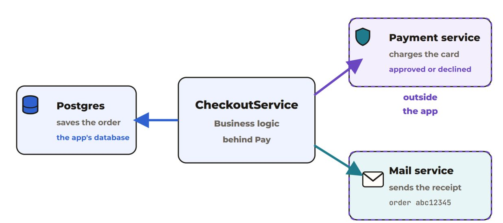

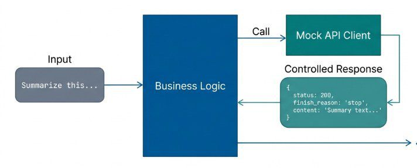

## 5. Integrationstesting

- Verifizieren, dass mehrere Komponenten zusammenarbeiten: REST-API-Endpoints, Business-Logik, Datenbank.
- HTTP ist das Request/Response-Protokoll des Webs; eine REST-API tauscht Daten über HTTP-Methoden (GET, POST, PUT, DELETE) aus.
- **Mocking**: Die API führt echte Business-Logik gegen die eigene Datenbank der App aus, aber **externe Services (z. B. der Payment-Anbieter) werden gemockt**, da die App sie nicht kontrolliert.

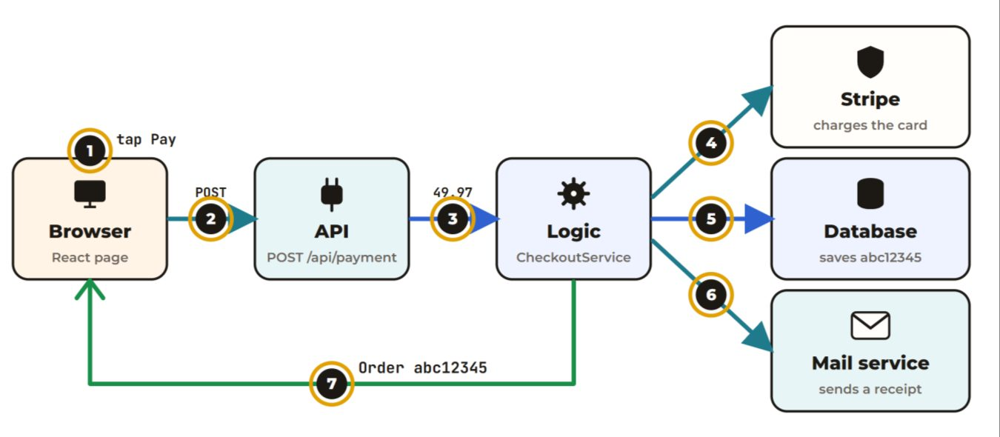

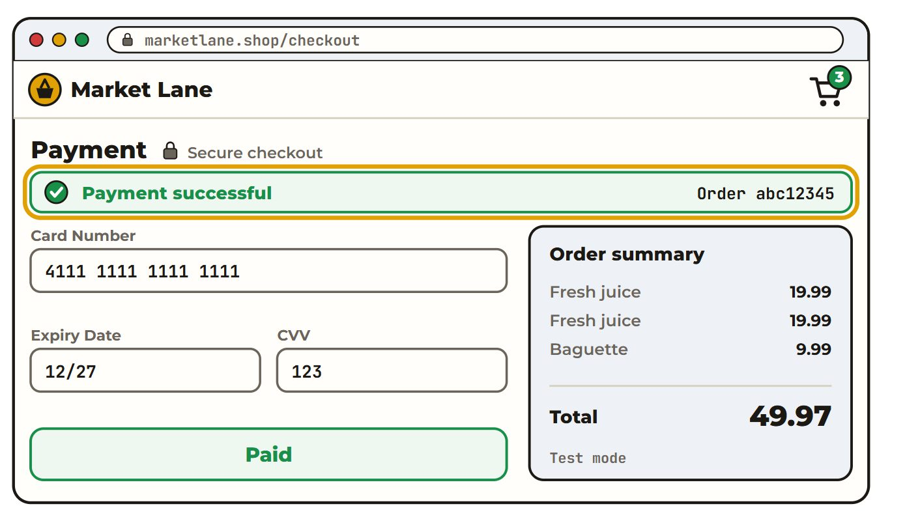

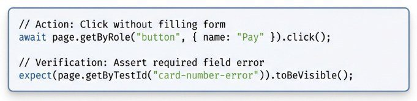

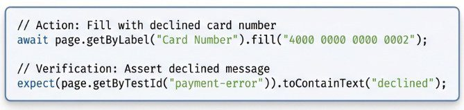

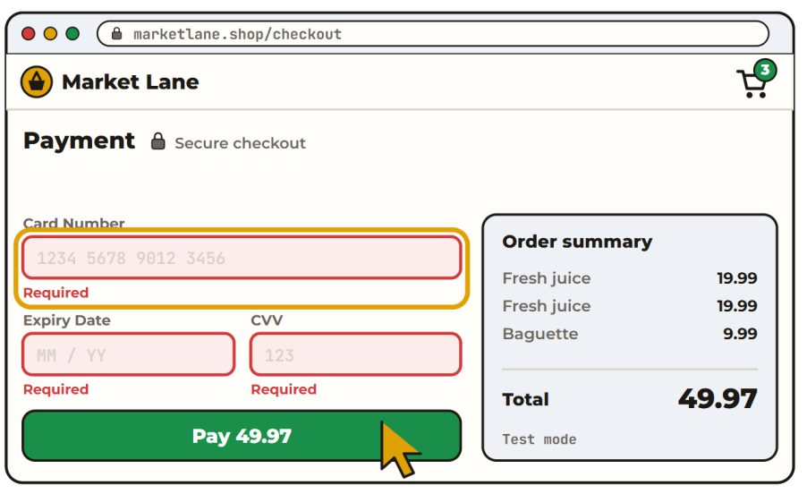

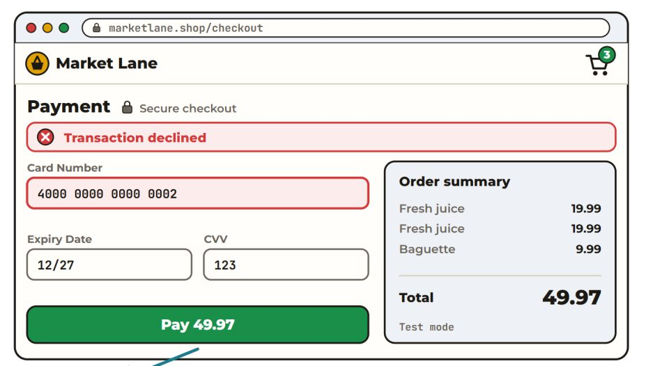

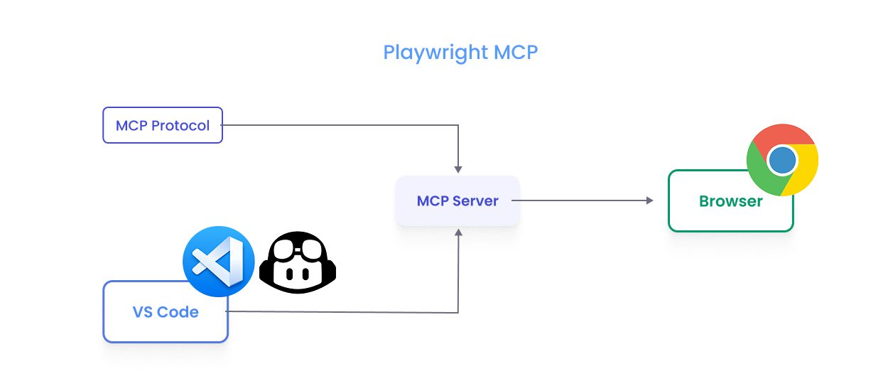

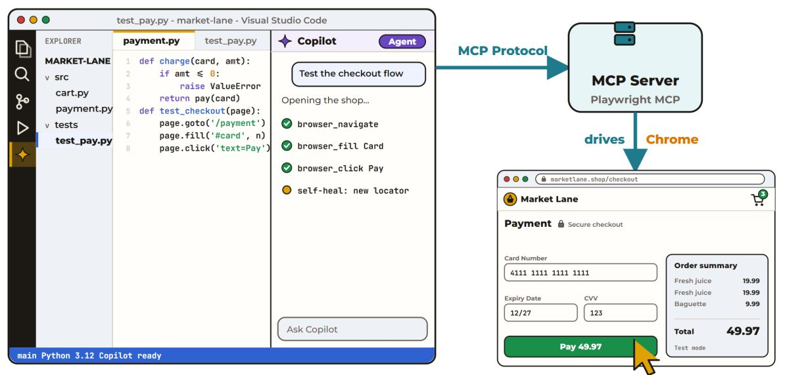

## 6. UI-/End-to-End-Testing mit Playwright

- **UI-Tests** erzeugen UI-Events (Tastenanschläge, Klicks) und beobachten die Ergebnisse; **E2E**-Tests testen komplette User-Flows in einem echten Browser.
- **Playwright** (Microsoft, Open Source): steuert echte Browser (Chromium, Firefox, WebKit).
  - **Semantische Locators** — Elemente finden, wie der User sie wahrnimmt („das Feld mit der Aufschrift 'Card Number'", „der Button, der 'Pay' sagt").
  - **Auto-Waiting** — `expect`-Assertions werden bis zum Timeout erneut versucht.
  - **Happy Path**: Zahlungsformular ausfüllen → die API validiert/bucht über Stripe → Erfolgsnachricht + Order-ID asserten (beweist, dass das Backend es verarbeitet hat).
  - **Unhappy Paths**: leeres Formular → Pflichtfeld-Fehler; abgelehnte Kartennummer → die UI behandelt den API-Fehler sauber, ohne zu crashen.
  - **Mobile-Layout**: Viewport programmatisch verkleinern; responsives Formular, keine abgeschnittenen Buttons prüfen.
  - **Headed** (Test zum Debuggen beobachten) vs. **headless** (kein Fenster; ideal für schnelles CI/CD).
- **Playwright + MCP** (Model Context Protocol): ein offenes Protokoll, das LLM-Apps mit externen Tools/Services verknüpft — lässt einen KI-Agenten den Browser in natürlicher Sprache steuern, statt für jeden Schritt ein neues Script zu schreiben.
- **Übung**: `git clone https://github.com/HKPolyUSE/playwright_testing`; `@playwright/mcp` MCP-Server in der IDE konfigurieren; das Login-Hilfs-Beispiel ausführen (`doLogin` mit `getByRole`-Locators).

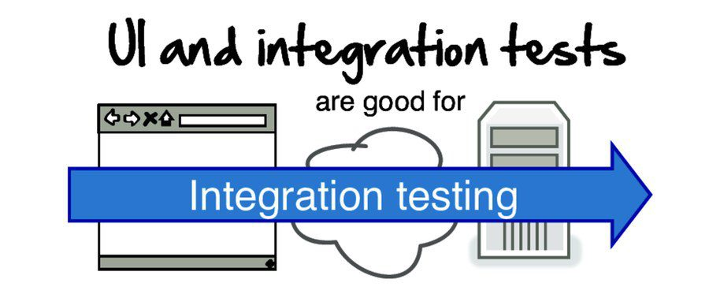

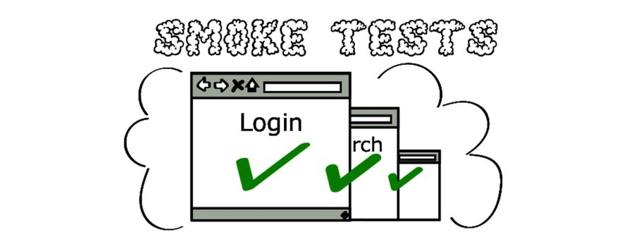

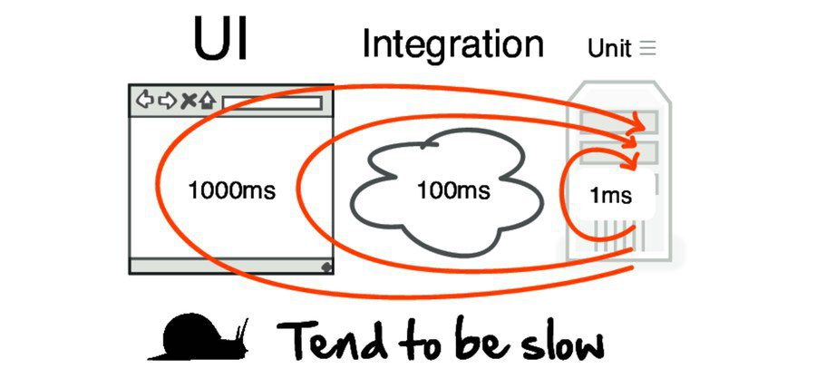

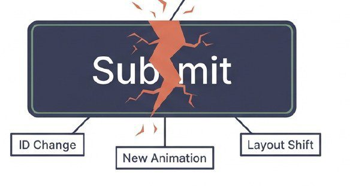

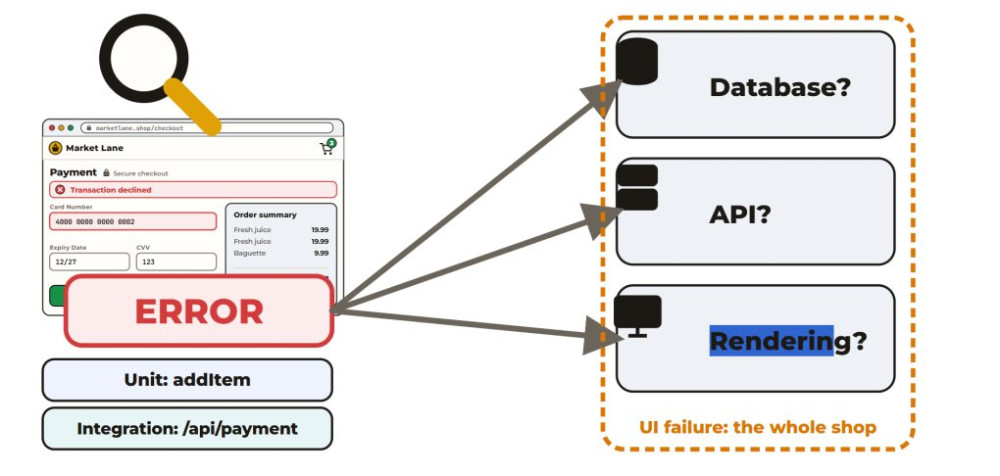

### UI-Test-Trade-offs

| Vorteile | Einschränkungen |
|---|---|
| Immer automatisierbar | Um Größenordnungen langsamer als Unit-Tests |
| End-to-End-Abdeckung (UI → Services → DB) | Fragil: ein Label-Umbenennen („Submit"→„Confirm") bricht hard-coded Selectors |
| Super für High-Level **Smoke Tests** (ist das System hoch, deployed, verbunden?) | Ein E2E-Fehler sagt, dass *irgendwas* falsch ist, aber selten *wo* |

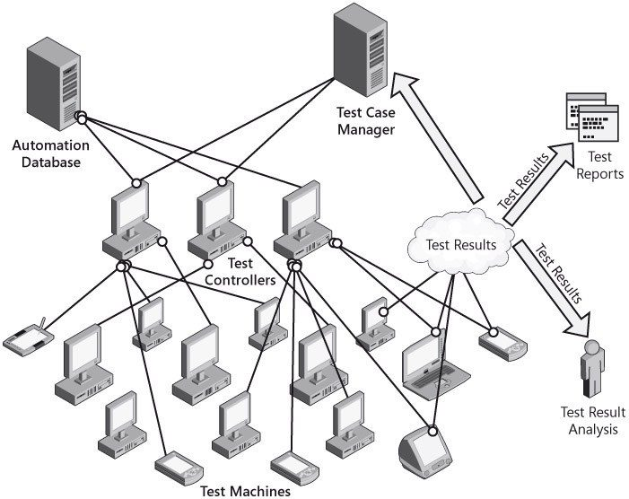

### Vorteile der Automatisierung insgesamt

**Schnell** (Load-Testing, massive Zufalls-Tests), **zuverlässig** (identische Operationen bei jedem Lauf, kein Menschenfehler), **wiederholbar** (Regressionstesting).

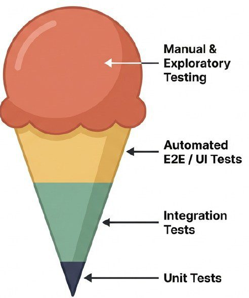

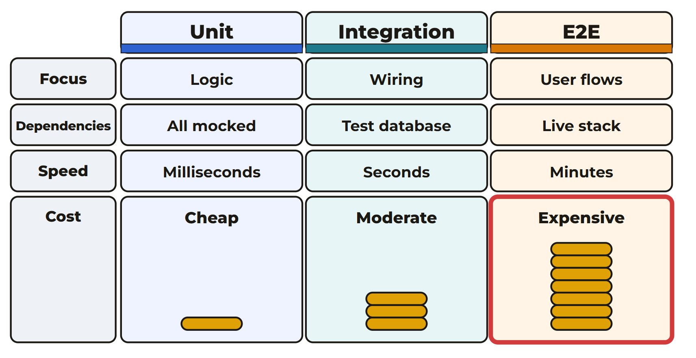

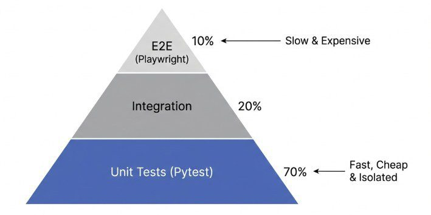

## 7. Test-Form: Pyramide vs. Cone

- **Eis-Cone (Anti-Pattern)**: größtenteils manuelles Testing + Automatisierung auf UI-Ebene; die Automatisierung imitiert nur langsame manuelle Prozesse.
- **Testpyramide**:
  - **Unit-Tests** (Basis) — isolierte Funktionen/Methoden; billig, Millisekunden, sofortiges Feedback.
  - **Integrationstests** (Mitte) — Komponenten/Services zusammen: API-Endpoints, DB-Operationen, Service-Kommunikation.
  - **UI-/E2E-Tests** (Spitze) — komplette User-Journeys durch die UI.

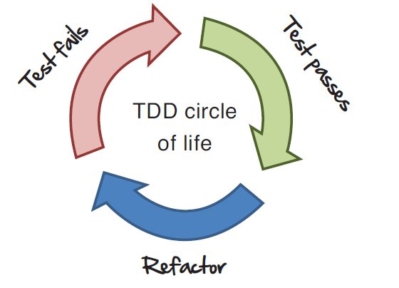

## 8. Testgetriebene Entwicklung (TDD)

- Normaler Flow: entwickeln → Tests schreiben → Tests ausführen.
- **TDD-Zyklus**: einen **fehlenden** Test schreiben → ausführen (er schlägt fehl) → den minimalen Code zum Bestehen schreiben → ausführen → **refactorn** → wiederholen (Red–Green–Refactor).
- **„Test first"** ist Design: Es zwingt dich, Anforderungen durchzudenken, die API/das Interface zu designen und zu entscheiden, wie der Code verwendet wird. Gut geschriebene Unit-Tests werden zu einer **funktionierenden Spezifikation** und einem bedeutenden Teil deiner technischen Dokumentation.
- **Genug Code**: Der fehlende Test markiert die Lücke; schreibe nur, was ihn bestanden lässt (die Implementierung kann suboptimal sein — später refactorn).
- **Refactoring**: Das Design verbessern, ohne das externe Verhalten zu ändern.
- **Vorteile**: Tests definieren einen Vertrag für korrektes Verhalten; automatisierte Tests laufen bei jedem Check-in; das Team shippt Features ohne Angst vor unbeabsichtigten Änderungen. Bonus: **Constraints für KI** — Tests limitieren KI-Änderungen auf solche, die alle bestehenden Fälle bestehen, und verhindern unerwünschte Änderungen korrekter Funktionalität.

## 9. Usability-Testing

- Testet, wie leicht User die Oberfläche bedienen können, an echten Usern. **Fünf Komponenten** (Nielsen): **Lernbarkeit, Effizienz, Memorability, Fehler (Anzahl/Schwere/Erholung), Zufriedenheit**.
- **Usability verbessern**: Mit repräsentativen Usern an realistischen Tasks testen; **beobachten**, wo sie pausieren, Fehler machen, verwirrt sind (nicht auf Eindrücke verlassen); die größten Probleme zuerst fixen; neu testen; über alle fünf Komponenten iterieren.
- **Guerrilla-User-Testing** — kostengünstiges Testing „draußen in der Wildnis".
- **Durchführung einer Session**: System auf der Startseite bereit; der Moderator gibt Tasks; nach dem Denkprozess fragen; Vorschläge notieren; Developer/Designer beobachten lassen; Exit-Interview (was mag/was nicht, Vorschläge); einen **Final-Report** erstellen (Wirksamkeit, Effizienz, Task-Zeit, Fehler, Zufriedenheit).
- **Testpersonen**: identifizieren & rekrutieren (Termin, Ort, Moderator, Protokollführer); **Anreize** (kostenloses Essen, Gutscheine) verbessern die Teilnahme.
- **Usability-Lab**: einfacher Ein-Zimmer-Setup → elektronischer Beobachtungsraum.
- **Think-Aloud**: Teilnehmer erzählen ihr Denken fortlaufend; hören, was sie tun/was sie suchen/was ihnen schwerfällt; sanfte Impulse („Was denkst du gerade?").
- **Test-Designs**:
  - **Between-Subjects (unabhängige Gruppen)** — jeder Teil wird von einzigartigen Usern getestet; mildert **Lerntransfer** (die Verwendung von Interface A lässt B leichter wirken), der Probleme maskieren kann.
  - **Within-Subjects** — jedes Subjekt testet alle Module; **Counterbalancing** (Task-Reihenfolge randomisieren/ausgleichen) + Pausen zwischen Sessions verwenden.
- **Erfasste Daten**:
  - *Performance*: Task-Abschlusszeit, % korrekt abgeschlossen (mit/ohne Impulse), Fehleranzahl, Fehler-Behebungszeit, manuelle Zugriffe, negative Kommentare.
  - *Bewertungen + Begründung*: Nützlichkeit, Erwartungs-Erfüllung, Bedienung/Lernen/Setup/Barrierefreiheit, Hilfe-Qualität.
  - *Präferenzen + Begründung*: dieser Prototyp vs. ein anderer, vs. ein Konkurrent, vs. das alte konzeptuelle Modell.

## 10. Key Takeaways

- Teste, was User tun (Happy Path), die Grenzen (Edge) und die Ausfälle (Negativ) — alle drei.
- Die meisten Defekte entstehen in Spec/Design → frühes statisches Testing (Reviews) ist die billigste Defekt-Entfernung.
- Anforderungen müssen verifizierbar sein; miss deinen Prozess mit DRE.
- Automatisiere in Pyramidenform: viele schnelle Unit-Tests, weniger Integrationstests, am wenigsten E2E-Tests.
- Mocke externe Dependencies, um Tests schnell und stabil zu halten; vermeide Flaky-Tests.
- TDD macht Tests zu einer lebendigen Spezifikation — und einer Guardrail für KI-generierte Änderungen.
- Usability wird gemessen, nicht angenommen: echte User beobachten, Think-Aloud, Evidenz berichten.
