# Software Development Lifecycle (SDLC)

---

## 1. What is the SDLC

A structured process outlining the stages of software development. Developed in the **1970s** to manage large-scale business systems; still relevant today.

Stages: **Requirements analysis → System design → Implementation → Unit test → Integration testing → System testing → Acceptance testing → Deployment → Maintenance**.

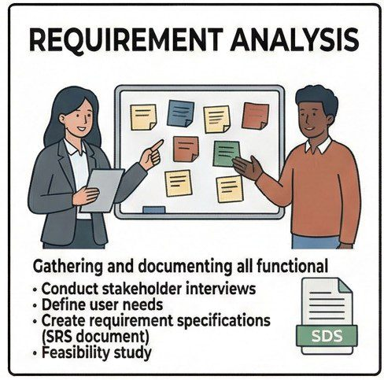

## 2. Requirements

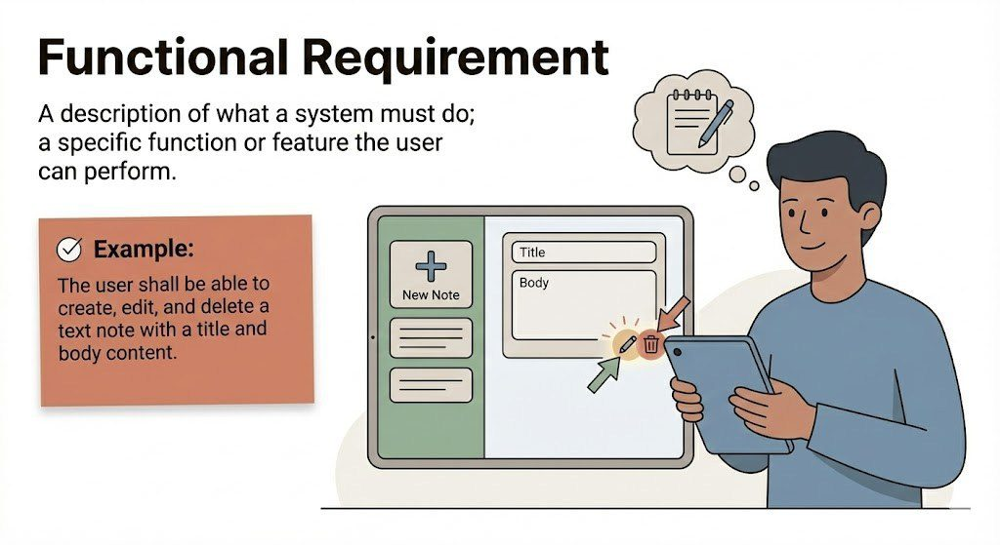

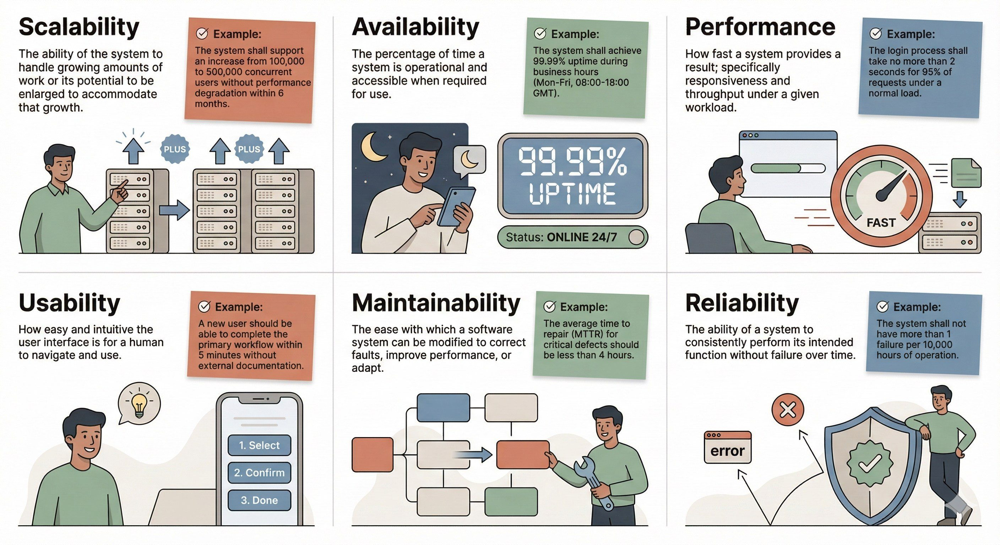

### Functional vs non-functional

- **Functional requirements** define *what* the system accomplishes (e.g., "send confirmation email on account creation", "search items by query", "manage cart before checkout", "social login", "notifications", "feedback/ratings").
- **Non-functional requirements** define *how well* it operates.

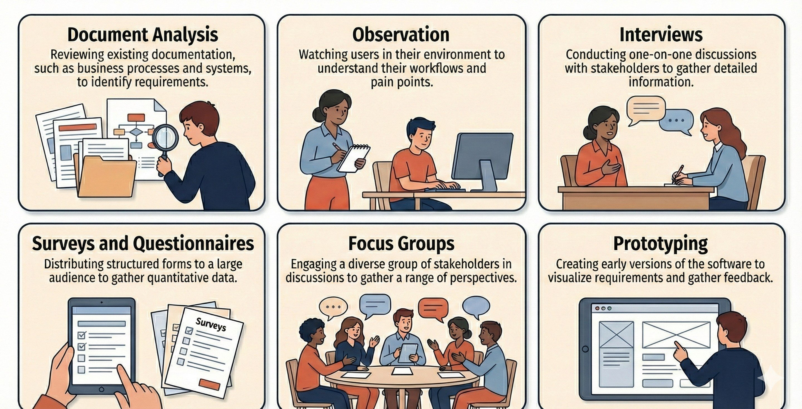

### Collecting functional requirements

| Method | Purpose |
|---|---|
| Document analysis | Review existing business processes/systems |
| Observation | Watch users in their environment (workflows, pain points) |
| Interviews | One-on-one stakeholder discussions |
| Surveys & questionnaires | Quantitative data from large audiences |
| Focus groups | Diverse stakeholder perspectives |
| Prototyping | Early versions to visualize and gather feedback |

AI can help (e.g., summarizing Zoom meetings into requirements) — but **always check the AI output for correctness, refine, and confirm with the client**.

### Requirements elicitation & management

- **Elicitation**: identify stakeholders → collect info (interviews, surveys, workshops) → document.
- **Management**: prioritization (what's essential first), change management (controlled changes, prevent scope creep), verification & validation (system meets requirements; requirements fulfill their purpose).

### Challenges & solutions

Challenges: stakeholders can't articulate needs; conflicting priorities; shifting business needs.

- **Ask better questions**: start from the problem, not the solution ("What pain point? What business value?"); open-ended process questions ("How do you currently do this? What breaks?"); challenge assumptions ("What if data is missing? Who owns this decision?"); use **5 Whys** for root causes.
- **Synthesize & resolve conflicts**: paraphrase to confirm ("So what I hear is…"); convert vague statements into testable requirements; use **MoSCoW** (Must/Should/Could/Won't).

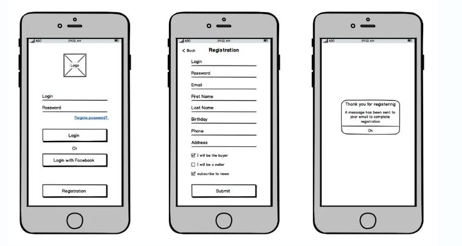

## 3. Prototyping & MVP

- **Wireframes** — low-fidelity page structure. **Mockups** — static but realistic (branding, colors, fonts). **Hi-fi prototypes** — closest to the final product; test visuals *and* user flow.
- **Types**: throwaway (quick feedback, discarded) / evolutionary (incrementally refined to final) / incremental (parts built separately, integrated at the end).
- "I can't tell you what I want, but I'll know it when I see it."

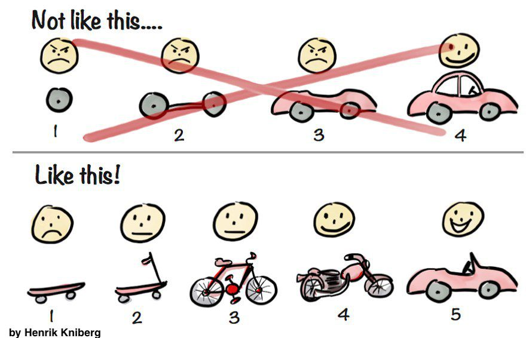

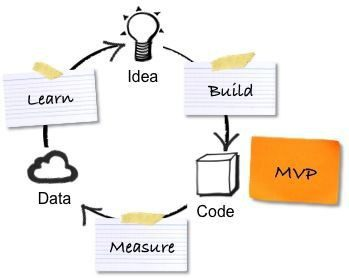

### MVP (Minimum Viable Product)

- Collect the **maximum validated learning about customers with the least effort**. Minimum = as little effort as possible; Viable = enough quality to judge whether customers will use it.
- Test the idea with real users → learn → iterate the next MVP; reduces the risk of building something not economically viable.

| Aspect | Prototype | MVP |
|---|---|---|
| Purpose | Test/visualize concept, design, UX | Deliver core functionality to users |
| Functionality | Often non-functional/limited | Fully functional core features |
| Market readiness | Not market-ready | Market-ready |
| Feedback focus | Design & feasibility | Product value & usability |
| Stage | Early, before full development | First usable launch |
| Goal | Validate design/feasibility | Validate business idea & attract users |

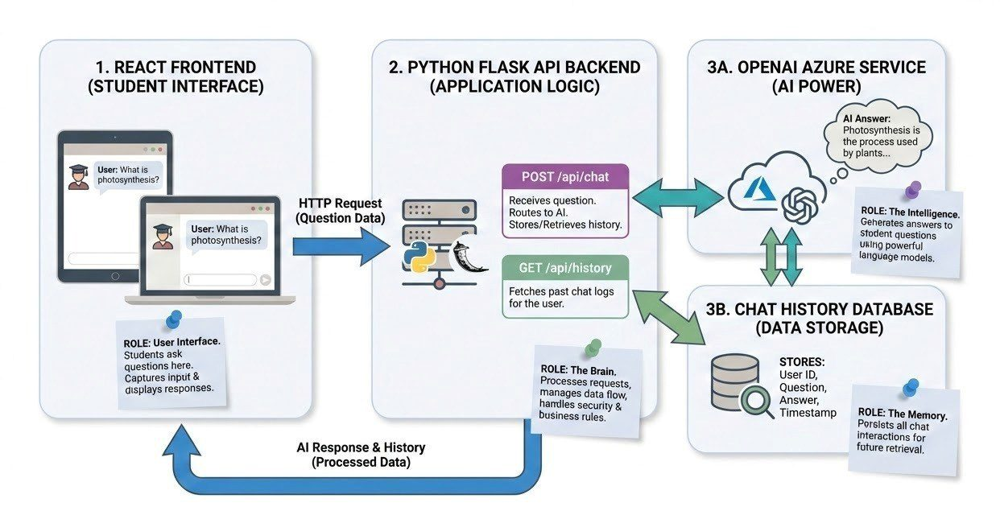

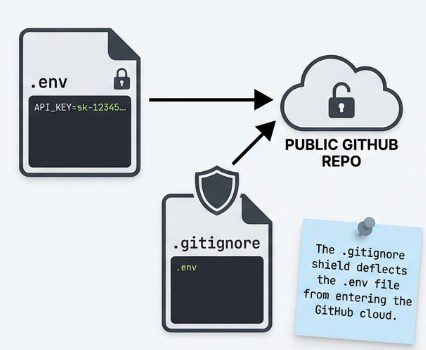

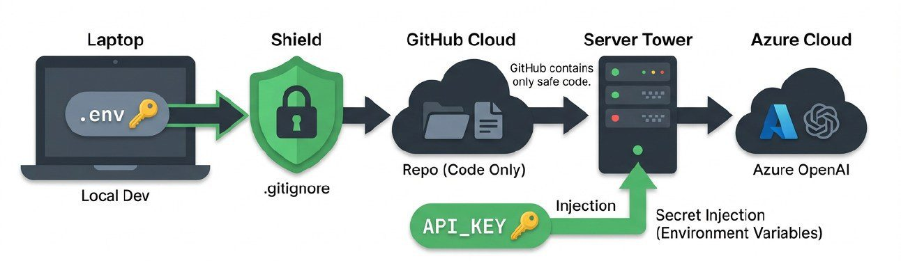

## 4. Design & implementation

- Requirements say **what**; design says **how**.
- A **system design interview** asks a candidate to architect a scalable system on a whiteboard — testing reasoning about requirements, trade-offs, component interactions.
- **Example: GenAI chat app** — Python Flask API backend (business logic, data storage/retrieval; relays questions to the AI service) + React frontend (UI; sends API requests, displays responses) + OpenAI Azure service (GenAI answers) + database (past chats).
- **Protecting API keys:**
  - Development: secrets in `.env` (local env vars); `.gitignore` excludes `.env` from version control. **Secrets must never appear in the remote repository.**
  - Production: keys stored in the platform (e.g., Vercel environment variables), injected at deployment, hidden from the public and frontend.

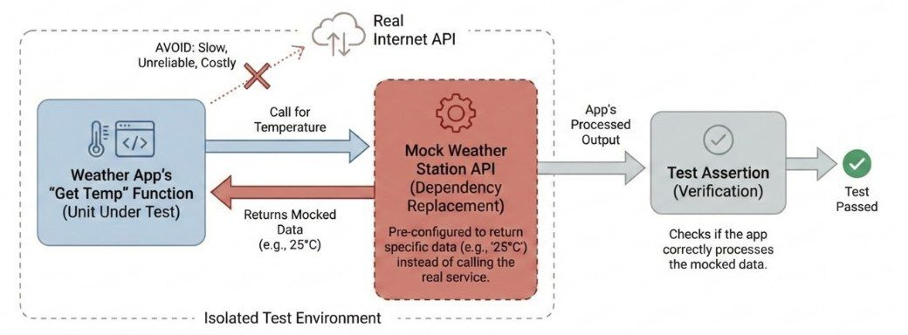

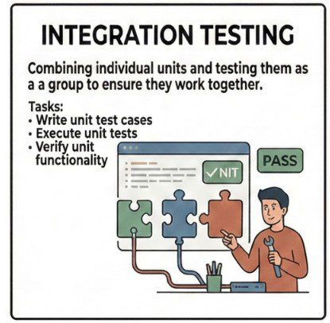

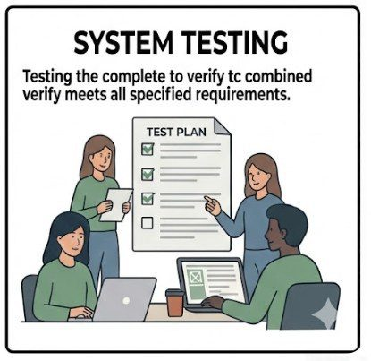

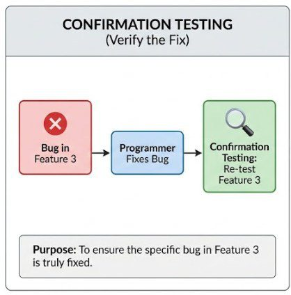

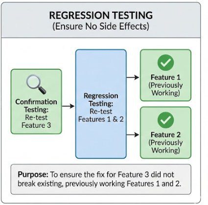

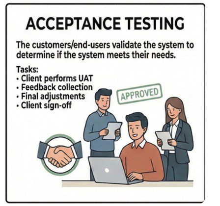

## 5. Testing phases

- **Unit testing**: individual units (functions, methods, classes) tested **in isolation** against their design spec; faults are easy to locate.
- **Integration testing**: modules combined and tested as a group — a bug-free module can still break when integrated (e.g., a caller misunderstands the interface spec).
- **System testing**: the whole system implements all requirements — functionality, robustness (recover from errors), interoperability (third-party systems), performance (throughput, response time), scalability, reliability over time, documentation usability.
- **Pull Request (PR)**: a workflow where a developer proposes merging one branch into another so teammates can review before integration.
- **Confirmation testing**: re-run test cases that failed previously to verify the fix.
- **Regression testing**: re-test after modification to ensure no previously-correct function broke. Re-run all tests (automation helps — Microsoft runs **60,000+ unit tests on every PR in under 7 minutes**) or select a subset reaching the modified code.
- **Test automation**: software controls test execution; a unit test is code that checks another piece of code works as expected (e.g., JUnit for Java).
- **Acceptance testing**: customer/end-users validate the system against acceptance criteria (functionality, performance, security).
  - **Alpha test**: at the developer's site, with developer present.
  - **Beta test**: at user sites without the developer — closest to actual use.

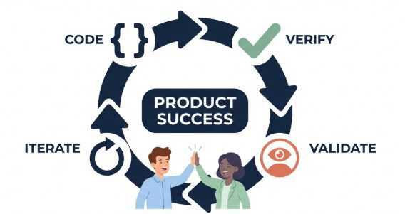

### Verification vs validation

- **Verification** — "Are we building the product **right**?" Code review, unit/integration/system testing; done by developers.
- **Validation** — "Are we building the **right** product?" Prototyping, acceptance testing, usability testing, A/B testing.
- Validation feeds **new requirements** back into the loop (feedback loop).

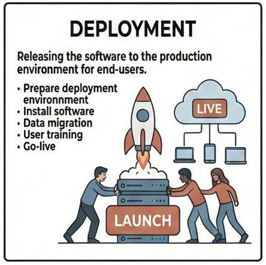

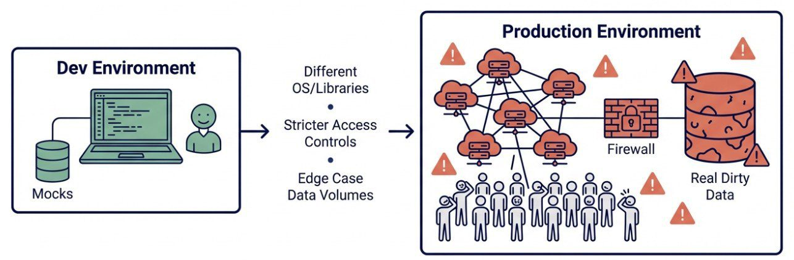

## 6. Deployment & environments

- **Dev vs production differences**: OS/library versions; production data edge cases & volumes; stricter access controls/firewalls; different resource limits; live external services behaving differently. ("Works on my machine" ≠ works for users.)

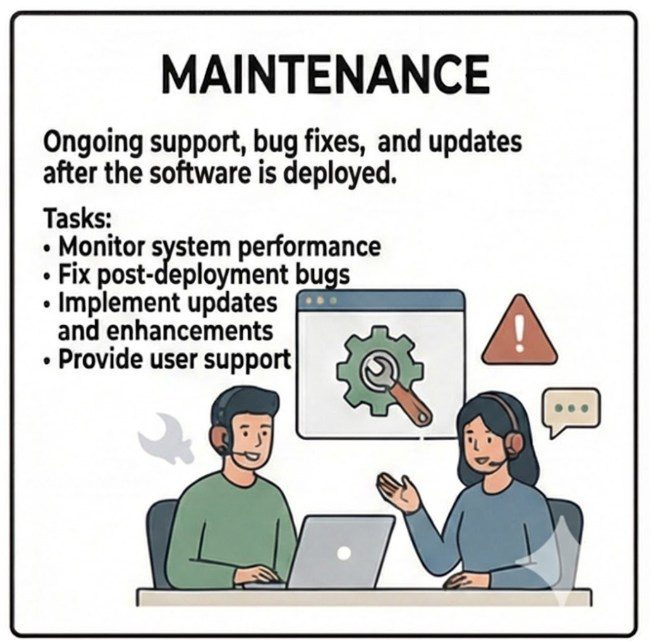

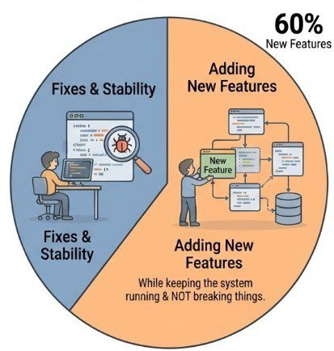

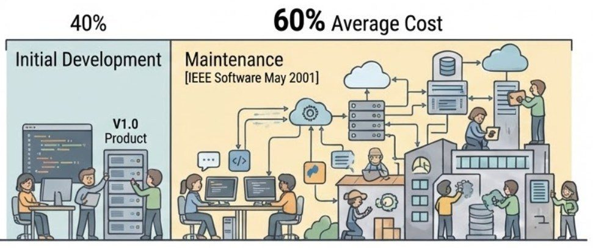

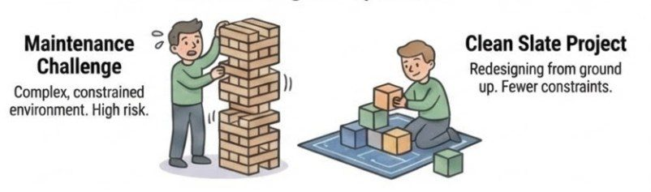

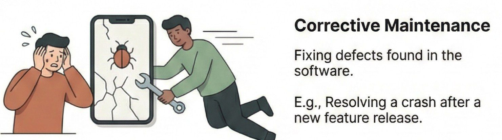

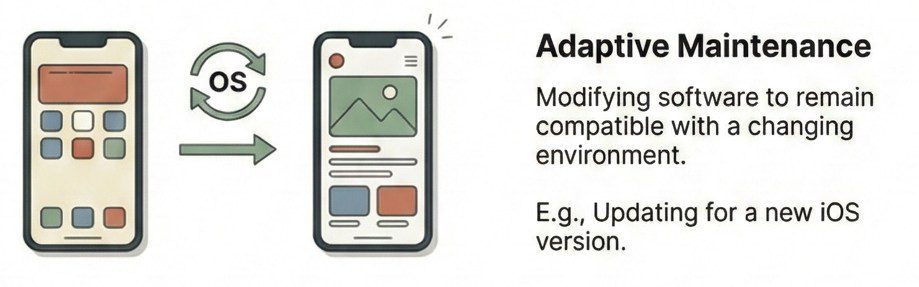

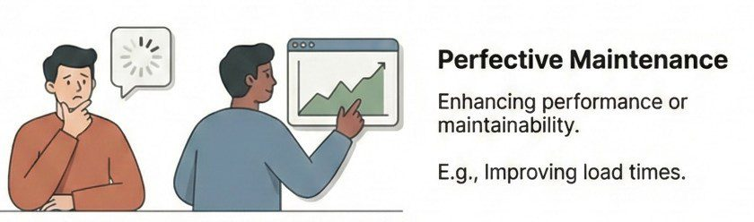

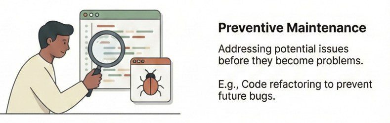

## 7. Maintenance

- Modification of a software product **after** deployment: fix production bugs, release patches, enhance performance, new versions.
- **60/60 rule** (IEEE Software, 2001): maintenance averages **60% of lifecycle cost**; ~60% of maintenance is adding new features without breaking existing ones. In clean-slate projects, maintenance is often harder than development.
- **ISO/IEC 14764:2006** maintenance types: **corrective** (fix defects), **adaptive** (stay compatible with changing environments), **perfective** (enhance performance/maintainability), **preventive** (address potential issues early).

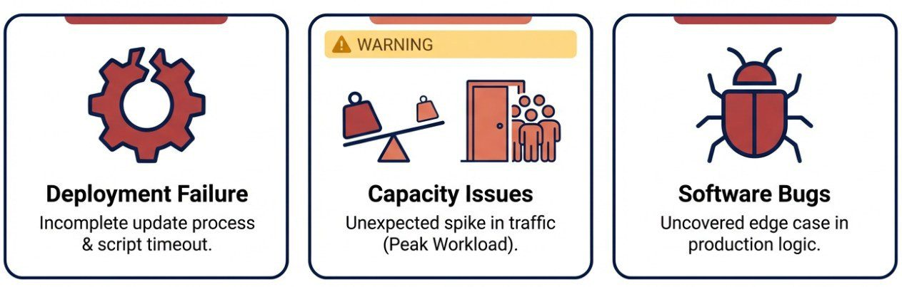

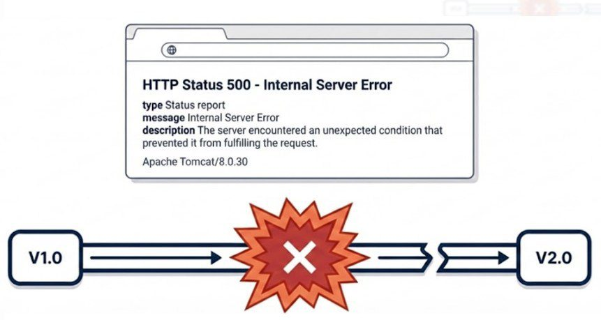

### Deployment failure case study

- 1:00 AM: new feature deployed; health checks pass.
- 3:00 AM: new inefficient queries (lacking indexes) start locking resources; response times degrade — **no alarms**.
- 10:00 AM: incident discovered — 7 hours of unnoticed degradation.
- Investigation: resource exhaustion + high latency correlates with the 1:00 AM deployment → root cause: unindexed queries.
- Mitigation: rewrite queries, add indexes; patch v1.1 tested in staging; deployed to production; **service restored at 9:00 PM**.

| Metric | Definition | This case |
|---|---|---|
| **TTD** (time to discover) | failure start → team aware | 7 hours (3 AM → 10 AM) |
| **TTM** (time to mitigate) | aware → fix verified | ~8 hours (diagnosis, patch, staging, deploy) |
| **TTR** (time to recover) | total customer impact | 18 hours (3 AM → 9 PM) |

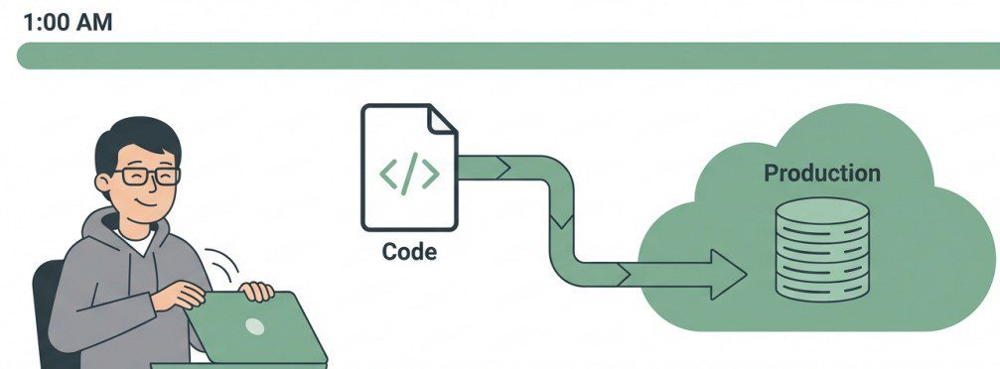

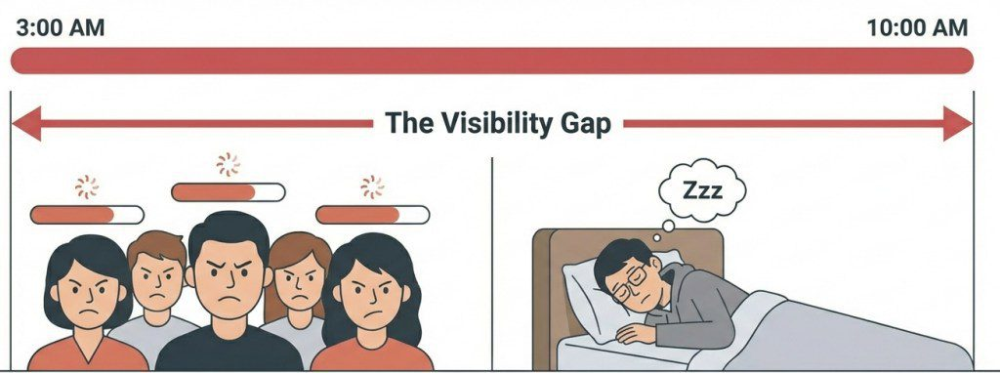

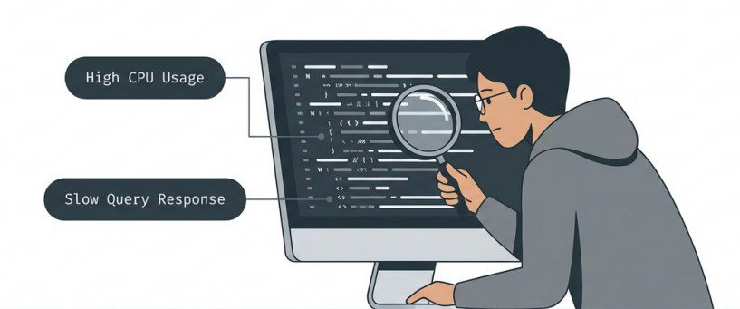

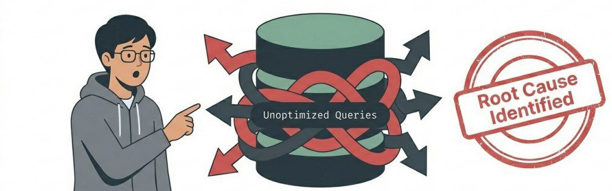

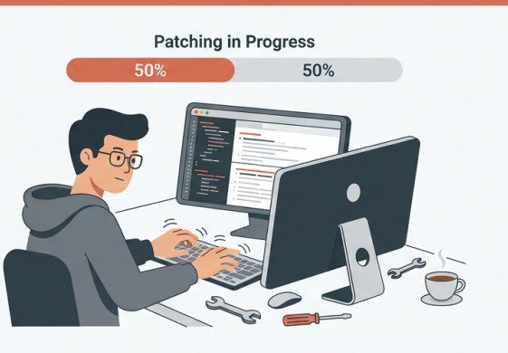

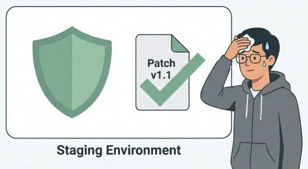

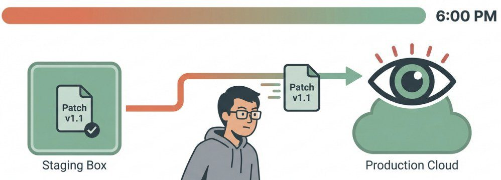

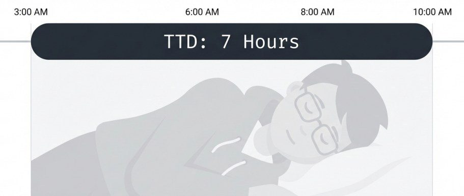

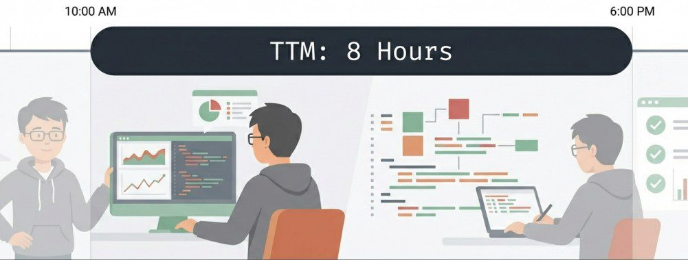

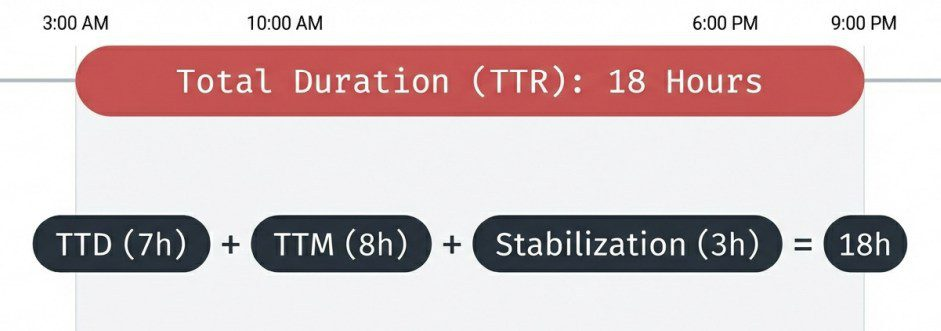

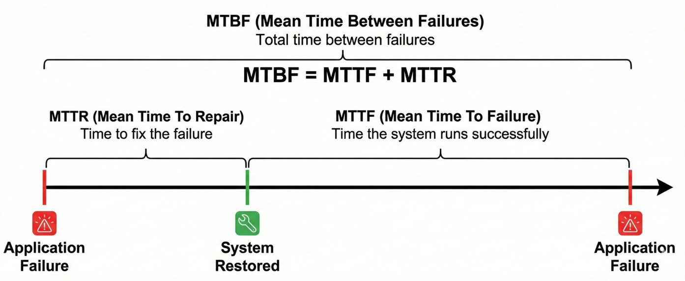

## 8. Availability

- **Availability = Uptime / (Uptime + Downtime)** = MTTF / (MTTF + MTTR). Described in "9s":

| Uptime | Downtime/week | Downtime/month | Downtime/year |
|---|---|---|---|
| 99% | 1.68 h | 7.2 h | 3.65 days |
| 99.9% | 10 min | 43.2 min | 8.76 h |
| 99.95% | 5 min | 21.6 min | 4.38 h |
| 99.99% | 1 min | 4.32 min | 52.56 min |
| 99.999% | 6 s | 26 s | 5.26 min |

- Factors affecting availability: hardware failure, network instability, software bugs, maintenance windows, security attacks (DDoS), power outages, capacity overload, configuration errors, third-party outages, poor backup/recovery.

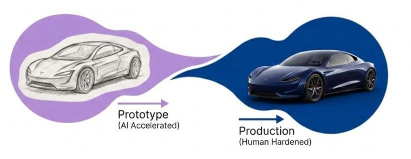

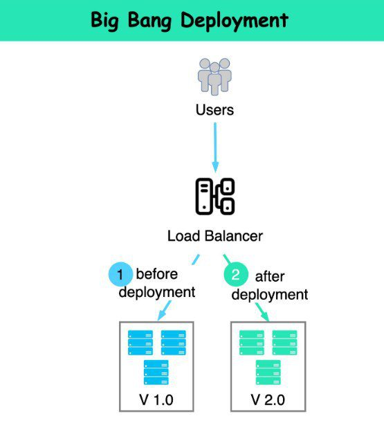

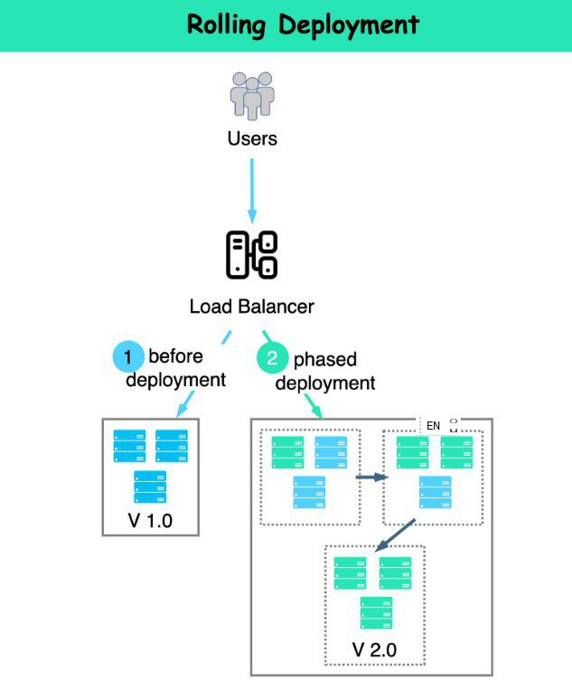

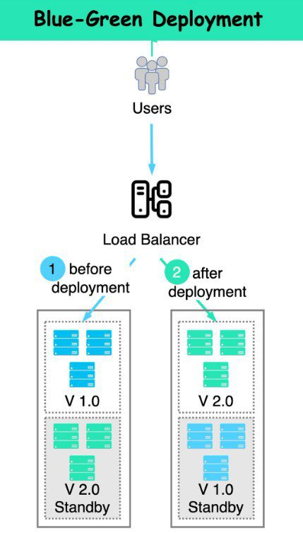

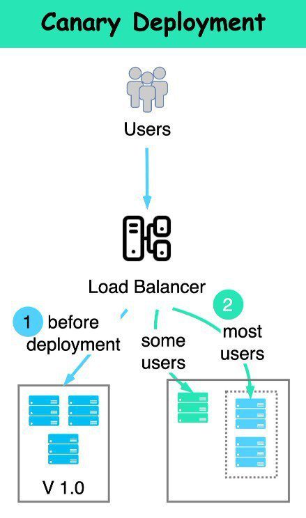

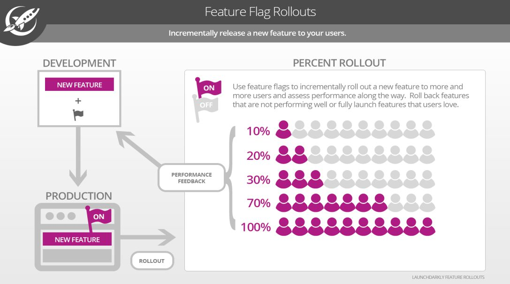

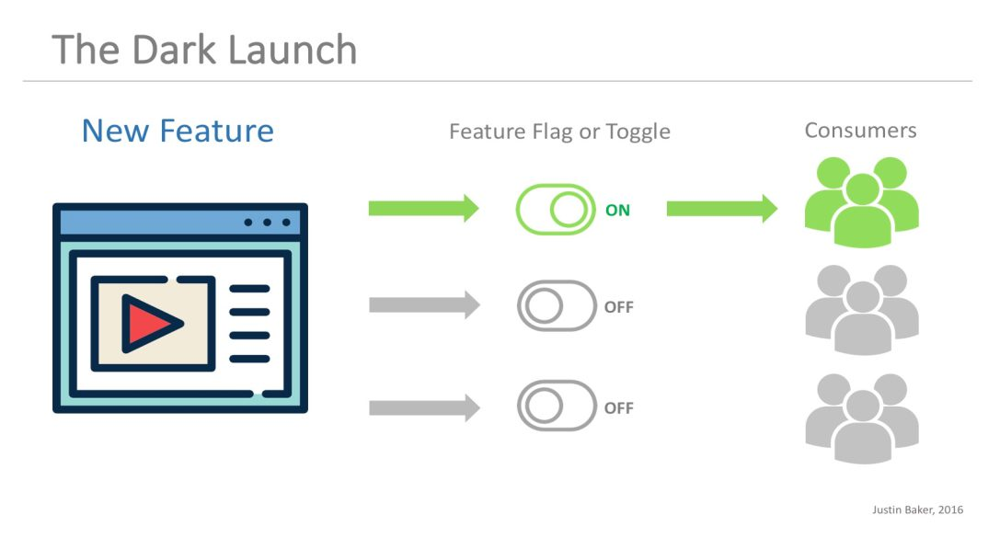

## 9. Deployment strategies

| Strategy | How it works | Trade-offs |
|---|---|---|
| **Big Bang** | Release new version in one go, with downtime; roll back if it fails | Risky for public-facing/business-critical apps; no easy rollback during downtime |
| **Rolling upgrade** | New version gradually replaces old; both coexist | Incompatible components can be rolled back |
| **Blue-Green** | Two identical environments; all traffic on Blue; deploy + test on Green; switch traffic when ready | Instant rollback by routing back to Blue |
| **Canary** | Upgrade a small subset of instances; route a slice of users to them; expand if no errors | Lowest blast radius for a new version |
| **Feature flags** | Toggle feature visibility/activation **without deploying new code** | Decouples release from rollout |

### How big tech ships code

1. Git commits during development (every change tracked).
2. **CI/CD** (e.g., CircleCI) takes over on commit: build, unit tests, quality checks.
3. Code moves to **QA environments** for regression & performance checks.
4. Production rollout via feature toggles, canary deployments, A/B testing.
5. **Monitoring & reliability**: SREs use Prometheus, Datadog, etc., to watch performance and resolve issues live.

## 10. Key takeaways

- Requirements quality drives everything downstream; use elicitation techniques, MoSCoW, and 5 Whys.
- Prototype to validate design; MVP to validate the business idea.
- Verification = product right; validation = right product.
- Bugs found early are far cheaper; test in layers (unit → integration → system → acceptance).
- Deployment is a risk-management exercise: choose the strategy by criticality and need for rollback.
- Maintenance dominates lifecycle cost (60/60) — design for it.
- Production is its own environment: expect different data, limits, and dependencies.
