# Software Testing Overview

---

## 1. What is software testing

An **investigation conducted to provide stakeholders with information about the quality** of the product under test. Quality facets: meets user needs, conformance to requirements, free of errors/failures, fitness of use, customer satisfaction, willingness to pay.

### Three basic test styles (LLM document app examples)

- **Happy path** — intended workflow with valid inputs: user uploads a supported `.pdf` within size limits; app parses and sends it to the LLM successfully.
- **Edge cases** — extreme but valid boundary inputs:
  - PDF exactly at Supabase's max file size; very long filename; document hitting the LLM's max context window; rapid repeated "Summarize" clicks; navigating away mid-upload and returning.
  - Related API errors: `200 OK`, `400 Bad Request` (content filter / invalid request), `429 Too Many Requests` (rate limit), `500 Internal Server Error`.
- **Negative testing** — invalid inputs & error conditions the system should reject or handle gracefully: unsupported file types (`.exe`, `.mp4`, `.zip`), corrupted PDFs, oversized files, LLM API exceptions, repeated rapid submissions to the summary endpoint.

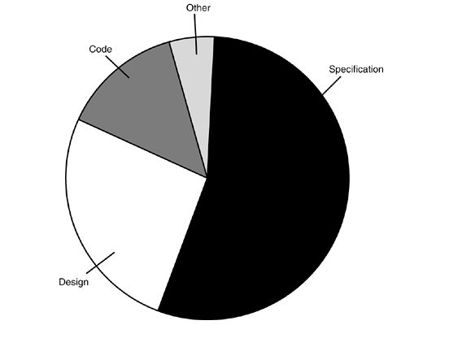

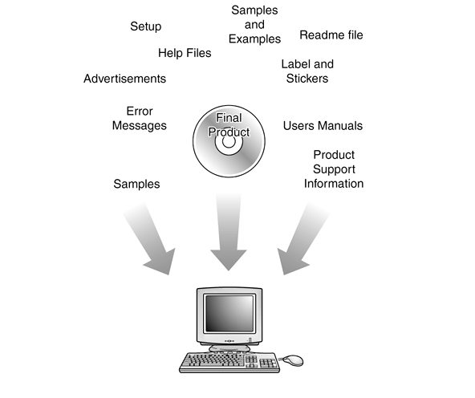

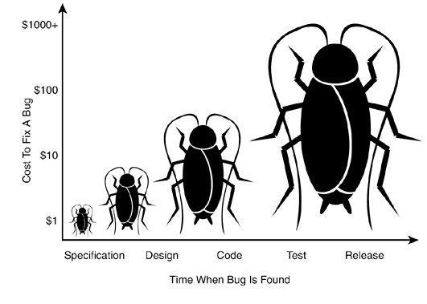

## 2. Defects, testing types, cost

- Studies show the **main cause of software defects is specification and design** — not coding.
- **Dynamic testing** — run the program with test cases to detect defects.
- **Static testing** — testing something that is **not running**: review code and documents (requirement spec, design, user manual, test plan, test cases) to locate errors. (Non-software pieces can have bugs too.)
- **Cost to fix bugs rises the later they are found** — find defects early.

### Verifiable (testable) requirements

> A requirement is verifiable iff there exists some finite, cost-effective process by which a person or machine can check that the product meets it.

- Non-verifiable: "works well", "user friendly", "shall usually happen".
- Testable NFR example: ~~"easy to use by medical staff"~~ → *"Medical staff shall be able to use all system functions after four hours of training; afterwards, experienced users' average errors shall not exceed two per hour of use."*

### Defect Removal Efficiency (DRE)

- A good testing process **increases defects found by testers and decreases those found by customers**, and detects defects as early as possible.
- **DRE = (defects detected and removed) / (total defects)**, where total = defects found in development + defects reported in the **first year after release**.
- Example: 1000 found during development + 100 reported in year one → total 1100.
- **Exercise**: Team A finds 30 in testing / 70 by users (DRE ≈ 30%); Team B finds 20 / 30 (DRE ≈ 40%) → **B is more effective** despite fewer total finds.
- Every phase can inject *and* remove defects; testing is mainly for removal — and fixing defects incorrectly can introduce new ones.

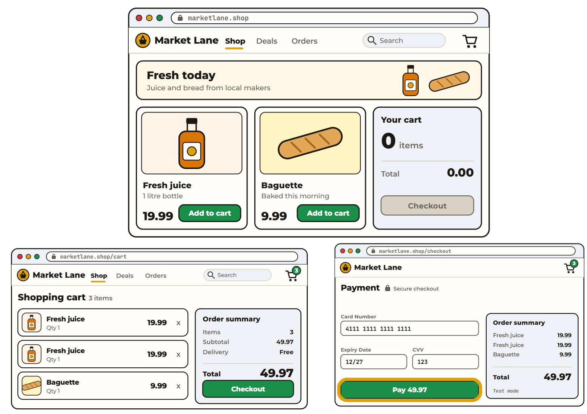

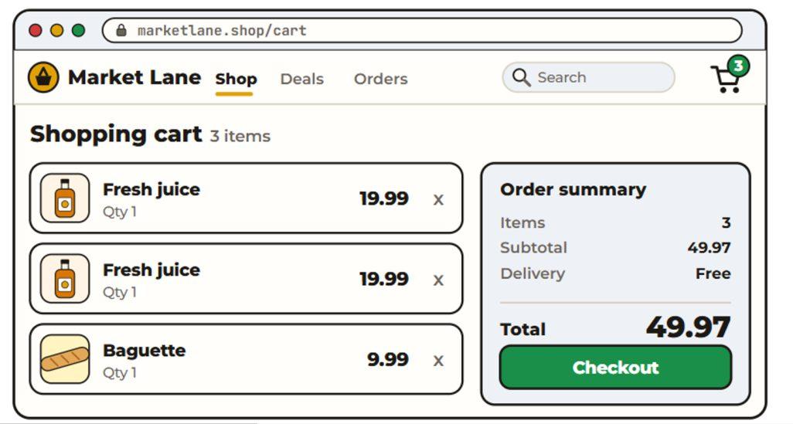

## 3. Manual vs automated testing

### Manual testing

A human executes test cases by hand (e.g., cart example: add 2× $19.99 + 1× $9.99 → verify "3 items" and "$49.97").

| Strengths | Weaknesses |
|---|---|
| Usability testing (intuitive interface) | Time-consuming |
| Visual validation (layout, colors, responsiveness) | Error-prone (human calculation mistakes) |
| Exploratory testing (unexpected bugs) | Not repeatable (testers execute differently) |
| Overall UX feel & flow | |

### Automated testing

Software controls test execution. Agile short cycles make manual regression nearly impossible. **Layers** (fast/cheap → slow/expensive): **unit tests → service-layer tests → UI tests**.

Ways to write automated tests: **hand-scripted** (write test code), **recorded** (tools capture UI interactions for replay), **GenAI-assisted** (e.g., GitHub Copilot).

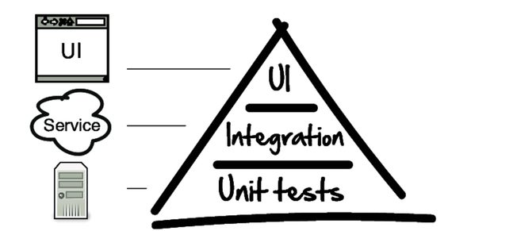

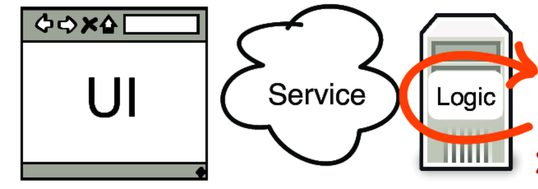


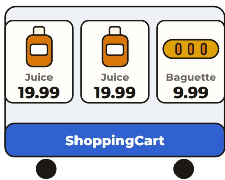

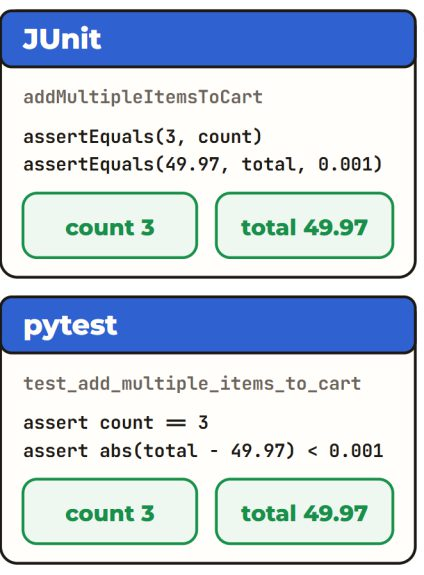

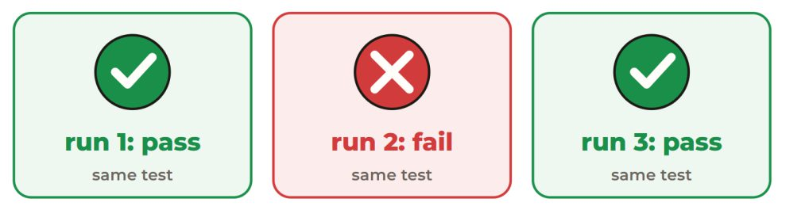

## 4. Unit testing

- A code-based test verifying a small, isolated unit (single function/method). Frameworks: **pytest** (Python), **JUnit** (Java), **Jest/Mocha** (JS).
- **Assertion** = a statement checking a condition is true; false → test fails.
- Example (cart: 2× $19.99 + 1× $9.99):

```java
// JUnit — Arrange / Act / Assert
ShoppingCart cart = new ShoppingCart();
cart.addItem(2, 19.99);
cart.addItem(1, 9.99);
assertEquals(3, cart.getItemsCount(), "Cart should have 3 items after adding.");
assertEquals(49.97, cart.getTotalAmount(), 0.001, "Total amount should be 49.97");
```

```python
# pytest — same test
cart = ShoppingCart()
cart.add_item(2, 19.99)
cart.add_item(1, 9.99)
assert cart.get_items_count() == 3, "Cart should have 3 items after adding."
assert abs(cart.get_total_amount() - 49.97) < 0.001, "Total amount should be 49.97"
```

- **AAA pattern**: **Arrange** (set up objects, dependencies, inputs) → **Act** (execute the unit under test) → **Assert** (verify actual vs expected).
- **Dependencies & flaky tests**: waiting on IO/external services kills test velocity; tests depending on live services/DBs/networks fail intermittently → **flaky test** = inconsistent results with no code change.
- **Mock** — a simulated object mimicking a real dependency: control return values, simulate errors, without touching real external systems.

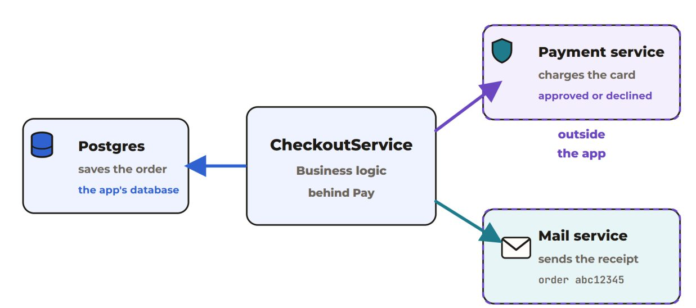

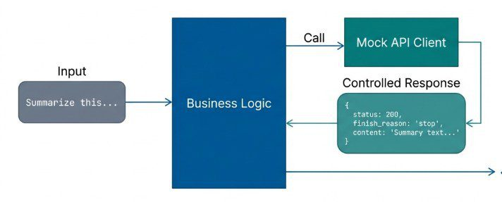

## 5. Integration testing

- Verify multiple components work together: REST API endpoints, business logic, database.
- HTTP is the web's request/response protocol; a REST API exchanges data via HTTP methods (GET, POST, PUT, DELETE).
- **Mocking**: the API runs real business logic against the app's own database, but **external services (e.g., the payment provider) are mocked** because the app doesn't control them.

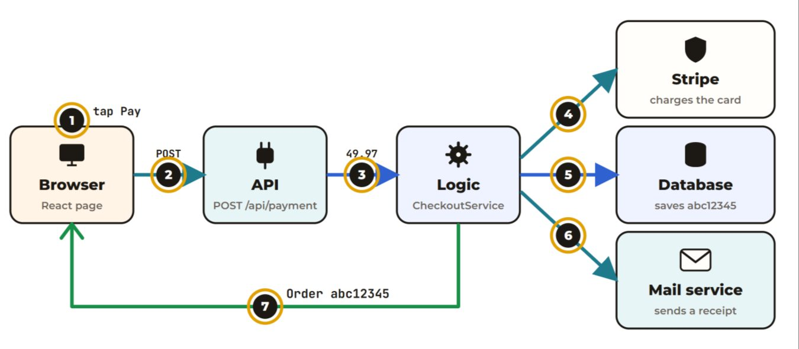

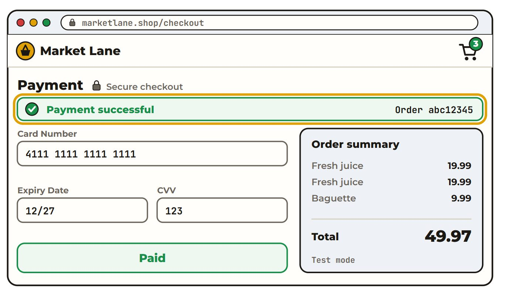

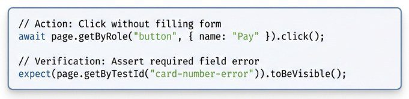

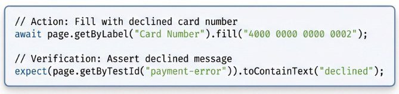

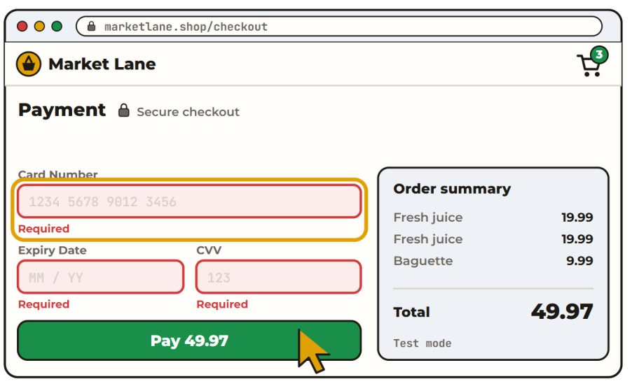

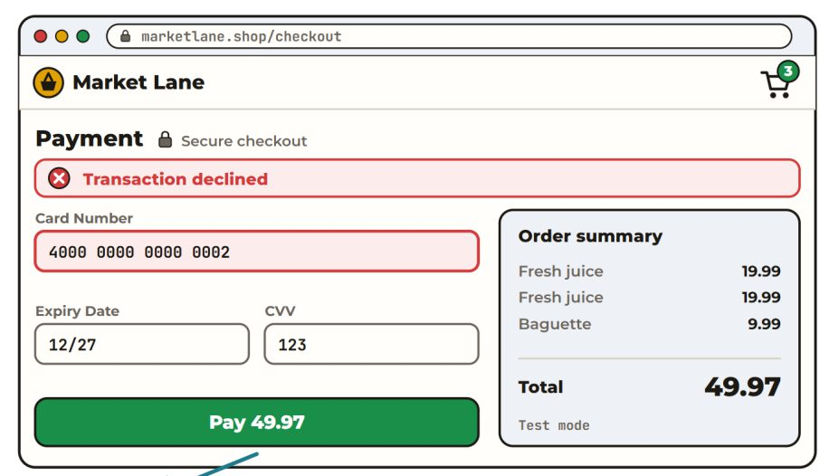

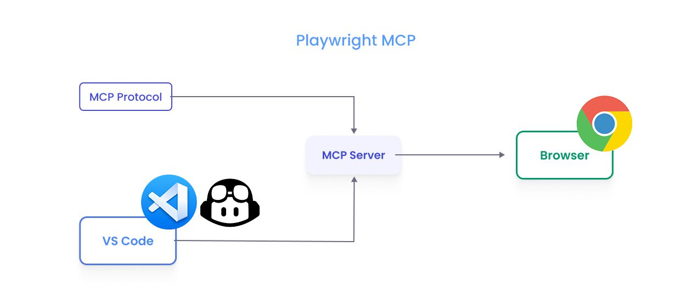

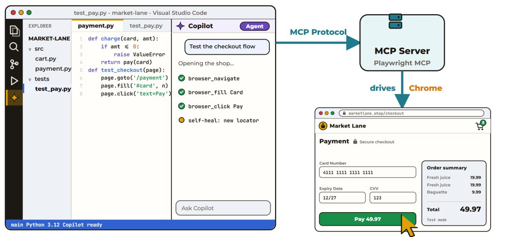

## 6. UI / end-to-end testing with Playwright

- **UI tests** generate UI events (keystrokes, clicks) and observe results; **E2E** tests full user flows in a real browser.
- **Playwright** (Microsoft, open source): drives real browsers (Chromium, Firefox, WebKit).
  - **Semantic locators** — find elements by how users perceive them ("the box labeled 'Card Number'", "the button that says 'Pay'").
  - **Auto-waiting** — `expect` assertions retry until timeout.
  - **Happy path**: fill payment form → API validates/charges Stripe → assert success message + Order ID (proves backend processed it).
  - **Unhappy paths**: empty form → required-field errors; declined card number → UI handles the API error gracefully without crashing.
  - **Mobile layout**: resize the viewport programmatically; check responsive form, no cut-off buttons.
  - **Headed** (watch the test for debugging) vs **headless** (no window; ideal for fast CI/CD).
- **Playwright + MCP** (Model Context Protocol): an open protocol linking LLM apps to external tools/services — lets an AI agent control the browser with natural language instead of writing a new script per step.
- **Exercise**: `git clone https://github.com/HKPolyUSE/playwright_testing`; configure `@playwright/mcp` MCP server in the IDE; run the login-helper example (`doLogin` with `getByRole` locators).

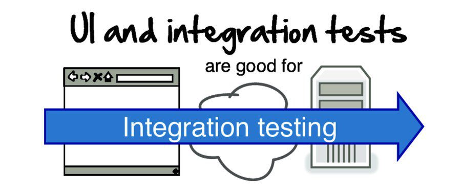

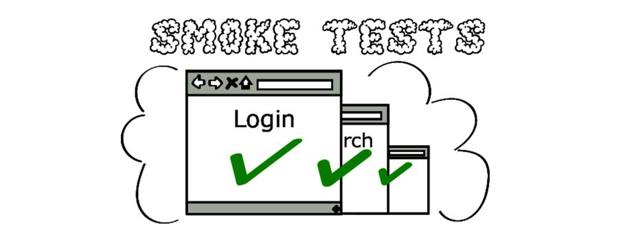

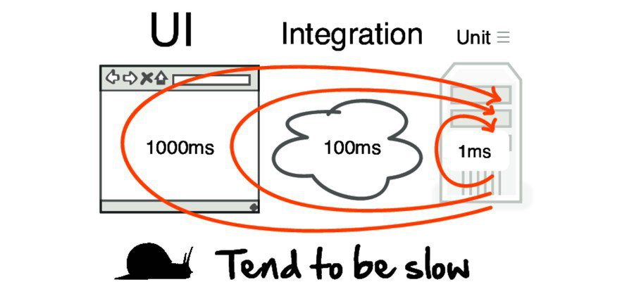

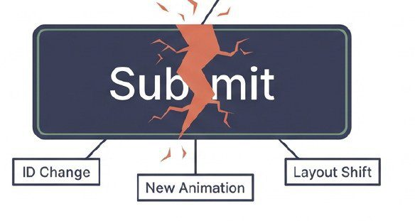

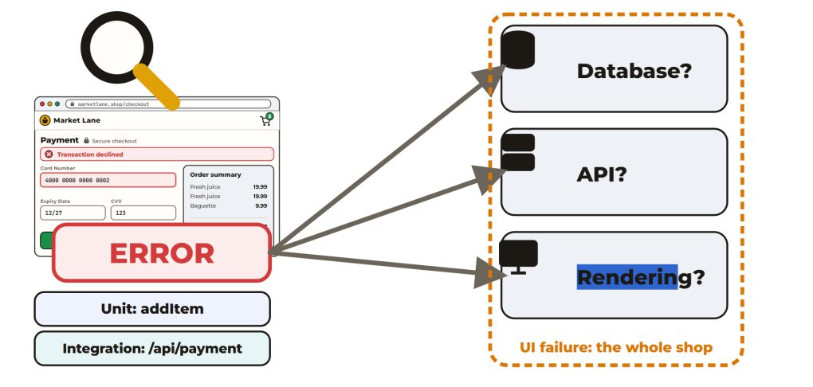

### UI test trade-offs

| Advantages | Limitations |
|---|---|
| Always automatable | Orders of magnitude slower than unit tests |
| End-to-end coverage (UI → services → DB) | Brittle: a label rename ("Submit"→"Confirm") breaks hard-coded selectors |
| Great for high-level **smoke tests** (is the system up, deployed, connected?) | An E2E failure says *something* is wrong, rarely *where* |

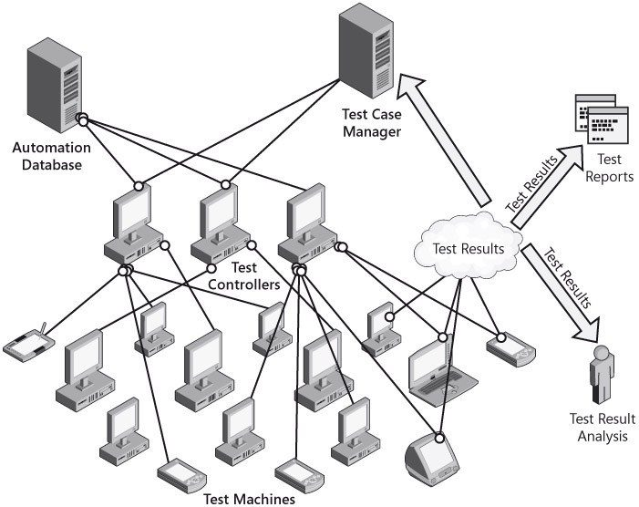

### Benefits of automation overall

**Fast** (load testing, massive random testing), **reliable** (identical operations every run, no human error), **repeatable** (regression testing).

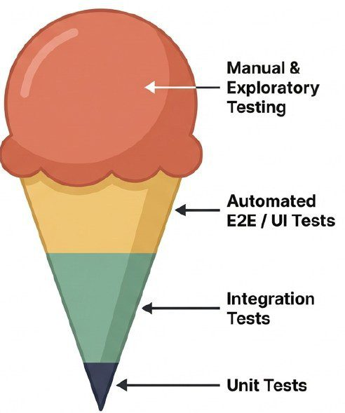

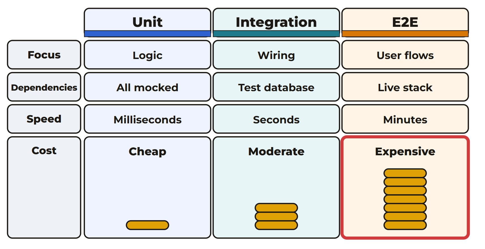

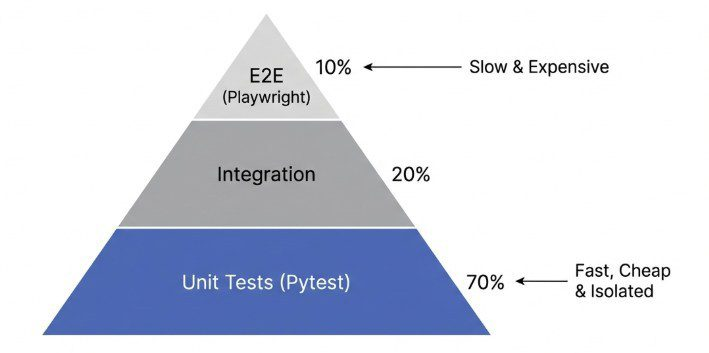

## 7. Test shape: pyramid vs cone

- **Ice cream cone (anti-pattern)**: mostly manual testing + automation at the UI level; automation just mimics slow manual processes.
- **Test pyramid**:
  - **Unit tests** (base) — isolated functions/methods; cheap, milliseconds, instant feedback.
  - **Integration tests** (middle) — components/services together: API endpoints, DB operations, service communication.
  - **UI/E2E tests** (top) — complete user journeys through the UI.

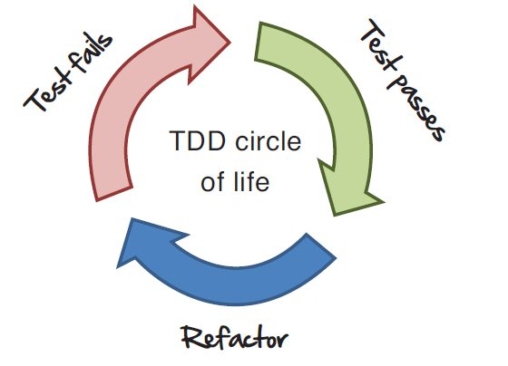

## 8. Test-driven development (TDD)

- Normal flow: develop → write tests → run tests.
- **TDD cycle**: write a **failing** test → run it (it fails) → write the minimum code to pass → run it → **refactor** → repeat (Red–Green–Refactor).
- **"Test first"** is about design: forces you to think through requirements, design the API/interface, and decide how the code will be used. Well-written unit tests become a **working specification** and a significant part of your technical documentation.
- **Just enough code**: the failing test marks the gap; write only what makes it pass (implementation may be suboptimal — refactor later).
- **Refactoring**: improve the design without changing external behaviour.
- **Advantages**: tests define a contract for correct behaviour; automated tests run on every check-in; the team ships features without fearing unintended changes. Bonus: **constraints on AI** — tests limit AI modifications to those that pass all existing cases, preventing unwanted changes to correct functionality.

## 9. Usability testing

- Tests how easily users can use the interface, on real users. **Five components** (Nielsen): **Learnability, Efficiency, Memorability, Errors (count/severity/recovery), Satisfaction**.
- **Improving usability**: test with representative users on realistic tasks; **observe** where they pause, err, get confused (don't rely on impressions); fix the biggest problems first; re-test; iterate across all five components.
- **Guerrilla user testing** — low-cost, "out in the wild" testing.
- **Conducting a session**: system ready on the start page; facilitator gives tasks; ask about thought process; note suggestions; let developers/designers observe; exit interview (likes/dislikes, suggestions); produce a **final report** (effectiveness, efficiency, task time, errors, satisfaction).
- **Test subjects**: identify & recruit (schedule, location, facilitator, note-taker); **incentives** (free lunch, gift certificates) improve attendance.
- **Usability labs**: simple single-room setup → electronic observation room.
- **Think-aloud**: participants narrate their thinking continuously; listen for what they're doing/looking for/finding hard; gentle prompts ("What are you thinking now?").
- **Test designs**:
  - **Between-subjects (independent groups)** — each part tested by unique users; mitigates **learning transfer** (using interface A makes B seem easier), which can mask problems.
  - **Within-subjects** — each subject tests all modules; use **counterbalancing** (randomize/balance task order) + breaks between sessions.
- **Data collected**:
  - *Performance*: task completion time, % completed correctly (with/without prompts), error counts, error-recovery time, manual accesses, negative comments.
  - *Ratings + rationale*: usefulness, expectation match, ease of use/learning/setup/accessibility, help quality.
  - *Preferences + rationale*: this prototype vs another, vs a competitor, vs the old conceptual model.

## 10. Key takeaways

- Test what users do (happy path), the boundaries (edge), and the failures (negative) — all three.
- Most defects originate in specs/design → static testing (reviews) early is the cheapest defect removal.
- Requirements must be verifiable; measure your process with DRE.
- Automate in pyramid shape: many fast unit tests, fewer integration tests, fewest E2E tests.
- Mock external dependencies to keep tests fast and stable; avoid flaky tests.
- TDD turns tests into a living specification — and a guardrail for AI-generated changes.
- Usability is measured, not assumed: observe real users, think-aloud, and report evidence.
