# Colaboración y Control de Versiones en el Desarrollo de Software

---

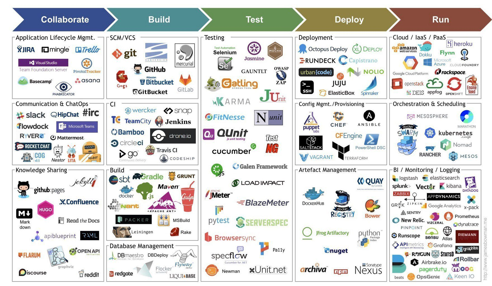

## 1. ¿Por qué el control de versiones?

Sin él, el código se acumula como un montón de archivos `final`, `final_v2`, `FINAL_real` (cómico "Piled Higher and Deeper" de Jorge Cham). El control de versiones te da historia, colaboración y red de seguridad.

## 2. Git y GitHub

- **Git**: sistema de control de versiones que te deja gestionar y rastrear la historia del código fuente.
- **Repositorio**: contenedor de todo tu proyecto; todas las carpetas y archivos dentro de él pertenecen a ese repositorio. Es donde ocurre el trabajo del proyecto: todos los archivos del proyecto y su historia de revisiones. Puedes trabajar solo o invitar a otros a colaborar.
- **GitHub**: servicio de alojamiento en la nube para gestionar repositorios Git.

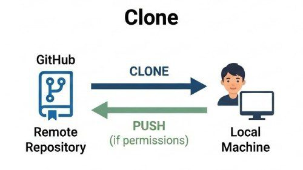

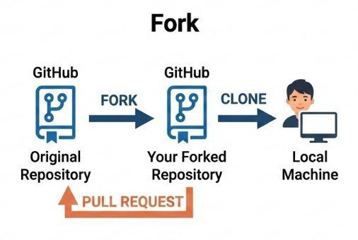

### Clone vs fork

- **Clonar**: crear una copia local en tu máquina para desarrollo; baja todos los datos del repositorio que GitHub tiene en ese momento, incluyendo todas las versiones de cada archivo y carpeta.
- **Fork**: crear una copia personal del repositorio en GitHub; desarrollas en tu fork y envías cambios al repositorio original vía pull request. Muy popular al contribuir a proyectos open source.

### Comandos esenciales

| Comando | Propósito |
|---|---|
| `git clone` | Clona un repositorio existente, creando una copia local con su historia |
| `git init` | Convierte el directorio local actual en un nuevo repositorio Git vacío |
| `git add` | Mueve cambios del directorio de trabajo al área de staging |
| `git commit` | Commitea los cambios del área de staging al repositorio local |
| `git push` | Empuja los commits locales al repositorio remoto, sincronizándolos |
| `git pull` | Obtiene actualizaciones del remoto hacia el local |
| `git fetch` | Recupera las últimas actualizaciones del repositorio remoto |
| `git merge` | Integra las actualizaciones obtenidas en la rama actual |
| `git checkout` | Cambia de rama o restaura archivos de commits/ramas distintas |
| `git branch` | Lista/crea ramas |
| `git log` | Muestra la historia de commits (mensajes, autores, timestamps) |
| `git status` | Muestra el estado actual del repositorio: cambios e información de rama |
| `git diff` | Muestra diferencias entre ramas/commits |

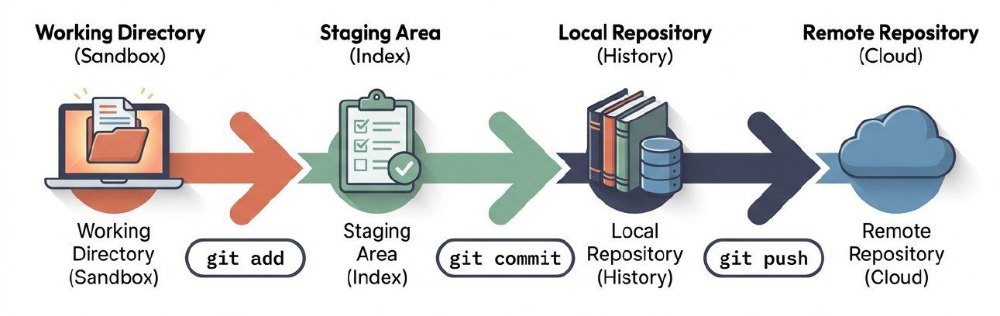

### Las tres zonas

1. **Directorio de trabajo**: la carpeta real del filesystem donde creas, editas y borras archivos.
2. **Área de staging**: la "punta de carga", el punto intermedio entre tu espacio de trabajo y tu historia permanente.
3. **Repositorio local**: los registros permanentes de tu proyecto en puntos específicos del tiempo, en tu computadora local.

- **Commit**: snapshot permanente que mueve archivos del área de staging al repositorio local; `git commit` le asigna una ID única y lo guarda en la historia del proyecto; `git log` muestra esa historia.
- **Push**: sube los commits locales de la rama actual (main) al servidor remoto (origin/main).
- **Branching**: líneas de desarrollo separadas que nacen del código base principal (rama *master* o *main*); aíslan el trabajo de features y fixes hasta que estén completas.
- **Merge**: al terminar el trabajo de una rama, `git merge` lo integra de vuelta a main, combinando las historias de ambas ramas; crea un **nuevo commit con dos padres** cuyo snapshot contiene todo el trabajo de ambas ramas.

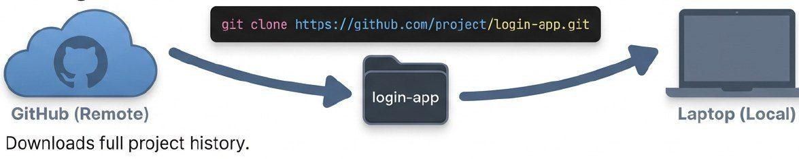

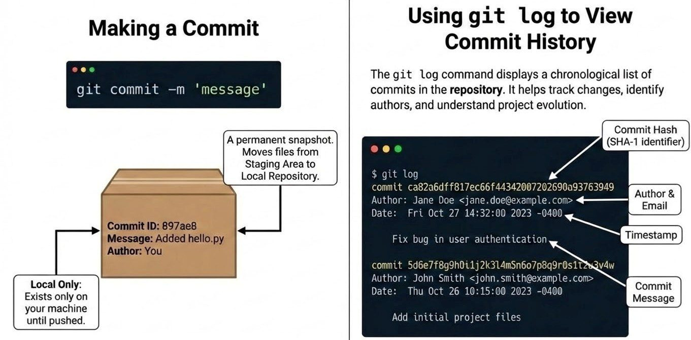

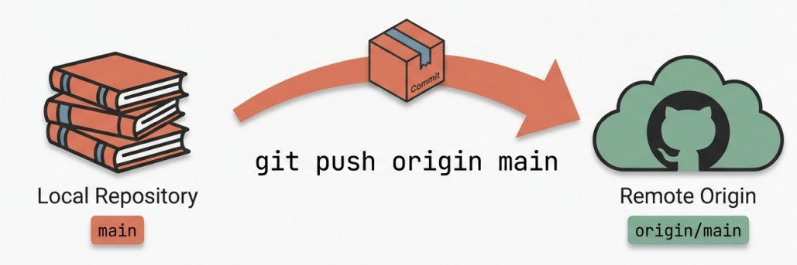

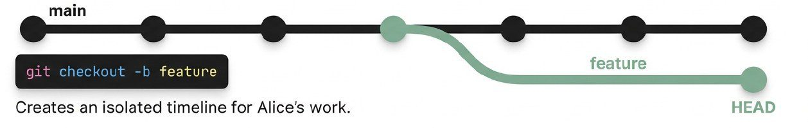

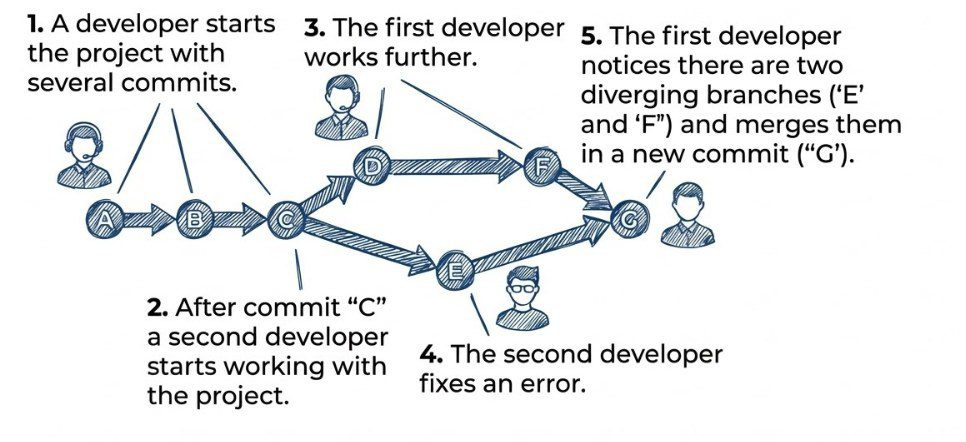

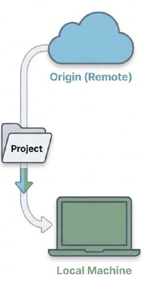

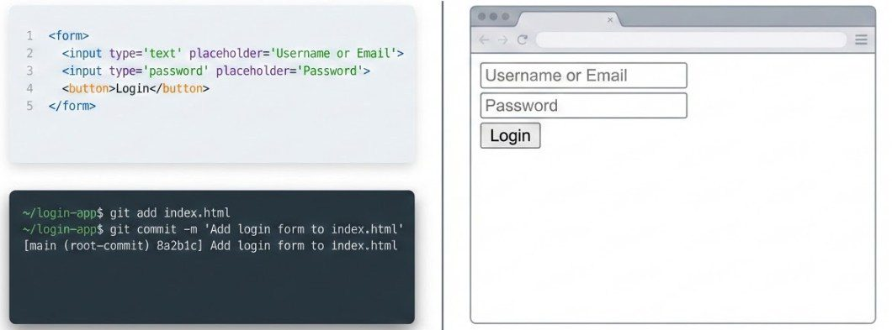

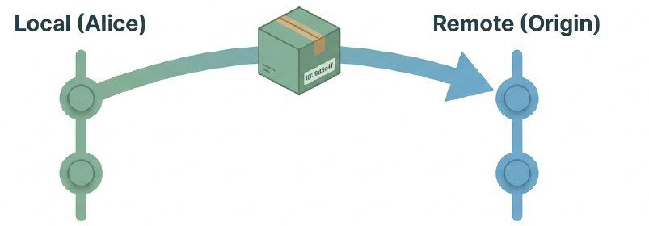

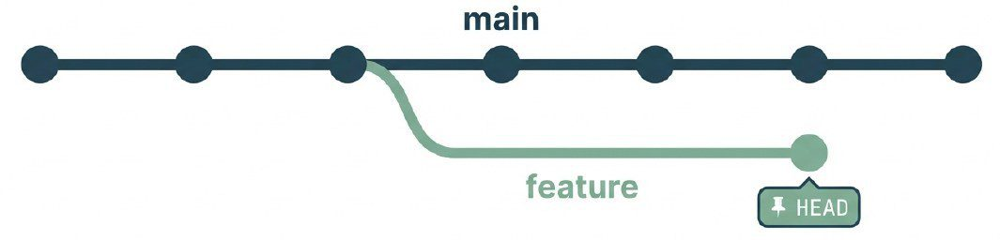

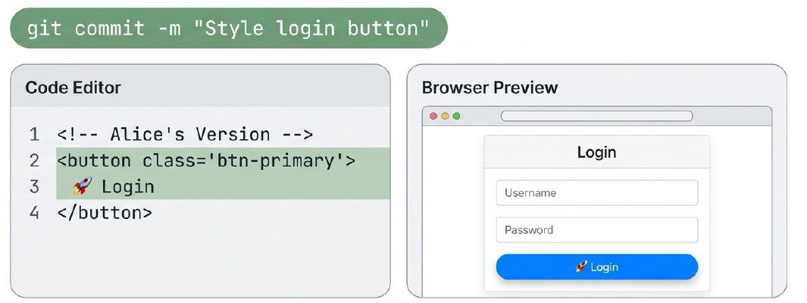

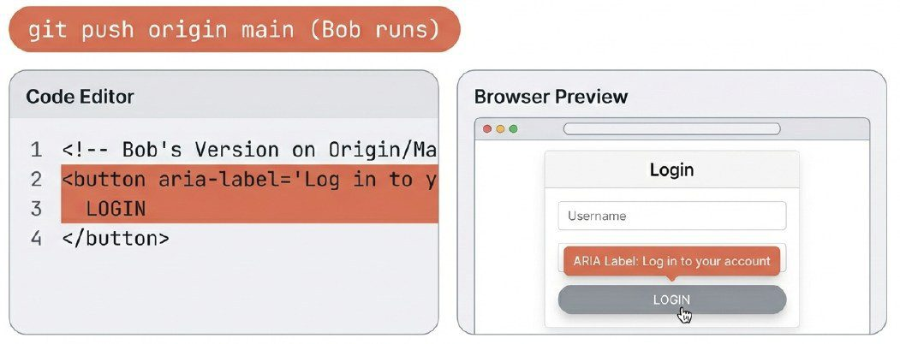

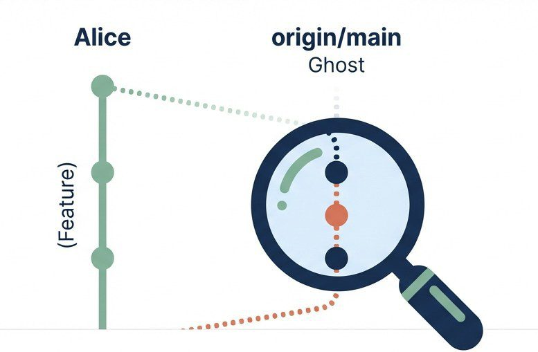

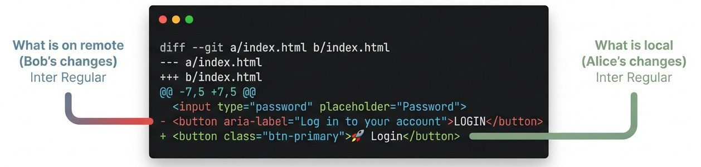

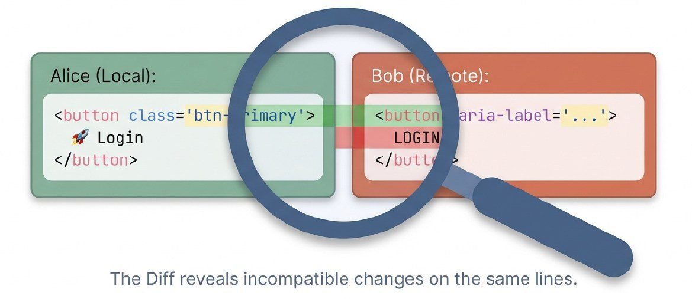

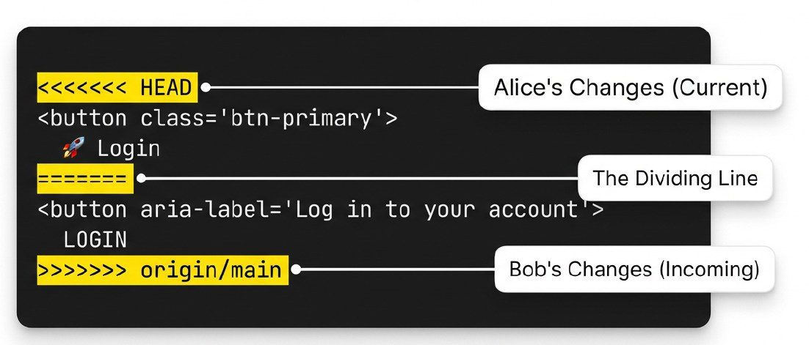

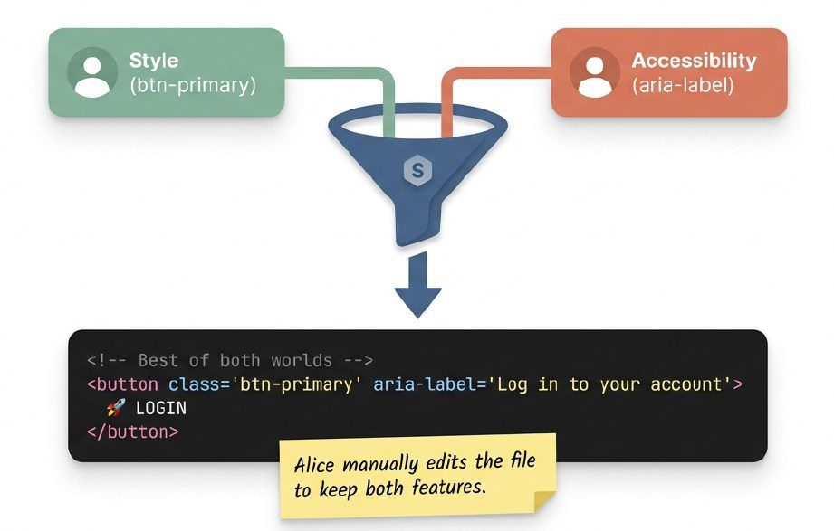

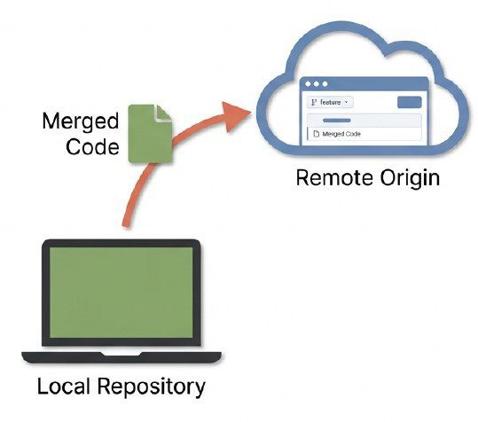

## 3. Recorrido del escenario (Alice & Bob)

1. `git clone https://github.com/project/login-app.git` — descarga el repositorio y su historia completa; conecta automáticamente tu carpeta local con *origin* (GitHub).
2. Alice crea un formulario de login: `git add index.html` → `git commit -m 'Add login form to index.html'`.
3. Sincronización: `git push origin main` — los commits de la rama local de Alice van al servidor; origin ahora coincide con la historia local de Alice.
4. Alice crea una rama de feature: `git checkout -b feature` (crea la rama y cambia a ella de inmediato). `git branch` lista las ramas.
5. Alice pule la UI (estilos CSS del botón, icono) y commitea localmente.
6. Mientras tanto, **Bob empuja cambios al main remoto**: agregó atributos de accesibilidad (el atributo `aria-label` da etiquetas más descriptivas para lectores de pantalla) y capitalizó el texto.
7. `git fetch` — actualiza tu conocimiento del repositorio remoto (descarga los commits de Bob) **sin tocar tus archivos de trabajo aún**. `origin/main` es una **rama de seguimiento remoto** (*remote-tracking branch*): referencia a una rama en el repositorio remoto; tras clonar, git nombra al repositorio "origin" por defecto; se actualiza al fetch.
8. `git diff origin/main` — muestra la diferencia entre la rama local actual (feature) y el main remoto (origin/main). ¡Alice y Bob modificaron **la misma línea**!
9. `git merge origin/main` — como ambos modificaron la misma línea, Git no puede decidir automáticamente cuál conservar. **Falla el merge automático.** Git edita el archivo para mostrar ambas versiones a la vez, pidiéndote elegir.
10. Alice **resuelve el conflicto**: combina las mejores partes de ambas versiones, borra los marcadores manualmente y combina la lógica. Git no puede hacer esto automáticamente (requiere intención humana).
11. Alice finaliza el merge: `git add index.html` → `git commit -m 'Merge origin/main; resolve login button conflict'` → `git push origin feature`.
12. **Pull Request (PR)**: un espacio dedicado para que los compañeros inspeccionen el código, hagan preguntas y aseguren calidad antes de que el trabajo se haga permanente. Bob revisa los cambios y comenta.
13. Alice aborda el feedback: edita el código localmente, stagea y commitea el fix (`git add index.html` → `git commit -m 'Update button text'`).
14. **Aprobar y mergear**: `git push origin feature` sincroniza el fix a la PR — **no necesitas una PR nueva**: empujar a la misma rama actualiza automáticamente la conversación existente en GitHub. Bob aprueba y mergea la feature a main.

## 4. Conventional Commits

Una especificación ligera para estructurar mensajes de commit y crear una historia explícita y consistente. Tipos comunes:

| Tipo | Significado |
|---|---|
| `feat:` | una nueva feature |
| `fix:` | un fix de bug |
| `docs:` | cambios de documentación |
| `style:` | cambios de formato o estilo |
| `refactor:` | refactorización sin agregar features ni fixear bugs |
| `test:` | agregar o modificar pruebas |
| `chore:` | cambios de mantenimiento que no son ni feature ni bug (p. ej., actualizar dependencias en `package.json`, modificar `.gitignore`, docs) |

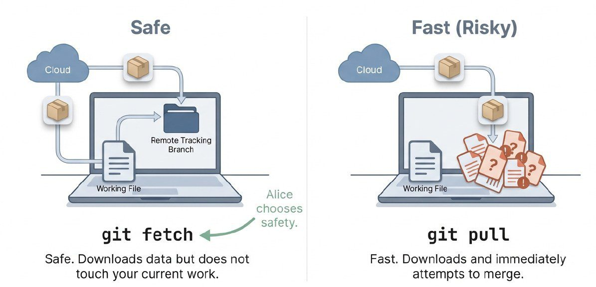

## 5. Fetch vs pull e higiene de ramas

- **`git fetch`**: descarga datos nuevos pero **no** toca tus archivos de trabajo; es seguro y permite revisar antes de mergear.
- **`git pull`**: descarga datos **y** los mergea inmediatamente a tu trabajo actual (fetch + merge).
- **Hacer pull de main con frecuencia**: al trabajar en una rama de feature, incorporar regularmente cambios de main mantiene tu rama al día; reduce el riesgo de conflictos y facilita integrar tu trabajo después; resuelve conflictos pequeños incrementalmente en vez de enfrentar muchos conflictos complejos de golpe al mergear.

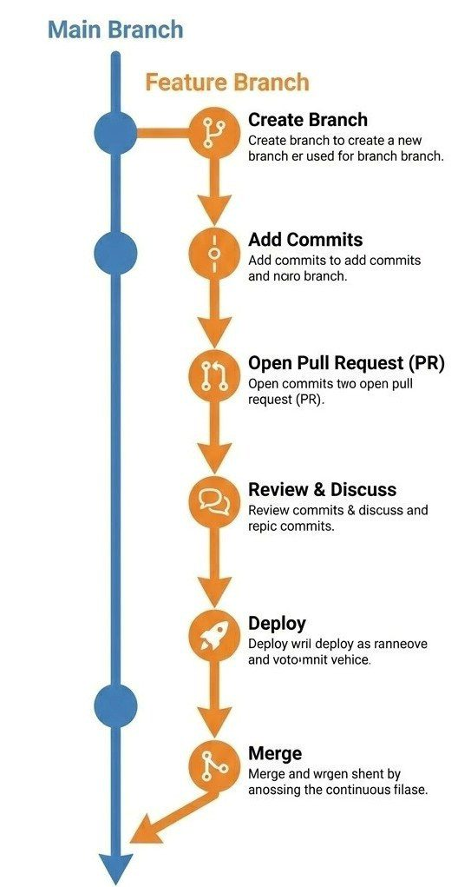

## 6. GitHub Flow

Flujo de trabajo ligero basado en ramas, diseñado para equipos y proyectos con despliegues regulares:

1. **Crear una rama** desde main: un entorno aislado para ideas y features; permite desarrollo seguro y previene cambios en conflicto entre developers.
2. **Agregar commits**: editar y guardar progreso commiteando con frecuencia en la rama; commits frecuentes dan una historia transparente y facilitan revertir cambios específicos sin deshacer trabajo no relacionado.
3. **Abrir una PR**: proponer mergear los cambios de tu rama a main; inicia discusión y revisión.
4. **Revisar y discutir**: los revisores sugieren mejoras o hacen preguntas; el developer sigue commiteando a la rama para abordar el feedback.
5. **Mergear a main**: una vez aprobada, la PR se mergea; los cambios se integran al código listo para producción.

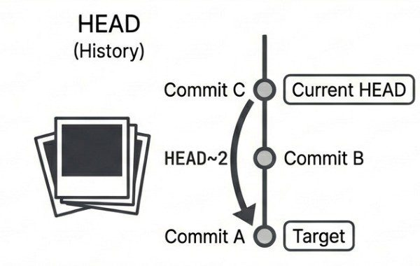

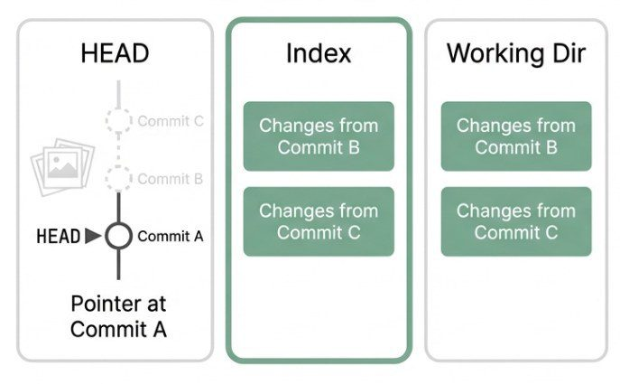

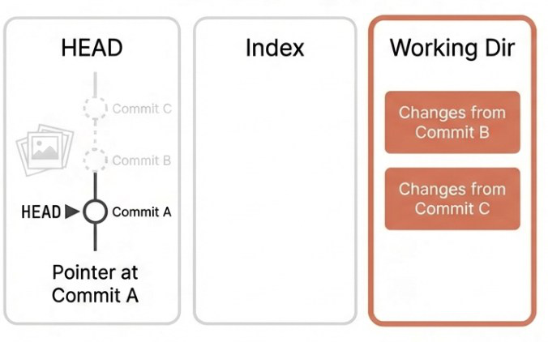

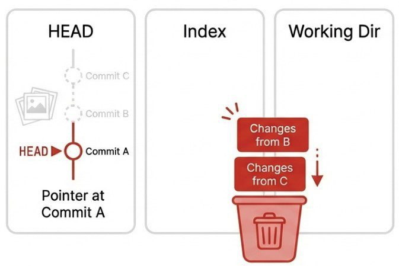

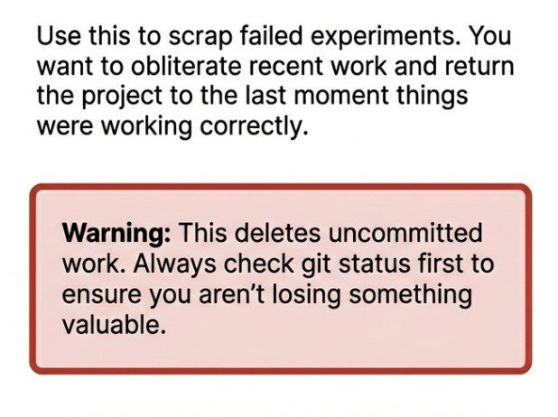

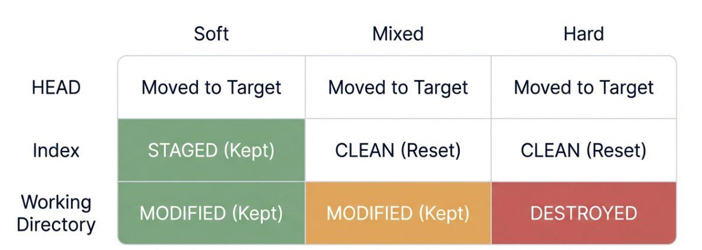

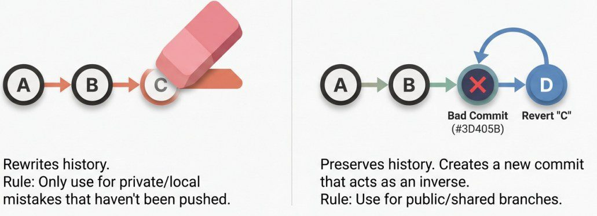

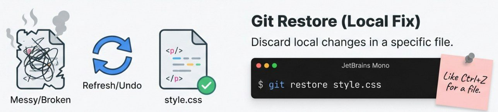

## 7. Operaciones de deshacer

`git reset [mode] HEAD~2` — deshacer los dos últimos commits (B y C) y volver al estado del commit A. (HEAD apunta al commit más reciente de la rama actual; `HEAD~2` es el commit dos antes del HEAD actual.)

| Modo | Historial | Staging (index) | Directorio de trabajo | Cuándo usarlo |
|---|---|---|---|---|
| `--soft` | Se retrocede | **Los cambios quedan stageados** | Intacto | "Me arrepiento de que fueran commits separados" — agrupar commits desordenados en uno limpio (**squashing**) |
| `--mixed` (default) | Se retrocede | Se limpia | **Cambios conservados sin stagear** | "Me arrepiento de haber commiteado, pero quiero seguir trabajando" — re-pensar cómo stagear, dividir el trabajo |
| `--hard` | Se retrocede | **Destruído** | **Destruído** | "Me arrepiento de que estos commits hayan pasado" — el repositorio coincide exactamente con el commit A; **usar con precaución** |

- **Force push**: si deshaces cambios en tu rama local, tu rama diverge de la remota y Git bloquea el push para no perder cambios remotos. `git push --force` **sobrescribe la rama remota** con la local, reemplazando su historia; cualquier cambio remoto no presente en tu local **se borra**. Úsalo con cuidado, especialmente si otros trabajan en la misma rama: si tus compañeros agregaron commits y tú haces force push, **sus commits se eliminan**.
  - **Buena práctica**: nunca resets una rama que ya se empujó a un remoto compartido; si otros pulleron tu rama, resetearla causa conflictos e historia confusa para todos; **solo resetea commits que existen únicamente en tu máquina local**.
- **`git revert`**: en vez de borrar historia, crea un **commit nuevo que introduce la inversa** de los cambios del commit revertido; la forma más segura de deshacer un commit, especialmente en entornos colaborativos; no reescribe historia, así que no causa problemas para colaboradores que ya pulleron el commit original.
- **`git restore`**: revierte un archivo (o archivos) del directorio de trabajo a la versión del último commit (HEAD); p. ej., cuando hiciste cambios experimentales que quieres deshacer solo para ese archivo (`git restore style.css`).

## 8. Colaboración más allá del código

- **GitHub Issues**: forma de rastrear mejoras, tareas o bugs en tu trabajo.
- **Release**: empaquetar y distribuir una versión específica y estable del software a usuarios u otros sistemas.
- **Release notes**: resumen documentado de cambios, mejoras, fixes e información importante incluidos en un release.

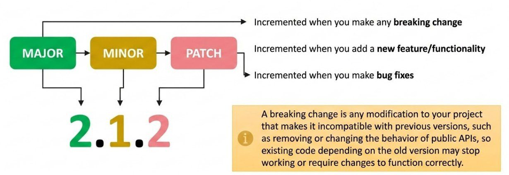

## 9. Versionado semántico

Una especificación: un conjunto simple de reglas que dicta cómo se asignan e incrementan los números de versión:

- **MAJOR**: se incrementa al hacer cualquier cambio disruptivo (*breaking change*).
- **MINOR**: se incrementa al agregar una nueva feature/funcionalidad.
- **PATCH**: se incrementa al hacer fixes de bugs.

**Ejercicio** (versión inicial v1.0.0):
- `fix: remove exposed Azure API key` → **v1.0.1**
- `feat: add Python Flask API backend` → **v1.1.0**
- `feat: upgrade to v2 API structure` (disruptivo) → **v2.0.0**

## 10. Puntos clave

- Modelo mental: **directorio de trabajo → área de staging → repositorio local → remoto**; cada comando mueve archivos entre estas zonas.
- Ramas aíslan el trabajo; merge (o PR) integra; resolver conflictos a propósito.
- `fetch` es seguro, `pull` mergea; hacer pull de main con frecuencia mantiene las ramas frescas.
- `revert` para historia compartida; `reset` local; nunca `--force` sobre el trabajo de compañeros.
- Conventional Commits + versionado semántico dan a la historia y a los releases una forma predecible y legible por máquinas.
