# ソフトウェア開発における協働とバージョン管理

---

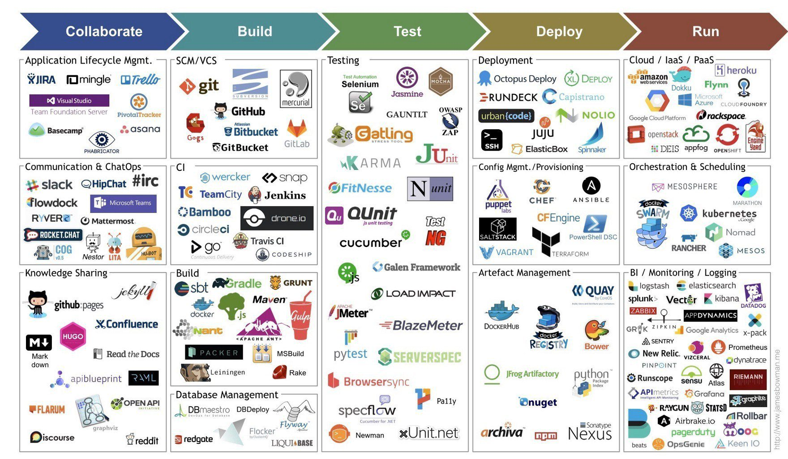

## 1. なぜバージョン管理が必要か

バージョン管理なしでは、コードは `final`、`final_v2`、`FINAL_real` のファイルの山になる(PHD コミック「Piled Higher and Deeper」)。バージョン管理は履歴、協働、安全網を与えてくれる。

## 2. Git と GitHub の基礎

- **Git** — ソースコードの履歴を追跡するバージョン管理システム。
- **リポジトリ** — プロジェクト全体の容器:全ファイル/フォルダ+完全な改訂履歴;プロジェクト作業が行われる場所(プロジェクトフォルダ)。
- **GitHub** — Git リポジトリをクラウドホスティングするサービス(**リモートリポジトリ**は Git リポジトリをホストするサーバ全般、例:GitHub や Bitbucket)。

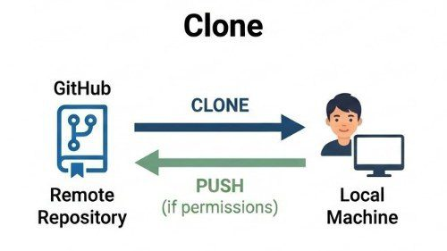

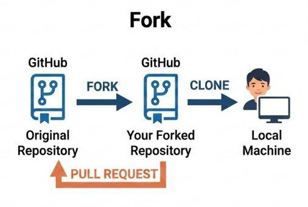

### Clone vs Fork

- **Clone** — 自環境のローカルコピーを作成;その時点の全リポジトリデータ(全ファイルの全バージョン)を取得。自分の開発に使う。
- **Fork** — GitHub 上に個人コピーを作成;fork で開発し、**pull request** で元のリポジトリへ貢献。オープンソース貢献の定番。

### コアコマンド

| コマンド | 用途 |
|---|---|
| `git clone` | 完全な履歴付きリポジトリをクローン |
| `git init` | ディレクトリを新しい空リポジトリにする |
| `git add` | ワーキングディレクトリの変更をステージングエリアへ |
| `git commit` | ステージされた変更をローカルリポジトリへコミット |
| `git push` | ローカルコミットをリモートへ push |
| `git pull` | リモート更新を取得し現在ブランチへマージ |
| `git fetch` | リモートの最新更新を取得(マージしない) |
| `git merge` | 取得した更新を現在ブランチへ統合 |
| `git checkout` | ブランチ切替、または特定コミットからのファイル復元 |
| `git branch` | ブランチの列挙/作成 |
| `git log` | コミット履歴(メッセージ、作成者、タイムスタンプ)を表示 |
| `git status` | 現在のリポジトリ状態、変更、ブランチ情報 |
| `git diff` | ブランチ/コミット間の差分を表示 |

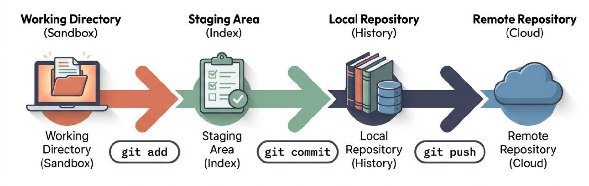

### 3 つのゾーン

1. **ワーキングディレクトリ** — 実際にファイルを作成・編集・削除しているフォルダ。
2. **ステージングエリア(index)** — ワークスペースと永久履歴の間の「ローディングドック」。
3. **ローカルリポジトリ** — プロジェクトのある時点での永久スナップショット。

- **コミット** = ステージされたファイルをローカルリポジトリへ移す永久スナップショット;一意の ID が採番される。
- **Push** = ローカルコミット(例:`main`)をリモート(`origin/main`)へアップロード。
- **ブランチ** = `main` から分岐した独立した開発ライン;機能/バグ作業を完了まで隔離。
- **マージ** = 完了したブランチを main に統合;**2 つの親**を持つ新しいコミットを作成し、両ブランチの全作業を含む。

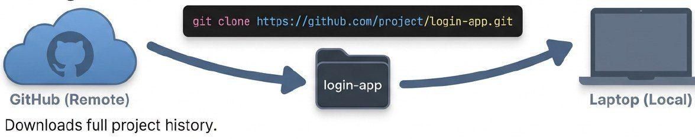

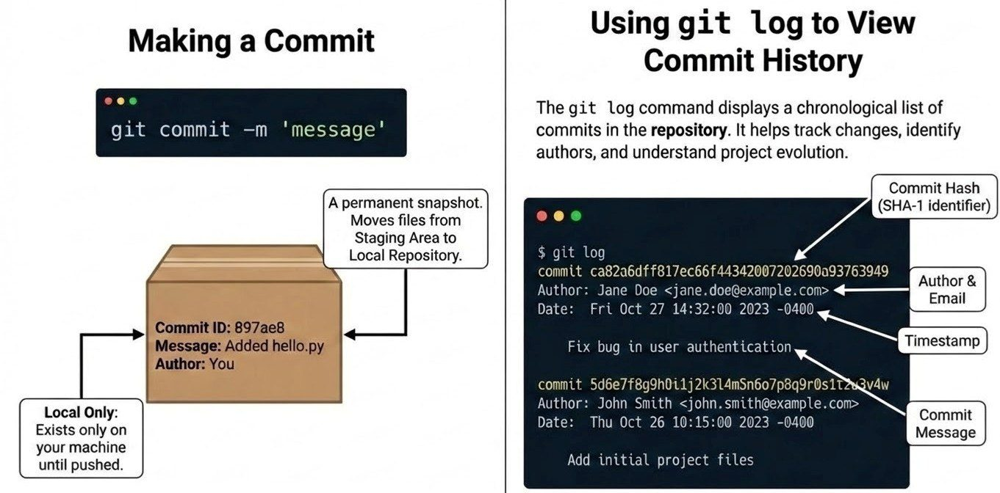

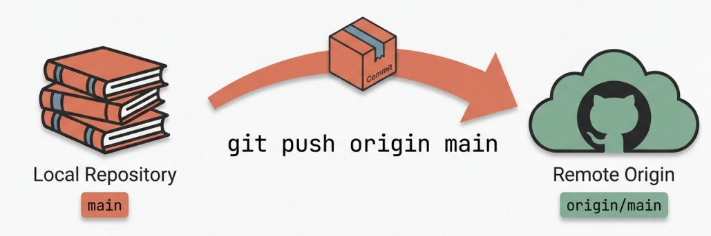

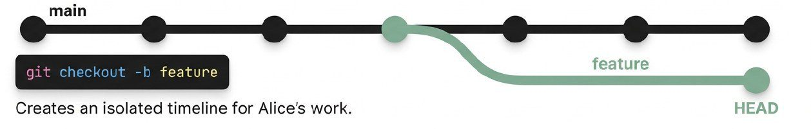

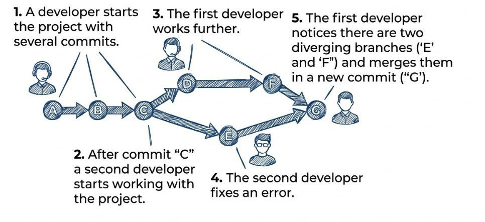

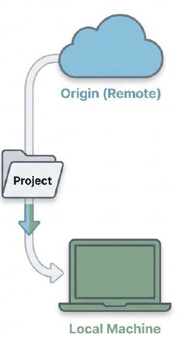

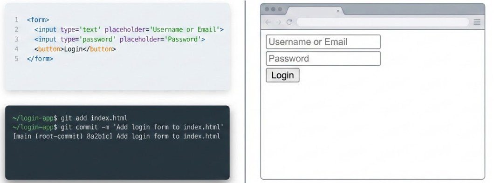

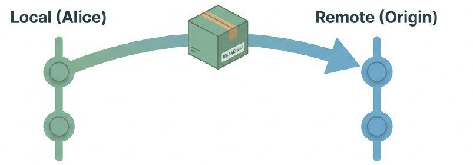

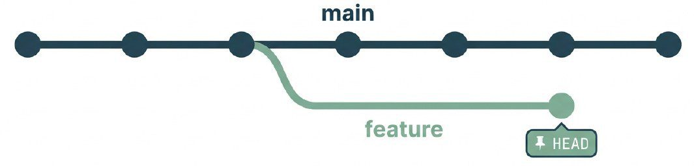

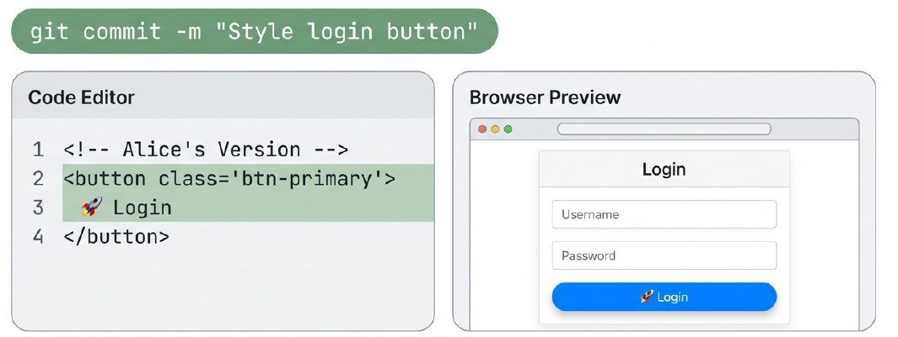

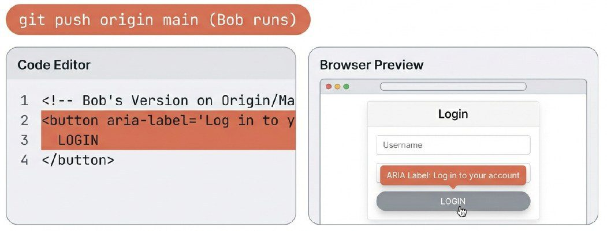

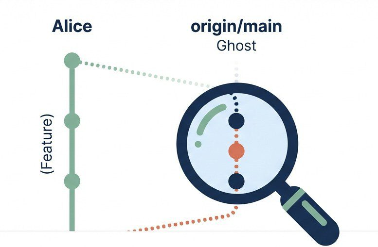

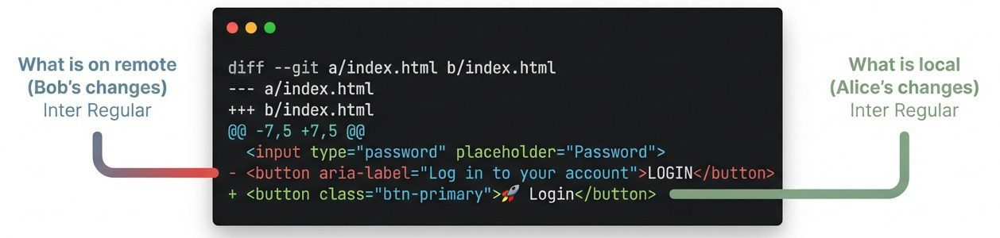

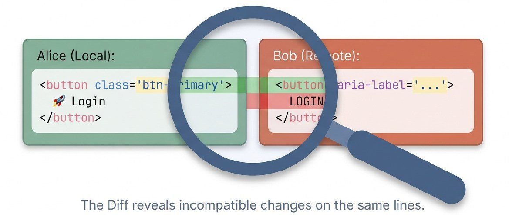

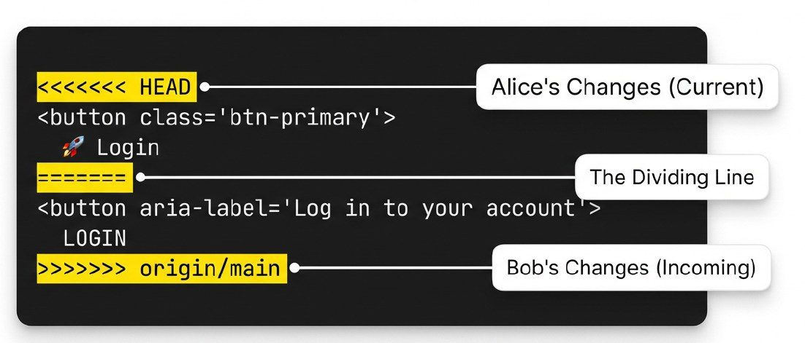

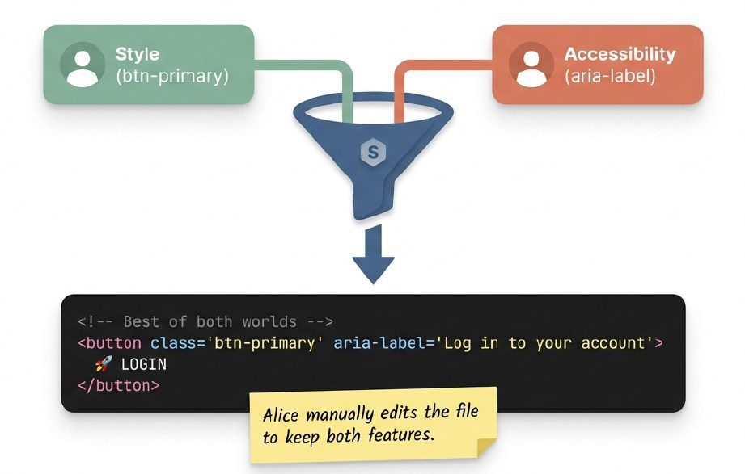

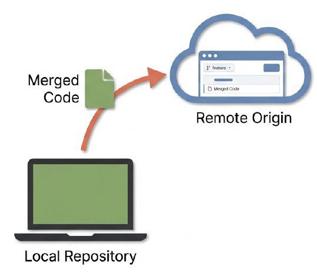

## 3. シナリオ演習(Alice & Bob)

1. `git clone https://github.com/project/login-app.git` — リポジトリ+全履歴をダウンロード;ローカルフォルダが `origin` にリンク。
2. Alice がログインフォームを作成:`git add index.html` → `git commit -m 'Add login form to index.html'`。
3. 同期:`git push origin main` — origin が Alice の履歴と一致。
4. Alice は新しい作業を隔離:`git checkout -b feature`(作成+切替)。`git branch` はブランチを列挙。
5. Alice が UI を磨く(CSS、ボタンのアイコン)、ステージ、コミット。
6. 一方 **Bob がリモートの `main` に push** — アクセシビリティ属性(スクリーンリーダー向けの `aria-label`)を追加しテキストを大文字化。
7. `git fetch` — リモートの知識を更新(Bob のコミットをダウンロード)するが**ワーキングファイルには触れない**。`origin/main` は**リモートトラッキングブランチ**(リモートリポジトリのブランチへの参照;clone 後のデフォルトリモート名は "origin")。
8. `git diff origin/main` — Alice と Bob が**同じ行を変更**していることが判明。
9. `git merge origin/main` — **自動マージ失敗**(同じ行が双方に変更)。**競合マーカー**が挿入され両バージョンが同時に表示される。
10. Alice が手動で**競合を解決** — 両バージョンの良い部分を組み合わせ、マーカーを削除(人間の意図が必要;Git は自動でできない)。
11. 仕上げ:`git add index.html` → `git commit -m 'Merge origin/main; resolve login button conflict'` → `git push origin feature`。
12. **Pull Request(PR)** — チームメイトがコードを検査し、質問し、仕事が永久になる前に品質を確保するための専用の場。Bob がレビューしコメント。
13. Alice がローカルでフィードバックに対応:編集 → `git add` → `git commit -m 'Update button text'`。
14. `git push origin feature` — **新しい PR は不要**;同じブランチへの push は既存の PR 会話を自動更新。Bob が承認;機能が `main` にマージ。

## 4. Conventional Commits(規約コミット)

コミット履歴を明示的・一貫した形にするための軽量な仕様のコミットメッセージ構造。一般的なタイプ:

| タイプ | 意味 |
|---|---|
| `feat:` | 新機能 |
| `fix:` | バグ修正 |
| `docs:` | ドキュメント変更 |
| `style:` | フォーマット/スタイル(動作に影響しない) |
| `refactor:` | リファクタ(機能追加・バグ修正なし) |
| `test:` | テストの新規追加/変更 |
| `chore:` | 維持管理(`package.json` の依存更新、`.gitignore` 等の設定変更、ドキュメントなど) |

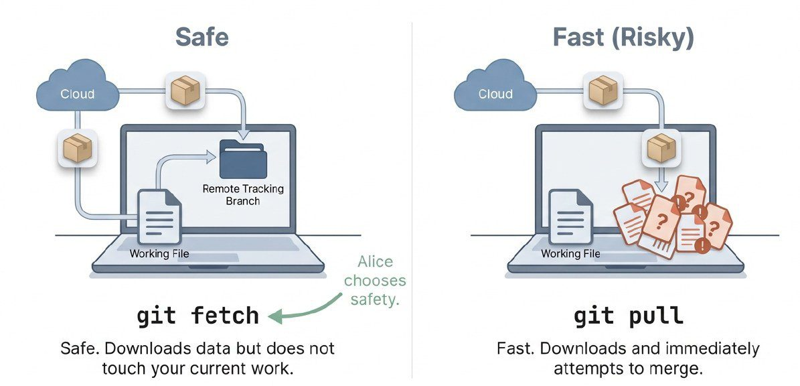

## 5. Fetch vs Pull とブランチの衛生管理

- **`git fetch`**:新データをダウンロードするがワーキングファイルには触れない — 安全で、マージ前にレビュー可能。
- **`git pull`** = fetch + 現在の作業への即時マージ。
- **頻繁に main から pull**:機能ブランチ上で最新を保ち、他人の更新と同期;マージ競合のリスクを低減;小さな競合を逐次解決し、最後に大量の複雑な競合に直面しない。

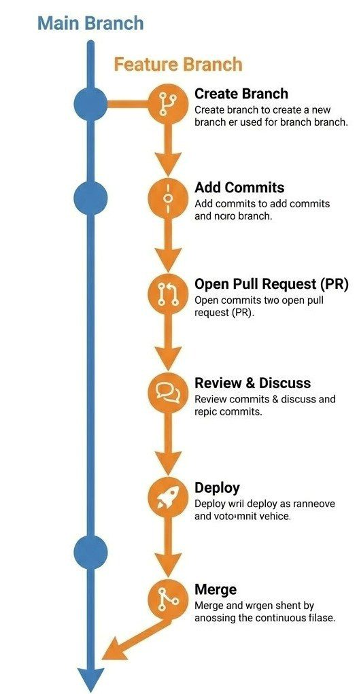

## 6. GitHub Flow

定期的デプロイを行うチームのための軽量なブランチベースのワークフロー:

1. **ブランチを作成** — `main` から分岐し、新しいアイデア・機能の隔離環境を作る;安全な機能開発と開発者間の競合変更の防止。
2. **頻繁にコミット** — 透明な履歴;無関係な作業を取り消さずに特定の変更を巻き戻しやすく。
3. **PR を開く** — ブランチの変更を main へのマージを提案;議論とレビューを開始。
4. **レビューと議論** — レビュアーが改善提案・質問;開発者がブランチにコミットを続けフィードバックに対応。
5. **main にマージ** — 機能が本番対応コードとなる。

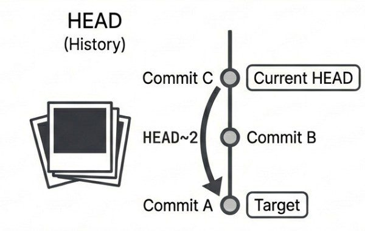

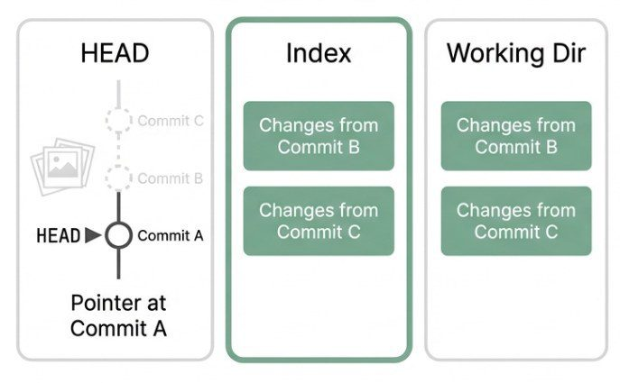

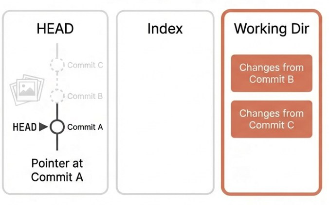

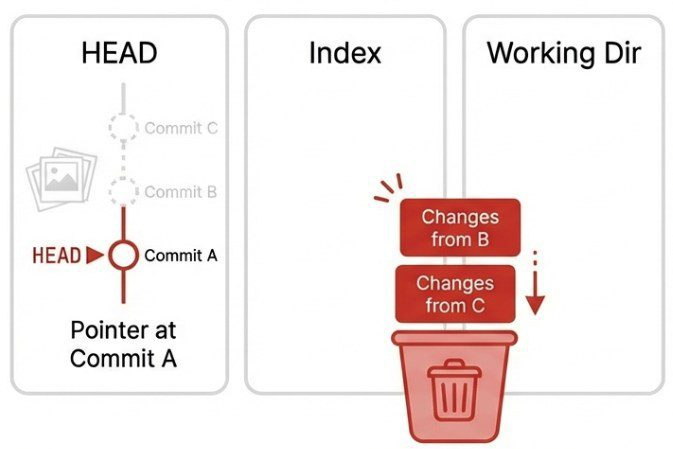

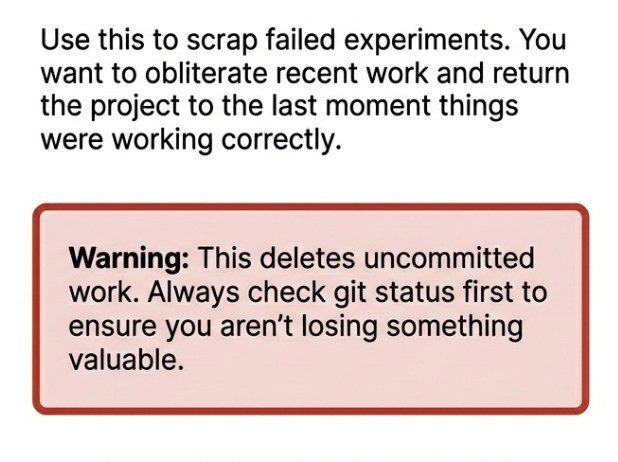

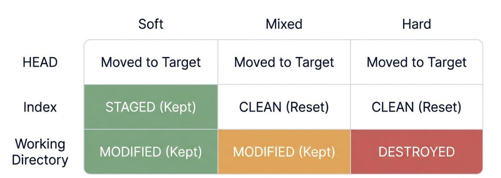

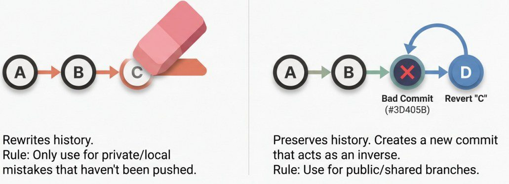

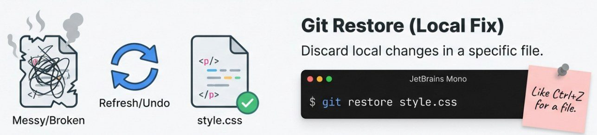

## 7. 取り消し操作

`git reset [mode] HEAD~2` — 直近 2 つのコミットを取り消す(HEAD = 現在ブランチの最新コミット;`HEAD~2` = 2 つ前)。3 つのモード:

| モード | 履歴 | ステージ(index) | ワーキングディレクトリ | 使う場面 |
|---|---|---|---|---|
| `--soft` | 巻き戻し | **変更はステージ済み** | 不変 | 「これらを別コミットに分けたことを後悔」— 散らかったコミットを 1 つの綺麗なコミットに**スクワッシュ** |
| `--mixed`(デフォルト) | 巻き戻し | クリア | **変更は保持・未ステージ** | 「コミットしたことを後悔、作業は続けたい」— ステージ方法を見直し、コミット分割 |
| `--hard` | 巻き戻し | **破棄** | **破棄** | 「これらのコミットが存在したことを後悔」— リポジトリを目標コミットと完全一致させる;**注意して使用** |

- **Force push**(`git push --force`):ローカルブランチでリモートブランチの履歴を上書き;リモートにしか存在しないコミットは削除される。
  - **ベストプラクティス**:共有リモートへ既に push したブランチを reset しない;ローカルにしか存在しないコミットのみ reset;そうでなければ teammate のコミットが失われ、競合と混乱した履歴となる。
- **`git revert`**:元コミットの変更の**逆変更**を導入する**新しいコミット**を作成 — 履歴を書き換えない;協働環境での**最も安全な取り消し**。
- **`git restore <file>`**:ワーキングディレクトリのファイルを直近コミット(HEAD)の状態に戻す(例:実験的な変更を `git restore style.css` で即座に取り消す)。

## 8. コード以外の協働

- **GitHub Issues** — 拡張、タスク、バグの追跡(バグ報告 / 機能要望)。
- **Release(リリース)** — 特定安定版のソフトウェアをユーザー/他システムへパッケージングして配布するプロセス。
- **Release notes(リリースノート)** — そのリリースに含まれる変更、改善、修正、重要情報の文書化されたサマリー。

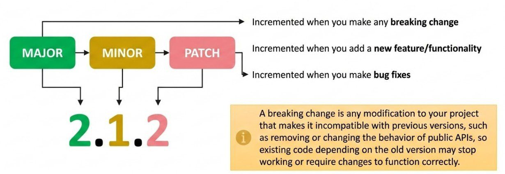

## 9. セマンティックバージョニング

`MAJOR.MINOR.PATCH`:

- **MAJOR** — 破壊的変更(breaking change)。
- **MINOR** — 新機能の追加(後方互換)。
- **PATCH** — バグ修正。

**演習**(初期 v1.0.0):
- `fix: remove exposed Azure API key` → **v1.0.1**
- `feat: add Python Flask API backend` → **v1.1.0**
- `feat: upgrade to v2 API structure`(破壊的)→ **v2.0.0**

## 10. キーポイント

- 心のモデル:**ワーキングディレクトリ → ステージングエリア → ローカルリポジトリ → リモート**;各コマンドはこのゾーン間でファイルを動かしている。
- ブランチで作業を隔離;マージ(または PR)で統合;競合は意図的に解決。
- `fetch` は安全、`pull` はマージ;頻繁に main から pull してブランチを新鮮に保つ。
- 共有履歴は `revert`;ローカルは `reset`;`--force` で teammate の作業を上書きしない。
- Conventional Commits + セマンティックバージョニングで、履歴とリリースに予測可能で機械可読な形を与える。
