# 軟體開發中的協作與版本控制

---

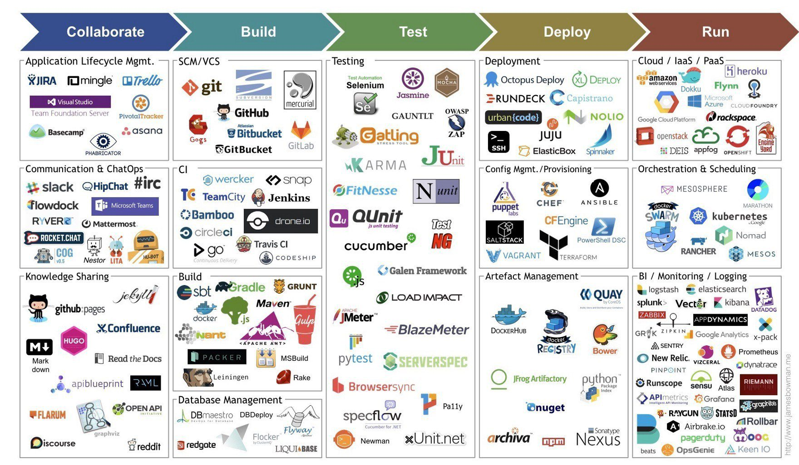

## 1. 為什麼需要版本控制

沒有版本控制,程式碼會堆成 `final`、`final_v2`、`FINAL_real` 的文件堆(「Piled Higher and Deeper」漫畫)。版本控制給你歷史、協作與安全網。

## 2. Git 與 GitHub 基礎

- **Git**——追蹤原始碼歷史的版本控制系統。
- **Repository(儲存庫)**——整個專案的容器:所有檔案/資料夾加上完整修訂歷史;專案工作發生的地方。
- **GitHub**——Git repository 的雲端託管(**remote repository** 是任何託管 Git repository 的伺服器,例:GitHub 或 Bitbucket)。

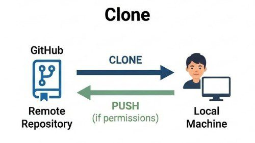

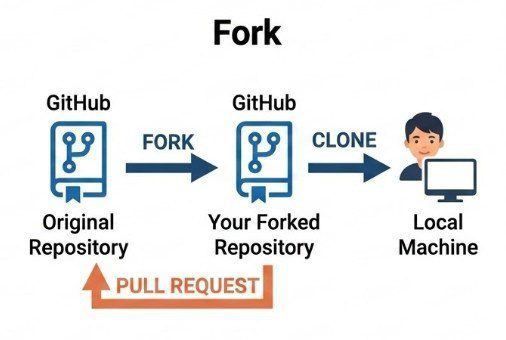

### Clone vs Fork

- **Clone(複製)**——在本機建立本地副本;拉下該時點的所有 repository 資料(每個檔案的每個版本)。用於自己的開發。
- **Fork(分叉)**——在 GitHub 上建立個人副本;在 fork 上開發,再以 **pull request** 向原始 repository 貢獻。開源貢獻的標準做法。

### 核心命令

| 命令 | 用途 |
|---|---|
| `git clone` | 複製一個含完整歷史的 repository |
| `git init` | 把目錄變成新的空 repository |
| `git add` | 把工作目錄的變更移到暫存區 |
| `git commit` | 把暫存變更 commit 到本地 repository |
| `git push` | 把本地 commit push 到 remote |
| `git pull` | 抓取 remote 更新並合併到当前分支 |
| `git fetch` | 取得 remote 最新更新(不合併) |
| `git merge` | 把抓取的更新合併到当前分支 |
| `git checkout` | 切換分支,或從某 commit 還原檔案 |
| `git branch` | 列出/建立分支 |
| `git log` | 顯示 commit 歷史(訊息、作者、時間戳) |
| `git status` | 当前 repository 狀態、變更、分支資訊 |
| `git diff` | 顯示分支/commit 間的差異 |

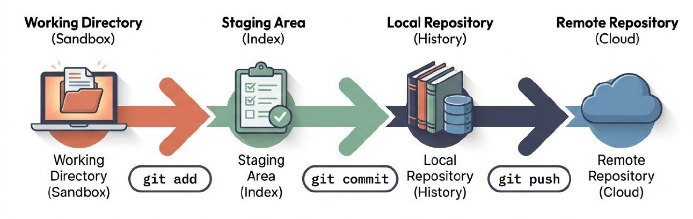

### 三個區域

1. **工作目錄(Working directory)**——實際編輯檔案的資料夾。
2. **暫存區(Staging area / index)**——工作區與永久歷史之間的「裝卸平台」。
3. **本地 repository**——專案在各時間點永久存檔的快照。

- **Commit** = 把暫存檔案移入本地 repository 的永久快照;分配唯一 ID。
- **Push** = 上傳本地 commit(例:`main`)到 remote(`origin/main`)。
- **Branch(分支)** = 從 `main` 分出的獨立開發線;讓功能/bug 工作在完成前保持隔離。
- **Merge(合併)** = 把完成的分支整合回 main;建立一個**有兩個 parent** 的新 commit,包含兩邊分支的所有工作。

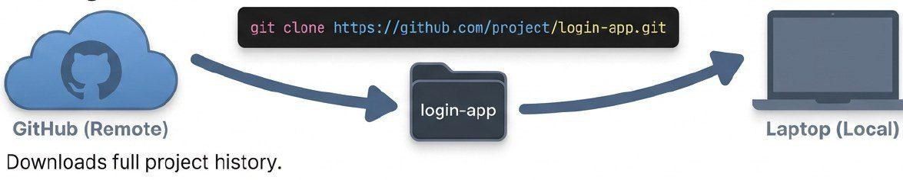

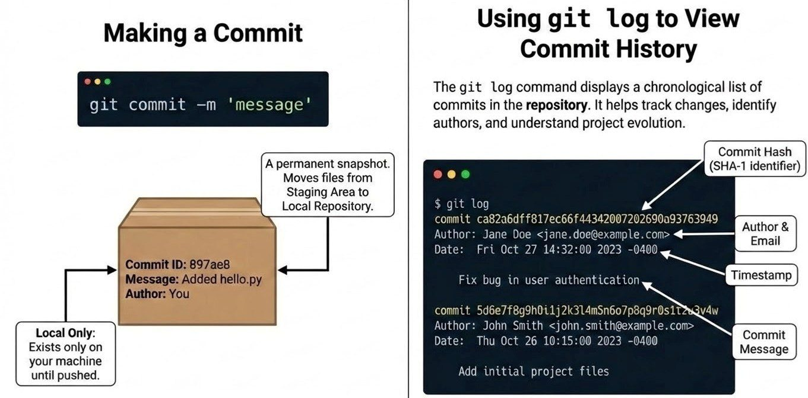

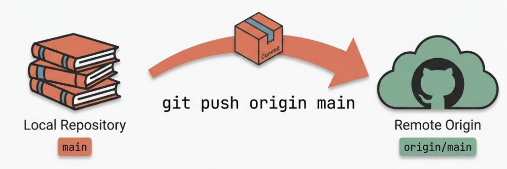

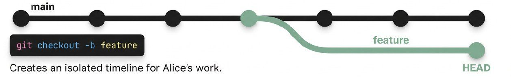

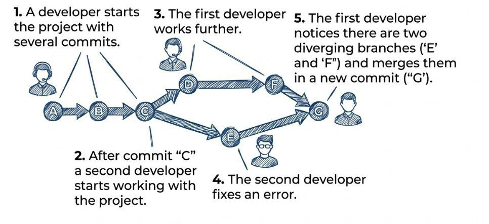

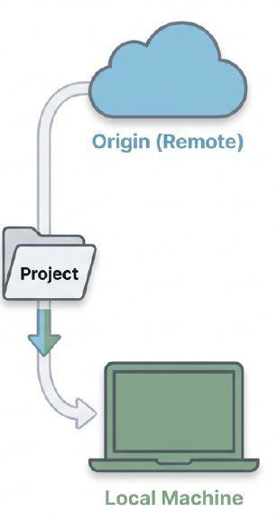

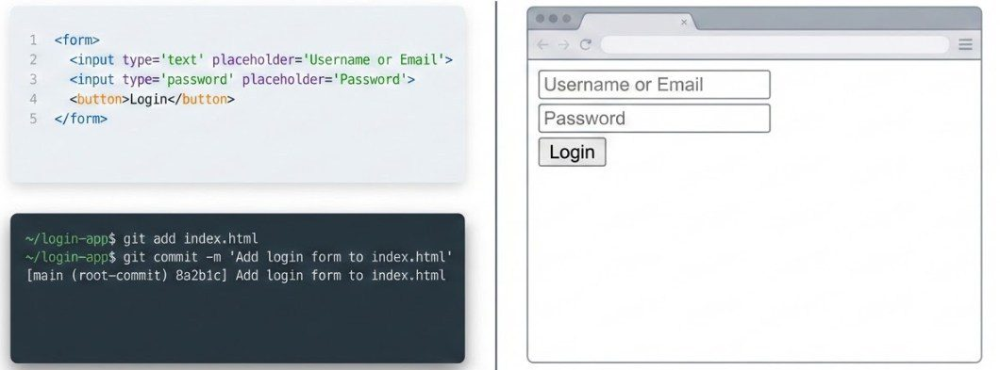

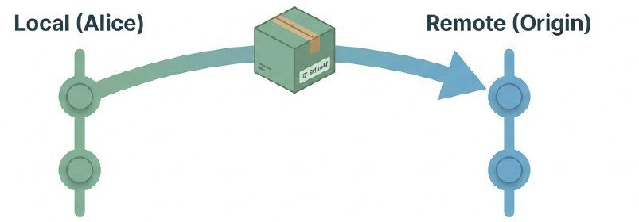

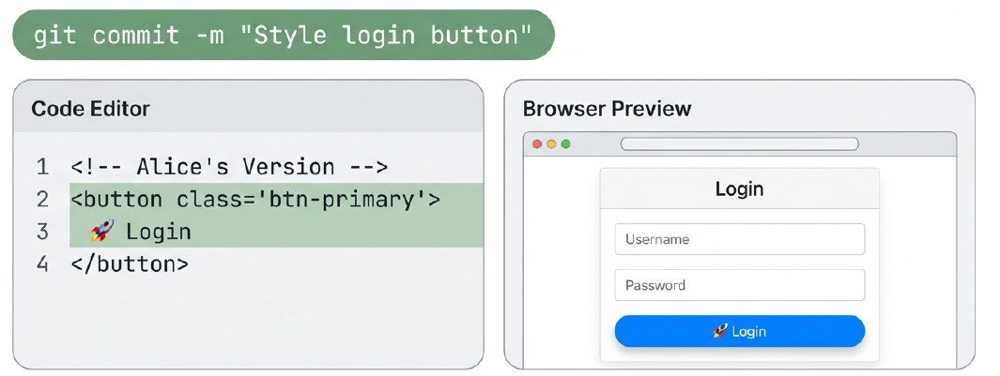

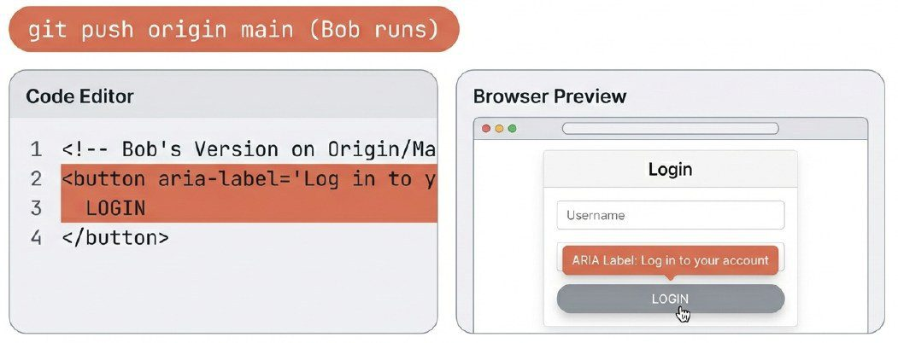

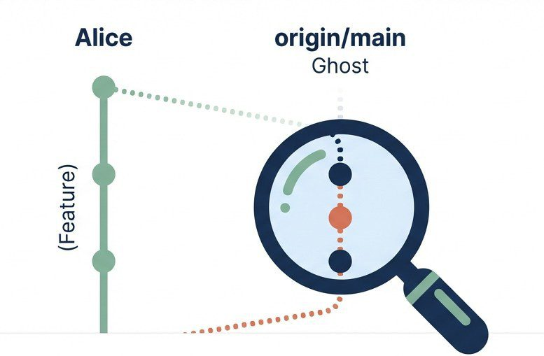

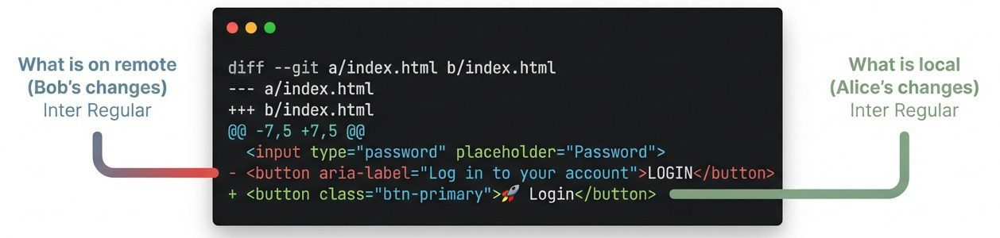

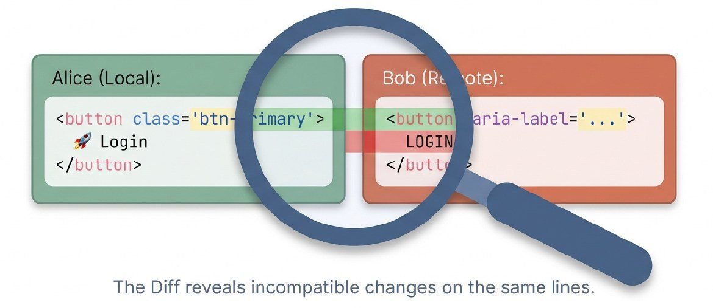

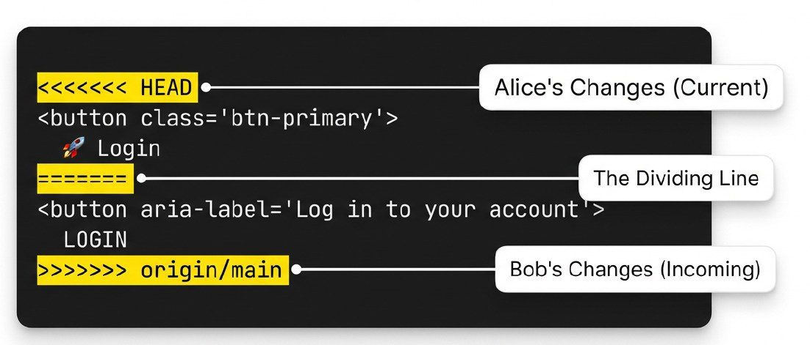

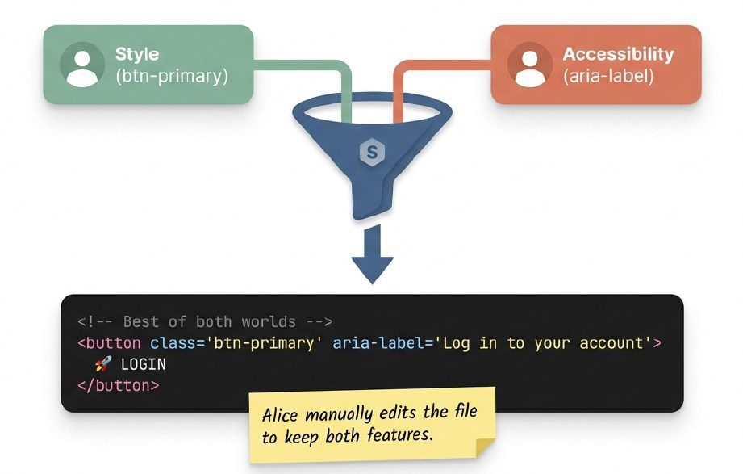

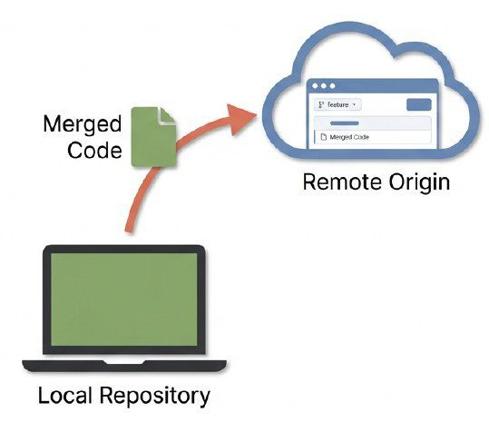

## 3. 情境走讀(Alice & Bob)

1. `git clone https://github.com/project/login-app.git` — 下載 repository + 完整歷史;本機資料夾連結到 `origin`。
2. Alice 建立登入表單:`git add index.html` → `git commit -m 'Add login form to index.html'`。
3. 同步:`git push origin main` — origin 與 Alice 的歷史一致。
4. Alice 隔離新工作:`git checkout -b feature`(建立並切換)。`git branch` 列出分支。
5. Alice 修飾 UI(CSS、按鈕圖示),暫存、commit。
6. 同時 **Bob 往 remote `main` push 了變更** — 加了無障礙屬性(`aria-label` 給螢幕閱讀器)並大寫文字。
7. `git fetch` — 更新對 remote 的認知(下載 Bob 的 commit),**不動工作檔**。`origin/main` 是**remote-tracking branch**(對 remote 分支的引用;clone 後預設 remote 名為 "origin")。
8. `git diff origin/main` — 發現 Alice 和 Bob **改了同一行**。
9. `git merge origin/main` — **自動合併失敗**(同一行被雙方修改)。Git 插入**衝突標記**,同時顯示兩個版本。
10. Alice 手動**解決衝突** — 結合兩版最好的部分、刪除標記(需要人類意圖;Git 無法自動做)。
11. 收尾:`git add index.html` → `git commit -m 'Merge origin/main; resolve login button conflict'` → `git push origin feature`。
12. **Pull Request(PR)** — 專為團隊審查程式碼、提問、確保品質而設的空間,讓工作在成為永久前被檢驗。Bob 審查並留言。
13. Alice 在本地處理回饋:編輯 → `git add` → `git commit -m 'Update button text'`。
14. `git push origin feature` — **不需要新的 PR**;push 到同一分支會自動更新既有 PR 的對話。Bob 核准;功能合併進 `main`。

## 4. Conventional Commits(規約 commit)

一個輕量規格,用結構化的 commit 訊息建立明確、一致的歷史。常見類型:

| 類型 | 含義 |
|---|---|
| `feat:` | 新功能 |
| `fix:` | bug 修復 |
| `docs:` | 文件變更 |
| `style:` | 格式/樣式(不影響行為) |
| `refactor:` | 重構(不加功能、不修 bug) |
| `test:` | 新增/修改測試 |
| `chore:` | 維護(相依更新、`.gitignore` 等設定、專案文件等) |

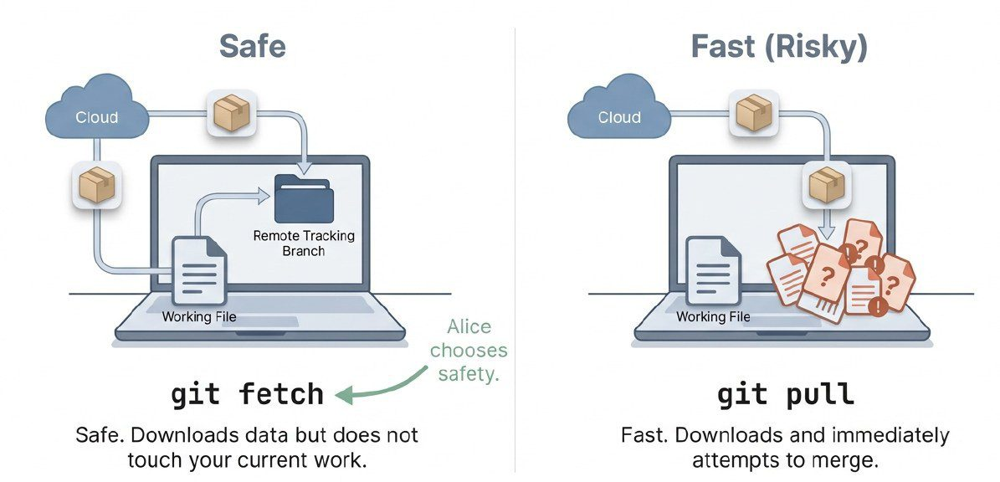

## 5. Fetch vs Pull 與分支衛生

- **`git fetch`**:下載新資料,不動工作檔 — 安全,可先審查再合併。
- **`git pull`** = fetch + 立即合併到当前工作。
- **頻繁從 main pull**:在 feature 分支上保持最新、與他人更新同步;減少合併衝突風險;小衝突增量解決,避免最後一次面對大量複雜衝突。

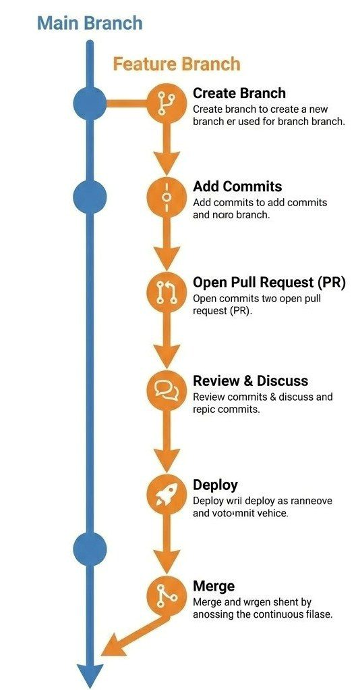

## 6. GitHub Flow

為定期部署的團隊設計的輕量分支式工作流:

1. **建立分支** — 從 `main` 分出,隔離新想法與功能,避免開發者間衝突變更。
2. **頻繁 commit** — 透明的歷史,方便回滾特定變更而不波及不相關工作。
3. **開 PR** — 提議把分支變更合併回 main,啟動討論與審查。
4. **審查與討論** — 審查者提建議或提問;開發者繼續 commit 處理回饋。
5. **合併進 main** — 功能成為生產就緒的程式碼。

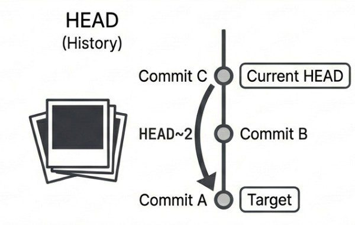

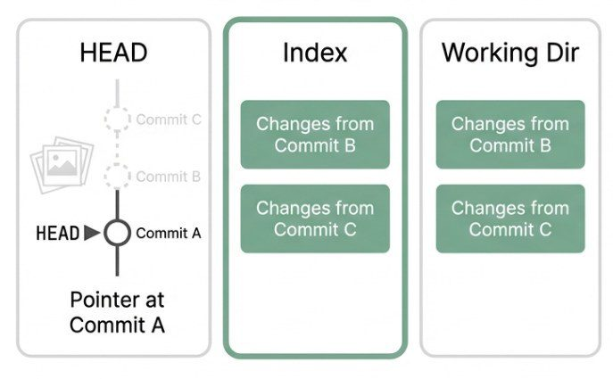

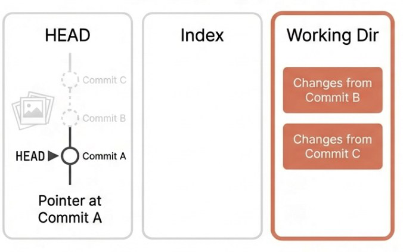

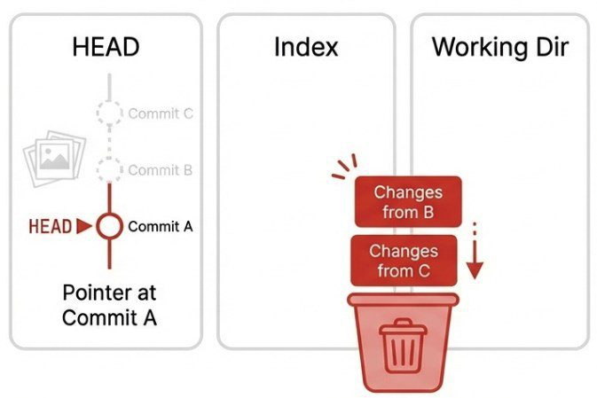

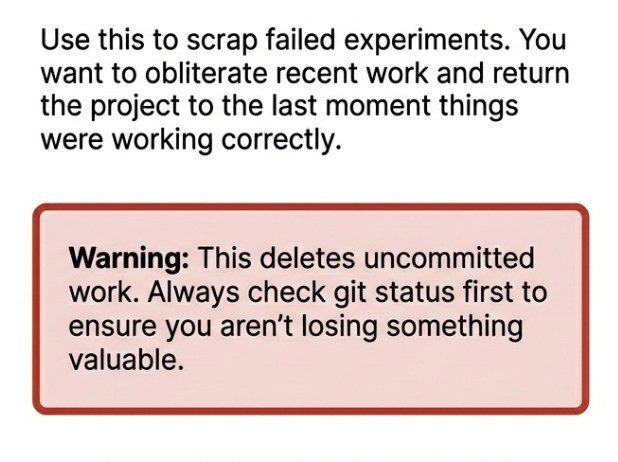

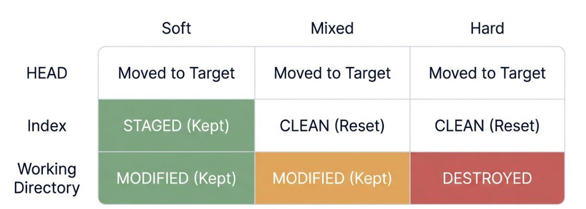

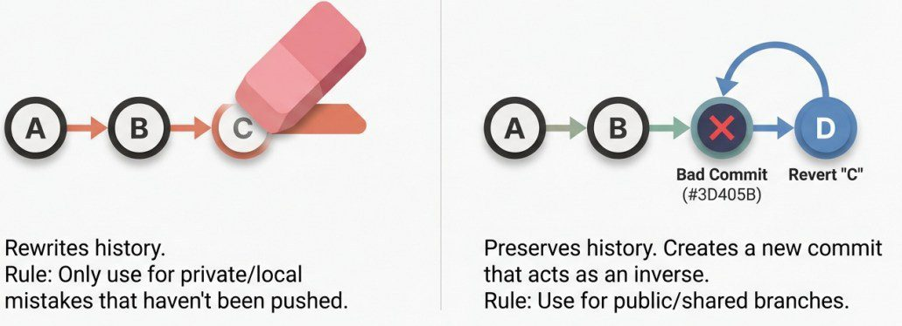

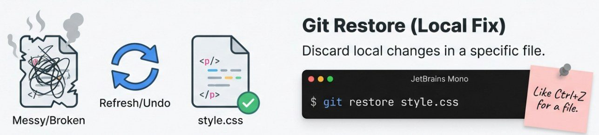

## 7. 取消操作

`git reset [mode] HEAD~2` — 取消最近兩個 commit(HEAD = 当前分支最新 commit;`HEAD~2` = 往回兩個)。三種模式:

| 模式 | 歷史 | 暫存區(index) | 工作目錄 | 使用時機 |
|---|---|---|---|---|
| `--soft` | 倒帶 | **變更保持已暫存** | 不動 | 「我後悔把這些拆成不同 commit」— 把凌亂 commit **squash** 成一個乾淨 commit |
| `--mixed`(預設) | 倒帶 | 清空 | **變更保留、未暫存** | 「我後悔 commit 了,但想繼續做」— 重新思考暫存方式、拆分 commit |
| `--hard` | 倒帶 | **摧毀** | **摧毀** | 「我後悔這些 commit 發生過」— repository 完全回到目標 commit;**謹慎使用** |

- **Force push**(`git push --force`):用本地分支覆寫 remote 分支歷史;remote 上多出的 commit 會被刪除。
  - **最佳實務**:絕不 reset 已 push 到共享 remote 的分支;只 reset 只存在本機的 commit;否則會刪除 teammates 的 commit,造成衝突與混亂歷史。
- **`git revert`**:建立一個**新 commit**來引入被 revert commit 的逆向變更 — 不改寫歷史;在協作環境中**最安全的取消方式**。
- **`git restore <file>`**:把工作目錄中的檔案還原到上次 commit(HEAD)的狀態(例:`git restore style.css`,快速撤销實驗性改動)。

## 8. 程式碼之外的協作

- **GitHub Issues** — 追蹤增強、任務、bug(bug 回報 / 功能請求)。
- **Release(發布)** — 把特定穩定版本的軟體打包分發給使用者/其他系統。
- **Release notes(發布說明)** — 該版本變更、改進、修復與重要資訊的文件摘要。

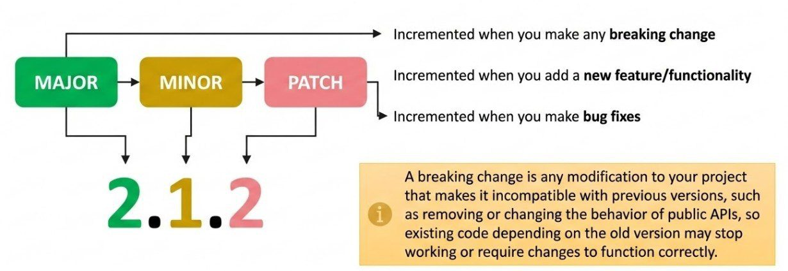

## 9. 語意化版本控制(Semantic Versioning)

`MAJOR.MINOR.PATCH`:

- **MAJOR** — 破壞性變更(breaking change)。
- **MINOR** — 新增功能(向後相容)。
- **PATCH** — bug 修復。

**練習**(初始 v1.0.0):
- `fix: remove exposed Azure API key` → **v1.0.1**
- `feat: add Python Flask API backend` → **v1.1.0**
- `feat: upgrade to v2 API structure`(破壞性)→ **v2.0.0**

## 10. 重點 takeaway

- 心智模型:**工作目錄 → 暫存區 → 本地 repository → remote**;每個命令都在這些區域之間搬移檔案。
- 用分支隔離工作;用 merge(或 PR)整合;有意識地解決衝突。
- `fetch` 安全,`pull` 會合併;常從 main pull 保持分支新鮮。
- 共享歷史用 `revert`;本機用 `reset`;絕不用 `--force` 壓過 teammates 的工作。
- Conventional Commits + 語意化版本控制,讓歷史與發布具備可預測、可機器讀取的形狀。
